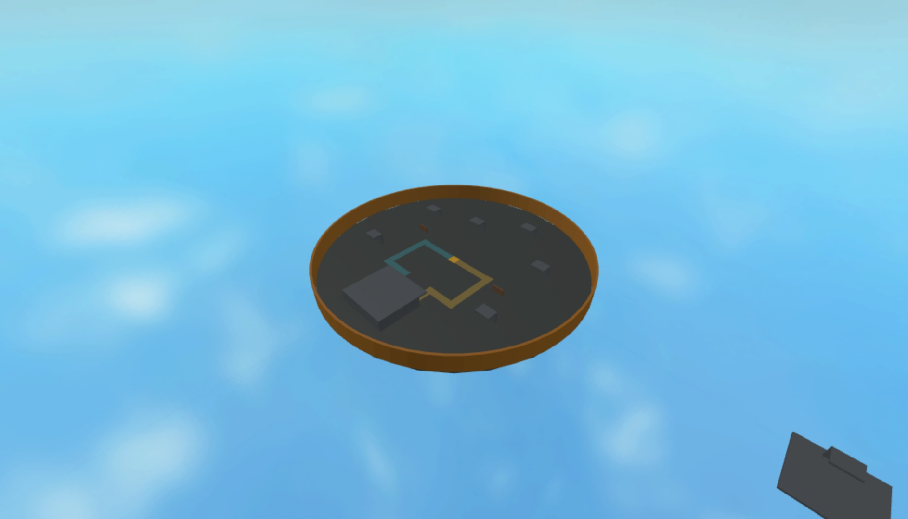

# Players vs C-130

**A Roblox game in development: one gunship against a united ground team.**

The intended game puts one C-130 operator above a circular industrial battlefield and 5–9 teammates on the ground. The ground team uses M-7 rifles and one recoverable rocket launcher to destroy the plane. Three direct rockets destroy an undamaged aircraft; rifle fire chips away at the same health pool.



*Current progress: P02 greybox battlefield, captured in Roblox Studio on 2026-11-08. Aircraft and combat are still planned.*

## What you can play today

The local build contains a circular greybox battlefield. Your avatar starts in its southern shelter. Follow the teal western route or ochre eastern route toward the gold marker at the center; that marker reserves the future rocket-launcher location. Industrial walls and roofed cover separate the routes from exposed areas, and an orange perimeter marks the battlefield edge. The launcher marker cannot be picked up, and cover cannot be destroyed yet.

Use standard Roblox desktop controls: **WASD** to move, **Space** to jump, and the mouse to control the view. The server is configured to return characters that leave the battlefield or fall below it to the shelter. A separate lobby/operator deck is authored outside the battlefield; role assignment and transport to it are still planned.

A status panel shows **Bootstrap running** with a **Development** or **Test** label. Aircraft, roles, weapons, rounds, spectating and results remain planned. Normal Roblox respawning still applies. There is no published Roblox play link. The map has passed host checks and local Studio clearance, cover, boundary, rebuild and walking checks with one client. [P02](plans/02-warzone-map.md) records the evidence and limits; this does not establish multiplayer combat or support for every avatar size.

The [roadmap](roadmap.md) tracks progress; the game described below is the planned MVP.

## Set up locally

For the complete local Studio workflow, use macOS with **Git**, **Python 3.10+**, system **curl**, and **Roblox Studio** installed. Sign in to Studio yourself and keep Play stopped while installing or connecting plugins. Setup downloads tools from GitHub and TestEZ from Wally, so network access is required. The setup/host checks also support Linux arm64/x86_64; automated Windows setup is not provided. See the [development guide](docs/development.md) for platform and tool details.

Clone the source and enter the checkout:

```sh
git clone https://github.com/hanegraaff/roblox-c130-extraction-shooter.git
cd roblox-c130-extraction-shooter
```

Choose the branch you intend to test before building. `main` contains the current integrated greybox; use the PR's head branch to review unmerged changes.

If you will make changes, create a dedicated task branch from the selected source before editing; see the [branch rules](docs/development.md#branches-ci-and-review).

Install the pinned tools and dependencies, run the complete host gate, and make the tool commands available in this terminal:

```sh
python3 scripts/setup.py  # First-time setup; rerun if tool/dependency checks request it
python3 scripts/verify.py
export PATH="$HOME/.rokit/bin:$PATH"
rojo plugin install      # Install the matching Studio plugin once
```

The verifier builds `build/game.rbxlx` for local development and `build/tests.rbxlx` with automatic Studio test runners. A successful host run currently includes **14 unit and 2 integration tests**, formatting/lint/type checks, both builds, geometry checks and release isolation. It does not run Roblox Studio. The dependency and build directories are generated and stay out of Git.

## Play and develop locally with Rojo

Rojo's local server watches repository files and sends code/map changes to the Studio plugin. Keep the server terminal running while you work; **Ctrl+C** stops it. Reuse a matching server if it is already running.

For the development place, run:

```sh
rojo serve default.project.json --address 127.0.0.1 --port 34873
```

1. In Studio, use **File → Open from File** to open `build/game.rbxlx` as a local development document. Reuse it if it is already open.
2. Keep **Play stopped**. Open **Plugins → Rojo** and connect to `localhost:34873`. Confirm the project is **PlayersVsC130** before applying the mapping. If the newly installed toolbar button is absent in Edit mode, save work and restart Studio once. If only the panel is hidden, reopen it with the Rojo toolbar button; Play is not needed.
3. Click **Play**. You should spawn in the southern shelter, with **Development** and **Bootstrap running** in one status panel.
4. Use **WASD**, **Space** and the mouse to walk both colored routes to the gold marker and inspect cover and the orange boundary. The marker is not a working launcher pickup yet.
5. Click **Stop** before editing repository files. Let Rojo sync changes into this same document, inspect the expected change, and start a fresh Play session. Reopening a new build after every edit is unnecessary.

If Rojo reports **Http requests can only be executed by game server**, stop Play and reconnect in Edit mode. Keep a separate test document for the test mapping below. The [development guide](docs/development.md#sync-this-repository-with-studio) covers the guarded macOS launcher, MCP connection and further troubleshooting.

## Run local automated tests

Run the full host gate after code/configuration changes:

```sh
python3 scripts/verify.py
```

For real-engine tests, start the test sync server in another terminal with Rokit's tools on PATH:

```sh
export PATH="$HOME/.rokit/bin:$PATH"
rojo serve test.project.json --address 127.0.0.1 --port 34872
```

1. Open `build/tests.rbxlx` as a **separate local test document**. Keep Play stopped while connecting **Plugins → Rojo** to `localhost:34872`; confirm **PlayersVsC130Tests**. Never apply this mapping to a cloud/release place.
2. Click **Play**. The panel should read **Test**. The mapped TestEZ runners execute automatically; do not start a second manual run.
3. Open Studio's **Output** panel. Expect **23 server tests and 2 client tests**, with zero failures, skipped cases or errors. These suites cover current rules, status/character behavior, map clearance, cover raycasts, boundary correction and two rebuilds.
4. Click **Stop**, then **Play** again. Check fresh passing reports and exactly one status panel, then stop when finished. The current map passed this sequence with one client; this does not establish multiplayer combat or capacity.

After source changes, stop Play, rerun the host gate, verify Rojo delivered the candidate and start a fresh session. Open a generated artifact separately when checking file-load reconstruction. For a documentation-only change, `python3 scripts/check_repository.py` checks local links, JSON, mappings and assets. See the [testing guide](docs/testing.md#run-the-studio-smoke-suites) for structured server/client reports and required evidence.

## Planned roles

### C-130 operator

The aircraft flies automatically around the map perimeter. Your thermal-style view always faces inward toward the battlefield; move the aiming reticle within that view and choose between:

- **30mm GAU-23/A Chain Gun:** faster, precise fire with a tighter zoom.
- **105mm M102 Howitzer:** slower heavy fire with a wider view and larger blast.

Selecting a weapon changes zoom while preserving each weapon’s cooldown and reload state. Solid cover blocks thermal highlighting and damage. Selected walls and barricades can break, while major buildings remain stable protection.

You win by eliminating every ground player or surviving until time expires.

### Ground team

Every ground player starts with an **M-7 rifle**. Use cover and coordinated fire to wear down the aircraft. One player at a time can carry the map’s **rocket launcher**. Three direct hits destroy a full-health plane; prior rifle damage can reduce the rockets still needed. Aircraft destruction immediately wins for the whole ground team, including eliminated teammates.

The planned launcher can be dropped and recovered after its carrier dies or disconnects. It reloads one rocket at a time with replenishing supply and no separate ammo pickups. These handling and reload choices are [tuning defaults](docs/decisions.md).

## Planned round flow

1. **Gather:** 6–10 players join, with one operator and 5–9 ground teammates.
2. **Deploy:** the ground team enters the circular warzone with rifles; one launcher appears at its map anchor.
3. **Fight:** the operator attacks from orbit while the team uses cover, rifles and rockets to destroy the plane.
4. **Resolve:** aircraft destruction wins for ground; total ground elimination or timeout wins for the C-130.
5. **Replay:** a clear result leads back to the lobby and a fresh round.

The initial round-length default is ten minutes. There will be no respawns during a round. Eliminated ground players spectate living teammates; late arrivals wait for the next round.

## Planned controls

These bindings are proposals to validate as the corresponding features arrive. Only standard avatar movement and camera controls work in the current map build.

| Action | Ground player | C-130 operator |
| --- | --- | --- |
| Move / aim | WASD / mouse; Space to jump | Mouse moves the reticle inside the inward-facing view |
| Fire | Left mouse button | Left mouse button |
| Aim / zoom | Right mouse button to aim | Zoom follows the selected weapon |
| Select weapon | 1: M-7; 2: launcher if carrying it | 1: 30mm; 2: 105mm |
| Reload | R | Independent automatic cooldown/reload |
| Interact / drop | E near launcher / G to drop it | — |
| Help | On-screen Help button | On-screen Help button |

The input target is desktop keyboard and mouse. Touch and gamepad support are deferred. Damage, cadence, reload timing, zoom and orbit speed need later playtesting; the three-rocket full-health rule is fixed. The MVP has one map, partial cover destruction and fresh equipment each round. Progression, purchases, vehicles, free flight and full building collapse are outside its scope.

## Follow development or contribute

- [Game design](game-design.md): intended rules and edge cases.
- [Roadmap](roadmap.md): capabilities and current status.
- [Requirements](requirements.md): acceptance obligations.
- [Development guide](docs/development.md): installation, builds, Studio and source synchronization.
- [Architecture](architecture.md): implemented boundaries and future systems.
- [Testing guide](docs/testing.md): automated gates and real-engine verification.

Source is maintained in [hanegraaff/roblox-c130-extraction-shooter](https://github.com/hanegraaff/roblox-c130-extraction-shooter). The repository retains its original name.
