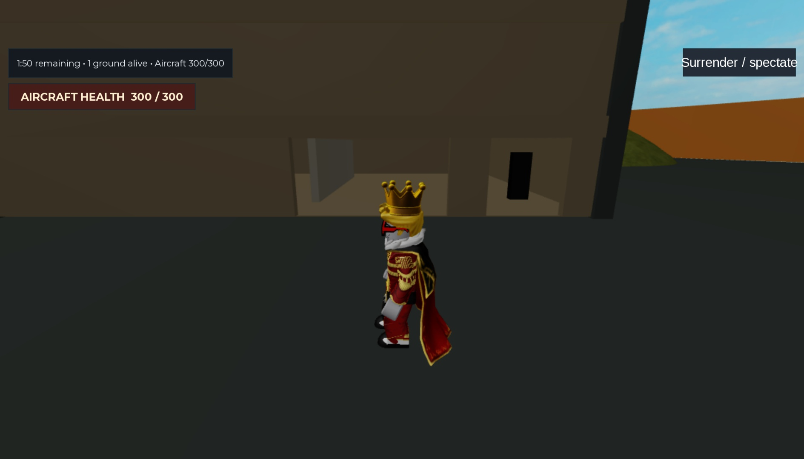

# Players vs C-130

**A Roblox game in development: one gunship against a united ground team.**

One player operates a circling C-130 while 5–9 teammates on the ground try to destroy it. Ground players start with M-7 rifles; coordinated hits wear down the aircraft's shared health. The intended map launcher will add rockets, with three direct hits destroying an undamaged plane. It is not yet a player item.



*P07 QA stage, 2026-11-13: actual desktop Studio capture in an active two-client round. Three 105mm hits opened the right Warehouse panel beside the original left doorway. The black upright block inside is a temporary QA visibility marker.*

## What you can play today

The local **P07 candidate on `plan/07-destruction`** combines rifle and gunship combat with progressive building-panel destruction. It has a **720-stud-diameter battlefield**, eight grass/rock hills, two large buildings and one smaller building, each with stairs and two usable floors. `main` contains the earlier verified combat build; it does not yet include this destruction candidate. P07 is available for review in [draft PR #29](https://github.com/hanegraaff/roblox-c130-extraction-shooter/pull/29); its multiplayer and operated visual acceptance remains incomplete, as recorded in the [plan](plans/07-destruction.md). There is no published Roblox play link.

A normal round starts in the protected, walkable lobby with 6–10 players. The server chooses one operator, preferring eligible players who have waited longer, then deploys the united ground team to shelter. The aircraft circles the perimeter automatically. The **ground team wins by destroying it**; the **operator wins by eliminating all ground lives or surviving until timeout**. The default limit is ten minutes. An operator disconnect forfeits to the remaining ground team. Results lead to a restored battlefield and a fresh lobby.

The operator looks inward through a grayscale thermal view. Hold **WASD** to pan: **A** moves left and **D** right; touch devices use the labelled arrows. Mouse movement or a separate touch aims the reticle. Releasing the pan holds the viewing angle relative to the circling plane. At wide zoom the level edge can enter roughly the outer quarter of the screen; corner edges may extend farther inward. Press **R / Recenter** for the safe default view. Select **1 / 30mm GAU-23/A Chain Gun** for the tighter **30°** view or **2 / 105mm M102 Howitzer** for the wider **40°** view. Switching preserves the pan angle and each weapon's ammunition and timers. Hold **left mouse / FIRE** at a valid surface to fire during an active round. Solid cover hides thermal highlights and protects ground players from blasts.

Ground players move with **WASD**, jump with **Space** and equip the **M-7** from the tool slot. Aim at the plane with the mouse and hold left click to fire; press **R** to reload. On touch devices, aim with the camera and use **FIRE / RELOAD** while equipped. Friendly fire is off. Use terrain, walls and roofs for protection, and watch for new openings: direct gunship fire darkens/cracks registered building panels before creating real holes. Three direct **105mm** hits open half a pristine panel; three further direct hits on its remaining solids remove it. Nine valid seconds of uninterrupted on-panel **30mm** fire advance one stage; a further nine advance the next. Pauses, misses and target or weapon changes clear unfinished 30mm work, while heavy-hit credit persists. Falling fragments accompany stage changes; floors, stairs and support frames remain stable. Ordinary standalone cover and terrain do not take panel damage.

Follow the teal western or ochre eastern route toward the gold center marker, which reserves the future launcher location. Both approaches and the buildings' normal upper-floor access work without demolition. An orange perimeter marks the playable edge; leaving it or falling below the battlefield returns an active ground player to shelter. Rifle-origin checks can temporarily block firing after suspicious position jumps until the player returns near the last trusted position or receives a server correction. Unusual terrain shapes or severe latency may also need tuning; the guard issues no automatic ban.

The HUD shows phase, role, life, time, ground survivors, ammunition and aircraft health. A confirmed rifle hit displays **AIRCRAFT HIT −5** for its shooter; server-resolved shots flash the reticle and show a short travelling tracer. Ground death, character reset or **Surrender / spectate** consumes that round's life. Eliminated players follow a living teammate; late arrivals and reconnecting players spectate until the next lobby. Resetting the operator's protected station character keeps the assignment, aircraft and deadline. Leaving the operator role restores the normal camera and removes thermal effects.

The visuals and HUD are primitive development art. Desktop and simulated-phone combat/panning were reviewed on the earlier integrated source; P07 still needs full rendered thermal/Destroyed-state review, falling-fragment visuals and native firing/readability review. Current two-client gunship and panning regressions and a focused reset probe have passing [source-specific evidence](docs/testing.md#run-the-p07-destruction-harness). A genuine third late client remains unverified because the tested session’s launch controls are disabled. The QA capture above demonstrates a new ground-view opening; full-plan acceptance remains incomplete. A physical mobile device, gamepad controls, combat audio, release performance and actual 6/10-player capacity remain unverified or planned. The MVP ships one level; [future levels](plans/15-interchangeable-levels.md) will reuse the same orbiting-aircraft, camera, combat and demolition rules. Launcher handling is P08 work; complete Help/presentation is P10 work. Progression, purchases, ground vehicles and full structural collapse are outside MVP scope.

## Set up locally

For the complete local Studio workflow, use macOS with **Git**, **Python 3.10+**, system **curl**, and **Roblox Studio** installed. Sign in to Studio yourself and keep Play stopped while installing or connecting plugins. Setup downloads tools from GitHub and TestEZ from Wally, so network access is required. The setup/host checks also support Linux arm64/x86_64; automated Windows setup is not provided. See the [development guide](docs/development.md) for platform and tool details.

Clone the source and enter the checkout:

```sh
git clone https://github.com/hanegraaff/roblox-c130-extraction-shooter.git
cd roblox-c130-extraction-shooter
```

Select the P07 candidate before building this version:

```sh
git fetch origin
git switch plan/07-destruction
git pull --ff-only origin plan/07-destruction
```

Use updated `main` instead if you want the earlier integrated combat build without P07 destruction. Do not discard local edits when switching source; select the same branch for builds, Rojo sync and test evidence.

If you will make changes, create a dedicated task branch from the selected source before editing; see the [branch rules](docs/development.md#branches-ci-and-review).

Install the pinned tools and dependencies, run the complete host gate, and make the tool commands available in this terminal:

```sh
python3 scripts/setup.py  # First-time setup; rerun if tool/dependency checks request it
python3 scripts/verify.py
export PATH="$HOME/.rokit/bin:$PATH"
rojo plugin install      # Install the matching Studio plugin once
```

The verifier builds `build/game.rbxlx` for local development and `build/tests.rbxlx` with automatic Studio test runners. A successful host run currently includes **54 unit and 53 integration tests**, formatting/lint/type checks, both builds, geometry checks and release isolation. It does not run Roblox Studio. The dependency and build directories are generated and stay out of Git.

## Play and develop locally with Rojo

Rojo's local server watches repository files and sends code/map changes to the Studio plugin. Keep the server terminal running while you work; **Ctrl+C** stops it. Reuse a matching server if it is already running.

For the development place, run:

```sh
rojo serve default.project.json --address 127.0.0.1 --port 34873
```

1. In Studio, use **File → Open from File** to open `build/game.rbxlx` as a local development document. Reuse it if it is already open.
2. Keep **Play stopped**. Open **Plugins → Rojo** and connect to `localhost:34873`. Confirm the project is **PlayersVsC130** before applying the mapping. If the newly installed toolbar button is absent in Edit mode, save work and restart Studio once. If only the panel is hidden, reopen it with the Rojo toolbar button; Play is not needed.
3. Click **Play**. The status panel reads **Development** / **Bootstrap running**, and the round panel shows a lobby waiting for six players. Your lobby character is protected and can move with WASD. A solo client cannot start a production round.
4. For solo exploration or a small local round, use the separate test mapping below. A single client automatically previews the battlefield. Two clients start real role/round testing; use three for teammate spectating while another ground player remains alive.
5. Click **Stop** before editing repository files. Let Rojo sync changes into this same document, inspect the expected change, and start a fresh Play session. Reopening a new build after every edit is unnecessary.

If Rojo reports **Http requests can only be executed by game server**, stop Play and reconnect in Edit mode. Keep a separate test document for the test mapping below. The [development guide](docs/development.md#sync-this-repository-with-studio) covers the guarded macOS launcher, MCP connection and further troubleshooting.

## Run local automated tests

Run the full host gate after code/configuration changes:

```sh
python3 scripts/verify.py
```

For real-engine tests, start the test sync server in another terminal with Rokit's tools on PATH:

```sh
export PATH="$HOME/.rokit/bin:$PATH"
rojo serve test.project.json --address 127.0.0.1 --port 34872
```

1. Open `build/tests.rbxlx` as a **separate local test document**. Keep Play stopped while connecting **Plugins → Rojo** to `localhost:34872`; confirm **PlayersVsC130Tests**. Never apply this mapping to a cloud/release place.
2. Click **Play**. The panel should read **Test**. The mapped TestEZ runners execute automatically; do not start a second manual run.
3. Open Studio's **Output** panel. The current source expects **137 server tests and 6 client tests**, with zero failures, skipped cases or errors. The test server records first-client startup progress in `workspace.ServerTestStartup` and waits up to 60 seconds for that client before publishing an explicit failed report. See the [testing guide](docs/testing.md#run-the-studio-smoke-suites) for startup diagnostics and source-specific evidence. These cover rules, selection rejection, service lifecycle, status/character behavior, actual GUI-hover/text-focus blocking, building/story/panel geometry, terrain reconstruction, supported routes, canonical aircraft poses, solid sight lines, boundary correction, all-panel residual geometry, pre-impact cover, fragment physics and pristine resets. These engine suites do not replace the P07 multiplayer and operated checks. After those suites pass, the test runner starts the round runtime. With one client, it automatically moves you to the battlefield for solo exploration. The HUD reads **Studio preview • Ground**. This bypasses the lobby location for testing; no opponent, active life or competitive round is created.
4. Click **Stop**, then **Play** again. Check fresh passing reports and one status panel plus one round panel. Stop before changing the mapping or source.
5. Use the **STUDIO TESTING** panel at the bottom right. Click **Role** to cycle Auto → Ground → Operator. With one client, the choice changes your solo preview immediately: Ground can walk, while Operator previews the inward thermal view. Hold **WASD** to pan and move the mouse to aim, or use the touch directional pad and a separate aiming touch. Use **R / Recenter** to reset the safe view, and **1 / 2** or the named buttons to inspect both zoom profiles. Solo selection is cosmetic and does not grant an active role. Click **Next round** to cycle 30, 60, 180 or 600 seconds.
6. For a real role/round test, use Studio **Server & Clients** with **2 clients** (or **3** for teammate spectating). Choose your roles, then click **Start round now** to bypass the lobby wait. Two Operator choices, or everyone choosing Ground, produces an explanation rather than silently changing a tester's choice. **Auto** fills the required operator when nobody explicitly requests it.
7. **Reset test / apply settings** ends the local test and restores preview/lobby. Role and duration choices apply to the next explicit **Start round now**; they do not change an active role or deadline. Use **End Session** to close multiplayer test clients when finished.

For **solo exploration**, just click **Play** in the test document; no **Server & Clients** windows are needed. If the panel says **Development**, stop Play and connect this document to the test server on `localhost:34872`, confirming **PlayersVsC130Tests**.

Use **Return to lobby** to inspect the walkable lobby, or **Explore map (solo)** to return to preview. No Command Bar commands are required. Solo previews are clearly labelled and do not grant an active round life, opponent or weapons. The panel and all override/settings code are excluded from the release mapping; production still requires 6–10 players and uses its normal role selection. See [test-control evidence](docs/evidence/lobby-preview.md) for verified cases.

The [P07 destruction harness](docs/testing.md#run-the-p07-destruction-harness) requires two actual clients, real gunship fire and a third spectator joining after damage. It checks panel replication, rejected traffic, heavy/30mm progression, opening traversal and repeated resets. Its written scenarios are not a passing report; collect the source-specific results and separate rendered/operated review. The [P14 pan harness](docs/testing.md#run-the-p14-panned-targeting-harness) requires two actual clients, a full orbit at each FOV, real terrain/upper-floor surface projections, selection coherence, role isolation and cleanup. Its automated pointer-input fixtures are separate from native mouse/keyboard/button review and 1280×720 / 1920×1080 rendered checks. The [P13 map harness](docs/testing.md#run-the-p13-expanded-map-harness) starts two actual clients, walks a ground avatar into all three upper floors, perturbs and resets the map twice, then requests a third actual late client to check rebuilt-map replication. The [P04 multiplayer harness](docs/testing.md#run-the-p04-aircraft-harness) uses two actual clients to sample a full 90-second orbit, check both zoom profiles and rejected selections, test thermal fixtures, reset/reentry and operator departure. The [P03 multiplayer harness](docs/testing.md#run-the-p03-multiplayer-harness) separately starts three clients, adds a late spectator and drives three accelerated rounds. The [P05 combat harness](docs/testing.md#run-the-p05-gunship-combat-harness) adds two-client firing, cover, rejection, result and reset checks. The [P06 harness](docs/testing.md#run-the-p06-ground-combat-harness) checks rifle and aircraft-health behavior; its current fixture passed with two actual clients. A single-client TestEZ pass does not establish replicated combat or release capacity.

After source changes, stop Play, rerun the host gate, confirm Rojo is connected to **PlayersVsC130Tests** on `localhost:34872`, verify it delivered the candidate and start a fresh session. If the sync server was restarted, reconnect the existing document's Rojo plugin in Edit before testing.

For fresh serialized-world acceptance through Studio MCP, build the probe from the selected checkout:

```sh
python3 scripts/build_studio_world_probe.py
```

Run the generated `build/studio-world-probe.luau` through MCP in the existing **Edit** document. It loads a newly built native world artifact, verifies source geometry and terrain restoration, then removes its fixture and restores prior terrain. This world-load check needs no new Studio process; normal Play server/client tests remain separate. See the [fresh-world procedure](docs/testing.md#check-a-fresh-native-world-load) for generated files, report checks and source identity.

For a documentation-only change, `python3 scripts/check_repository.py` checks local links, JSON, mappings and assets. See the [testing guide](docs/testing.md#run-the-studio-smoke-suites) for structured server/client reports and required evidence.

## Controls and cover

| Action | Ground player | C-130 operator |
| --- | --- | --- |
| Move / aim | WASD and mouse; Space to jump | WASD pans (A left, D right); touch arrows pan in their shown directions; mouse or a separate touch aims |
| Recenter view | — | R / Recenter |
| Select weapon and zoom | Equip M-7 from tool slot | 1 / 30mm button; 2 / 105mm button |
| Fire | Hold left mouse / FIRE while equipped | Hold left mouse / FIRE at a valid aim point |
| Reload | R / RELOAD while equipped | Automatic, independently per weapon |
| Surrender / spectate | On-screen button during an active life | — |

The M-7 defaults are **5 damage**, a **30-round magazine**, **120 reserve rounds**, **0.15-second cadence** and **2-second reload**. Aircraft health starts at **300**. The faster 30mm holds **100 rounds**, fires every **0.15 seconds** and automatically reloads in **5 seconds**; the 105mm holds **one round** and automatically reloads in **4 seconds**. The 105mm has a wider blast. These values are tuning defaults; switching cannot refill ammunition or reset readiness.

Panel damage counts server-resolved **direct gunship impacts**, separately from blast damage to players. The first 30mm hit starts the clock with zero elapsed credit; trigger time alone does not count. Current mixing defaults let one heavy hit contribute one third of a stage and preserve it through interruptions. Completed stages persist until reset. Damaged panels leave two solid side strips around a central 50% opening; those strips still block movement, shots and thermal sight lines. A creating blast uses the cover present before the damage batch; later shots can exploit the hole. Up to 48 server-owned fragments fall against scenery and expire after eight seconds. They do not damage or collide with players or supply cover. See [destruction contracts](architecture.md#progressive-panel-destruction-p07) for timing and collision details.

The future launcher will be droppable and recoverable after carrier death or disconnect, with one rocket replenished per reload and no separate ammunition pickups. Three direct 100-damage rockets destroy a pristine plane in server-only fixtures; previous rifle damage can reduce the remaining hits needed. Pickup, carry, selection, drop and player rocket controls remain planned. The [roadmap](roadmap.md) and plan records distinguish current behavior, completed acceptance and future work.

## Follow development or contribute

- [Game design](game-design.md): intended rules and edge cases.
- [Roadmap](roadmap.md): capabilities and current status.
- [Requirements](requirements.md): acceptance obligations.
- [Development guide](docs/development.md): installation, builds, Studio and source synchronization.
- [Architecture](architecture.md): implemented boundaries and future systems.
- [Testing guide](docs/testing.md): automated gates and real-engine verification.

Source is maintained in [hanegraaff/roblox-c130-extraction-shooter](https://github.com/hanegraaff/roblox-c130-extraction-shooter). The repository retains its original name.
