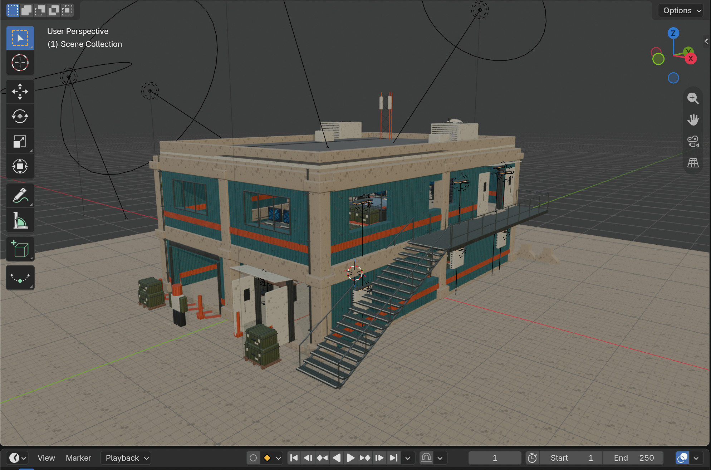

# Players vs C-130



*User-provided P16 Blender authoring viewport, selected 2026-11-13. [Editable source and review views](assets/blender/military-outpost/README.md).*

One player operates a circling C-130 while a team of 1–9 Ground players tries to bring it down. The ground team starts with M-7 rifles and can recover three rocket launchers from the map, carrying one per player. Three direct rockets destroy an undamaged aircraft. Rifle hits reduce the same health pool.

## Play a round

Rounds start in the protected, walkable lobby. With 2–10 players, the server assigns one operator and deploys everyone else as one ground team. The C-130 automatically circles the edge of the 720-stud battlefield. The default round lasts ten minutes, and friendly fire is off.

- **Ground team.** Follow the trails from any Sandbreak exit. Pick up a launcher inside the Salt Flats hangar, outside Vesper Radar’s south gate, or outside the military depot by the parking lot. Buildings and large rock formations provide cover. Lead the moving plane when firing a rocket. The carrier keeps their M-7, and the launcher's four-second reload continues through weapon switches, drops and transfers. A living teammate can recover it after a drop, death or disconnect while the round is active. If the drop position is invalid, the launcher returns to its original anchor.
- **C-130 operator.** Scan the ground through the inward-facing thermal camera. The 30mm GAU-23/A Chain Gun gives a tighter view, and the 105mm M102 Howitzer gives a wider view and blast. Weapon selection changes zoom and preserves the pan, ammunition and reload timing for each weapon. Releasing the directional controls holds the camera angle relative to the plane through its orbit.
- **Spectating.** Ground death, character reset or surrender consumes your round life. The camera follows a living Ground player and switches to the battlefield overview if no target is available. Late arrivals and reconnecting players can watch until the next round. Operator reset replaces the protected station body and preserves aircraft health.

The ground team wins when it destroys the plane. The C-130 wins by eliminating every ground player or surviving until time runs out. A lethal impact must land before the deadline. The ground team wins if the plane is destroyed and the last ground player is eliminated in the same pre-deadline step. A rocket already in flight can still hit after its shooter dies while the round remains active.

If the operator leaves while a ground player is alive, the ground team wins by forfeit. If the last ground player leaves while the operator remains, the C-130 wins by departure. An empty match or failed deployment can end without a winner. All remaining players see the same result and reason. After Results, the lobby camera returns and the battlefield, aircraft and equipment reset for the next round.

## Controls

| Action | Ground player | C-130 operator |
| --- | --- | --- |
| Move and aim | WASD to move, Space to jump, mouse or touch camera to aim | WASD or touch arrows pan, with A left and D right. The mouse or a separate touch aims |
| Recenter view | — | R / Recenter |
| Select weapon | Native tool slots or M-7 / ROCKET touch buttons | 1 / 30mm button or 2 / 105mm button |
| Fire | Hold left mouse / FIRE while equipped | Hold left mouse / FIRE at a valid surface |
| Reload | M-7 with R / RELOAD, launcher reloads automatically | Automatic for each weapon |
| Pick up or drop launcher | E / PICK UP within reach, G / DROP while carrying | — |
| Surrender | Surrender / spectate button during an active life | — |

On desktop, while spectating, press **[** or **]**, or select **Previous** or **Next**, to switch among living Ground players when more than one is available. The spectator view lets you watch until the round resets.

Press **P** or select **Settings** to adjust **Effects** and **Camera shake**. Use **↑/↓** to select a setting and **←/→** to change it, or click the setting to cycle through **Off**, **Reduced** and **Full**. Effects start at Full and camera shake at Reduced. Your choices last for the play session. Effects control cue sounds, HUD pulses and the aircraft destruction flash. Shake applies to the results camera after aircraft destruction.

Both roles see the timer, remaining Ground lives and aircraft health during play. Ground players see their equipped weapon's ammunition and reload, launcher ownership or recovery, and health on the desktop HUD. The operator sees the selected weapon's name, zoom and readiness. Incoming fire, impacts and round results have text cues at every effects setting. The aircraft health bar shrinks from green through amber to red as damage accumulates, with numeric health for both roles. The gunship reports and impacts arrive as delayed thumps. The M-7 has a sharp positional shot sound, and rockets have a launch rush, exhaust trail and separate impact.

## Battlefield cover

Sandbreak and Salt Flats sit in yellow sand among stock boulders, cacti and dry brush. The trail toward Vesper turns to forest soil beneath pines and redwoods. The military depot sits beside worn asphalt, a striped parking lot and a line of telephone poles. Four survey corners mark an empty 212 × 146-stud pad south of Sandbreak. [District screenshots](docs/evidence/districts/README.md)

Salt Flats Hangar occupies the former Foundry site. The full-size hangar has twin aircraft bays, four accessible levels, and a walk-in C-130 wreck beside the apron. The wreck offers overhead cover until a direct howitzer hit or three uninterrupted seconds of 30mm hits destroy it. Vesper Array occupies the former Warehouse site. Four entrances open onto a courtyard beneath the radar dish. Twin stairs lead to the observation gallery. The dish and the strip beneath the gallery give temporary cover, and the open roof exposes much of the route to the aircraft. The detailed Outpost has a workshop, upstairs command room, balcony and exterior stairs. The ground camera moves closer inside its rooms as needed and restores the previous outdoor zoom at exit. The orange boundary marks the playable disk. Leaving it or falling below the map returns an active ground player to shelter.

Ground players deploy inside the Sandbreak bunker at the original spawn site. Four entrances lead out past the roof breach, nearby vehicle wrecks, and radio relay. [Sandbreak import and review](assets/blender/spawn-bunker/IMPORT.md)

Solid walls hide ground thermal highlights and block shots and blasts. Walls and roofs, including the battlefield starting shelter, show persistent Light damage, open at Heavy damage after three direct 105mm hits, and disappear after three more. Nine earned seconds of valid same-panel 30mm hits advance a stage. Interruptions preserve earned damage and pause its timing. A new opening benefits later impacts. Debris falls against scenery, and floors, stairs, supports and the outside lobby stay intact. [Destruction rules](architecture.md#progressive-panel-destruction-p07)

## Availability

Play locally in Roblox Studio from `main`. One battlefield is playable, including the detailed Outpost, indoor ground camera, both roles and the full match and replay loop. To host a session in the Roblox app, follow [Publish and play privately](#publish-and-play-privately). The MVP release and real 6- and 10-player acceptance are pending. [Roadmap](roadmap.md)

## Set up locally

Use macOS with **Git**, **Python 3.10+**, system **curl** and **Roblox Studio** for the complete workflow. Sign in to Studio and keep Play stopped while installing or connecting plugins. Setup requires network access to GitHub releases and the Wally registry. The automated tool setup also supports Linux arm64/x86_64. [Development prerequisites](docs/development.md#install-and-build-from-a-clean-clone)

For the district revision before merge, select `feat/battlefield-districts` in the clone or switch commands below. For the integrated game, clone `main`.

```sh
git clone --branch main https://github.com/hanegraaff/roblox-c130-extraction-shooter.git
cd roblox-c130-extraction-shooter
python3 scripts/setup.py
python3 scripts/verify.py
export PATH="$HOME/.rokit/bin:$PATH"
rojo plugin install
```

On an existing clone, preserve your local edits, run `git fetch origin` and switch with `git switch main`. Run `git pull --ff-only origin main` to update it, then run the same setup and verification commands from the repository root.

Setup installs the pinned tools and dependencies. Install the matching Rojo Studio plugin once. The verifier runs host unit and service tests, static checks, asset reconstruction and release isolation, and builds `build/game.rbxlx` and `build/tests.rbxlx`. Create a dedicated task branch before contributor edits. [Branch rules](docs/development.md#branches-ci-and-review)

## Publish and play privately

1. In Creator Dashboard, select the approved test experience. Open **Publish settings → Manage Audience → Manage access → Playtest**, set the audience to **Playtesters**, and save. Set the start place’s player limit to **10**. [Roblox audience settings](https://create.roblox.com/docs/production/publishing/publish-games-and-places#target-audience)
2. Note the place’s current published version for rollback. Open `build/game.rbxlx` in Studio, choose **File → Publish As**, and select the approved experience and its existing start place. [Roblox Version History](https://create.roblox.com/docs/projects/version-history)
3. Open the published place in Studio and use **Collaborate** to grant each invited tester **Play** access. In Creator Dashboard, use **⋯ → Copy URL** on the experience tile and share it with those testers. [Roblox collaborator permissions](https://create.roblox.com/docs/projects/collaboration#manage-collaborators), [Copy the Roblox link](https://create.roblox.com/docs/projects/configure-games#copy-landing-page-link)
4. Have everyone open the link in the **Roblox app** and join the same server. You can start with **two players total**, including you. For a larger match, keep everyone connected until the next round starts with the full group.

The [P12 release plan](plans/12-mvp-release.md#authorization-and-destination-access) records the team’s approved destination. The [release runbook](docs/release.md) covers asset permissions and the full live test checklist.

## Play and develop locally with Rojo

From the repository root, start the development sync server. Keep its terminal running while working. Reuse it if it is already serving the same project and port.

```sh
rojo serve default.project.json --address 127.0.0.1 --port 34873
```

1. In Studio, use **File → Open from File** to open `build/game.rbxlx` as a local document. Reuse the document if it is already open.
2. In Edit mode, open **Plugins → Rojo** and connect to `localhost:34873`. Confirm the **PlayersVsC130** mapping before applying it. If a newly installed plugin's toolbar button is absent, save work and restart Studio once.
3. Click **Play** to check the walkable lobby and the HUD waiting for two players. Use **Server & Clients** with two clients to start a match. The separate test mapping offers solo exploration and explicit role and round controls.
4. After repository edits, stop Play, confirm the same Edit document received the expected change through Rojo, and start fresh Play. If the server restarted or the plugin disconnected, reconnect the existing document in Edit mode. [MCP, sync and troubleshooting](docs/development.md#sync-this-repository-with-studio)

## Run local automated tests

Run `python3 scripts/verify.py` after code or configuration changes. Use `python3 scripts/check_repository.py` for documentation-only changes.

Start the test sync server in another terminal with Rokit on PATH.

```sh
export PATH="$HOME/.rokit/bin:$PATH"
rojo serve test.project.json --address 127.0.0.1 --port 34872
```

1. Open `build/tests.rbxlx` as a separate **local** test document. With Play stopped, connect **Plugins → Rojo** to `localhost:34872` and confirm **PlayersVsC130Tests**. Use this mapping only in the local test document.
2. Click **Play**. Expect automatic TestEZ reports in Studio **Output** and a **Test** bootstrap panel while the test runtime starts. The current mapping discovers **199 server cases** and **14 per actual client**. All should pass with zero failures, skips or errors. The server waits up to 60 seconds for the first client. Stop and start fresh Play to confirm fresh reports, one bootstrap status owner and one visible round HUD after startup. [Collect Studio smoke reports](docs/testing.md#run-the-studio-smoke-suites)
3. With one client, Play opens the labelled Ground preview. Use the **STUDIO TESTING** panel to cycle **Role** through Auto, Ground and Operator, or move between **Explore map (solo)** and **Return to lobby**. Preview lets you walk the map or use the thermal camera and both zooms while waiting for a match.
4. For an active local match, use Studio **Server & Clients** with **2 clients**. Use **3** to exercise launcher transfer and teammate spectating, or **4** to give an eliminated player two targets to cycle through. Set roles and **Next round** duration, then click **Start round now**. Leave an **Auto** choice if nobody selects Operator. Two Operator choices or all Ground choices are rejected with a message.
5. Play through Results and wait for the lobby to return. Start the next round to inspect restored equipment and cover. **Reset test / apply settings** returns to the lobby or solo preview. Test-panel role and duration choices apply to the next explicit start. Use **End Session** when finished.

The four-client player experience harness checks role HUDs, keyboard controls, spectator targeting and camera cleanup. The match harness covers competitive endings, departures and replay. The performance harness exercises combat load, cleanup, frame time, memory and latency. Stop Play and confirm the updated source reached the same test document before collecting fresh evidence. [Player experience harness](docs/testing.md#run-the-player-experience-harness), [match harness](docs/testing.md#run-the-p09-match-outcome-harness), [P11 workloads](docs/testing.md#run-the-p11-performance-harness)

## Inspect the Blender outpost

Open [military-outpost.blend](assets/blender/military-outpost/military-outpost.blend) in **Blender 5.3.0** to explore the exterior, furnished rooms, saved views and six material and shape damage families. Run `python3 scripts/p16_audit.py` to check the committed package without launching Blender. [Asset review guide](assets/blender/military-outpost/README.md), [in-game Outpost record](plans/17-integrate-military-outpost.md)

## Follow development or contribute

- [Game design](game-design.md) and [requirements](requirements.md)
- [Development guide](docs/development.md), [architecture](architecture.md) and [testing guide](docs/testing.md)
- [Release preparation and live acceptance](docs/release.md)
- [Author Roblox assets](.agents/skills/author-roblox-assets/SKILL.md) and [import Blender assets into Roblox](.agents/skills/import-blender-to-roblox/SKILL.md)
