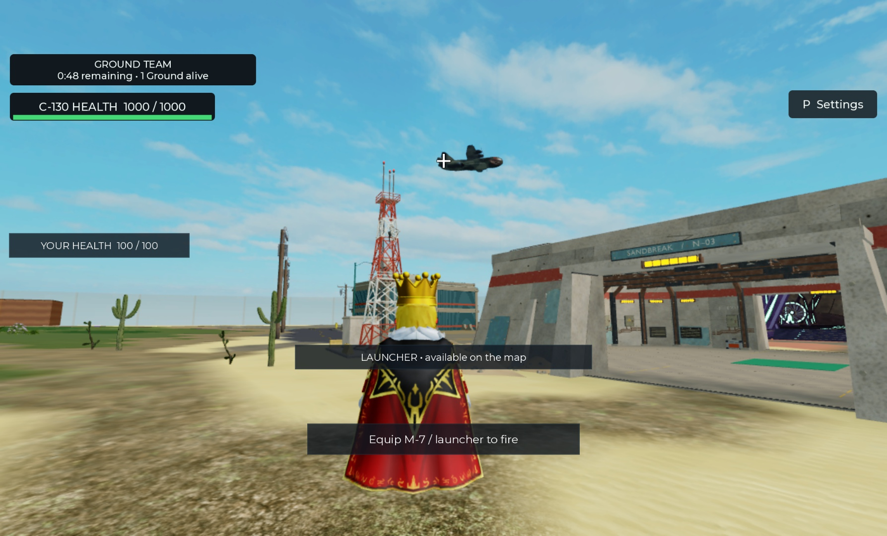
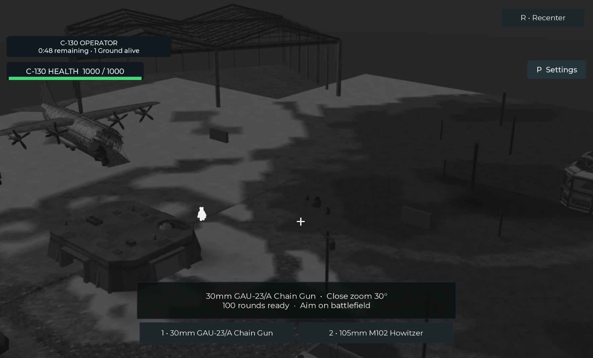
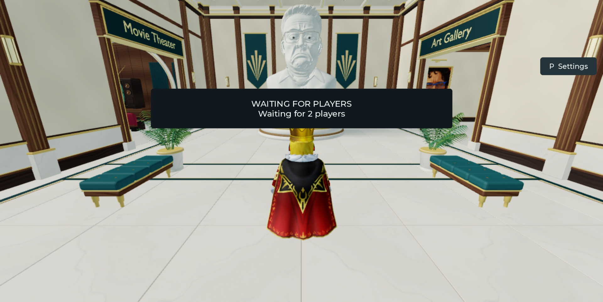
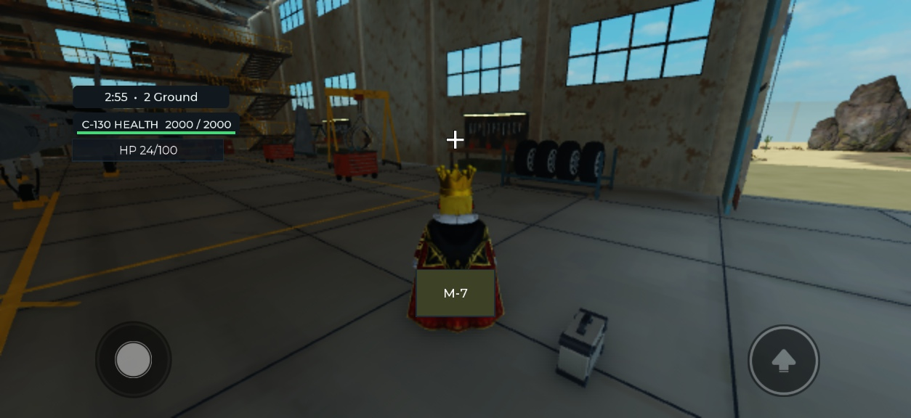
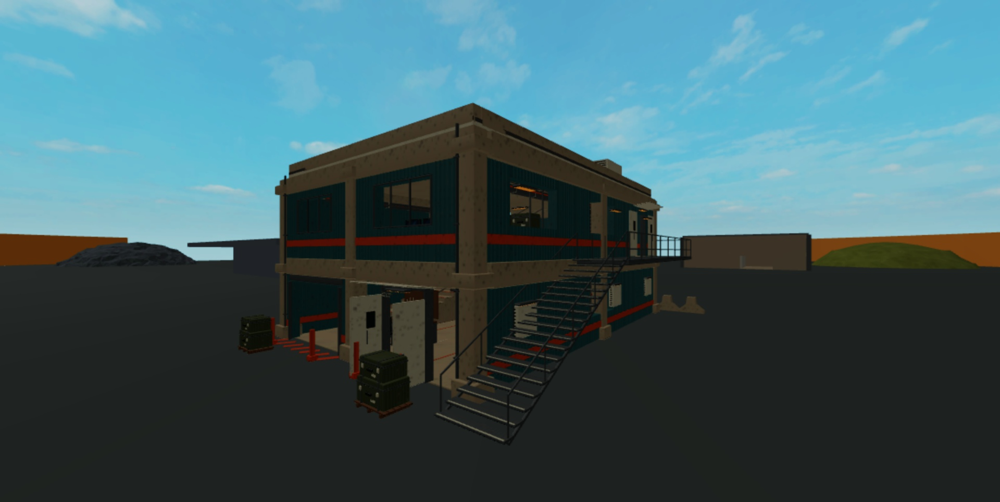
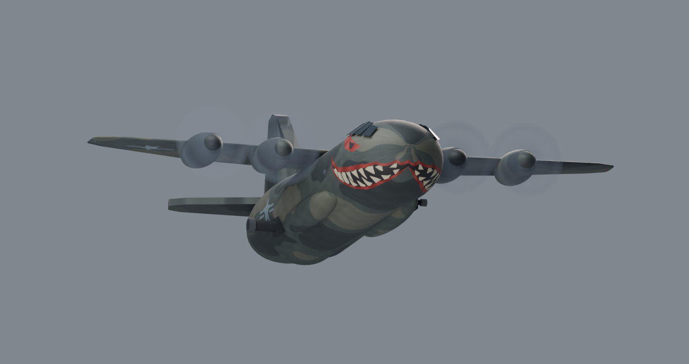

# C-130 Assault

## Game

One player operates a circling C-130. A team of one to nine Ground players races for cover and rocket launchers, then tries to bring the aircraft down before it eliminates them or the clock expires. The circular battlefield spans 720 studs, Roblox’s unit of distance.

### Play a round

1. **Meet in the lobby.** Players spawn facing the stone bust, between the movie theater and art gallery. With the default settings, a match needs at least two players in the same server. The game assigns one operator and puts everyone else on Ground.
2. **Scatter.** Ground deploys inside Sandbreak bunker and gets 20 seconds to spread out or pick up launchers. The operator watches the same countdown on a black screen. The plane arrives at zero, both sides can fire, and the ten-minute combat clock starts.
3. **Fight for sight lines.** Ground starts with an M-7 rifle. There are four launchers, one inside Salt Flats Hangar, one outside Vesper Radar’s south gate, one outside the military depot by the parking lot, and one on the Prism Seedship’s lower deck. Keep the rifle when you pick up a launcher. Each launcher reloads in 15 seconds, even if a teammate takes it over. A direct rocket hit deals 150 damage and an M-7 hit deals 5. The aircraft starts with 1,000 health per deployed Ground player. Look for a single-use medkit in or near each of the five landmarks. With the default settings, it restores up to 25 health to an injured teammate.
4. **Watch cover change.** The C-130 flies its own orbit while the operator pans and aims the sights. Exposed Ground players appear white against dark grayscale scenery. Solid cover blocks both the highlight and damage. The 30mm chain gun gives a close view and can take down a panel with two seconds of earned hits. Damage stays on the panel when firing pauses. The 105mm howitzer gives a wider view, can destroy a panel with one direct hit, and reloads in 12 seconds. A new opening can expose someone to the next shot.
5. **Finish and replay.** Ground wins by destroying the aircraft. The C-130 wins by eliminating Ground or running out the clock. Eliminated players return to the lobby and can use **Spectate** at the theater TV to follow living teammates. At the result, everyone returns for a two-minute intermission while the map and equipment reset.

- **Ground on desktop.** **WASD** moves, **Space** jumps and the mouse aims. Equip a weapon from the tool slots and hold left mouse to fire. **R** reloads the 30-round M-7 from unlimited reserve. **E** picks up a launcher, **G** drops it and **F** uses a nearby medkit. Hold **Left Alt** to free the cursor.
- **Ground on touch.** Use the movement stick and jump button, drag to aim, and use **M-7**, **ROCKET**, **FIRE**, **RELOAD**, **PICK UP**, **DROP** and the medkit’s **Use** prompt as they appear.
- **Operator on desktop.** **WASD** pans the camera, the mouse aims the reticle and holding left mouse fires. **1** selects 30mm, **2** selects 105mm and **R** recenters.
- **Operator on touch.** Use the directional arrows to pan, drag on the battlefield view to aim, and use **30mm**, **105mm**, **FIRE** and **Recenter**.

Use **Settings** to adjust effects and camera shake. The experience owner and authorized balance testers can tune upcoming rounds in the lobby’s **Balance** panel. [Balance controls and presets](docs/balance.md)

### Screenshots



*Ground after aircraft arrival. A player has reached the open ground outside Sandbreak bunker. Two-client Studio build `fc8febb`.* [Capture record](plans/33-rewrite-readmes.md#gameplay-captures)



*The same moment through the operator’s 30mm sight in Studio build `fc8febb`. The exposed player appears white beside the dark bunker. The aircraft at left is the wreck beside Salt Flats Hangar.* [Capture record](plans/33-rewrite-readmes.md#gameplay-captures)



*The protected lobby in Studio Play, from the release-equivalent build at `2c753b6`.* [Lobby capture record](plans/22-integrate-lobby.md#completion-record)



*An injured Ground player approaches a medkit at Salt Flats Hangar in the Studio phone simulation, build `cbe28d4`.* [Phone capture record](docs/evidence/p30/studio-phone-verified.json)

### Availability

**C-130 Assault** was last verified in a private Roblox playtest. Ask the owner for the current invitation and experience link. Sign in to the invited Roblox account, open the link, then choose **Play** to launch the Roblox app. If the lobby says **Waiting for 2 players**, have a second invited player join the same server. Desktop mouse and keyboard and touch controls are available. Controller support is future work. [Private playtest record](plans/26-live-balance-panel.md#2026-11-28--published-owner-playtest)

## Project / Development Setup

### Set up locally

**Roblox Studio** is the editor and local game simulator. **Luau** is Roblox’s scripting language. **Rojo** builds place files containing the world and scripts from Git, and streams source edits into an open Studio document.

For the complete workflow, use macOS with Git, Python 3.10 or later, system `curl`, and Roblox Studio. Sign in to Studio. The automated tool setup also supports Linux, where you can run the host checks. [Install Roblox Studio](https://create.roblox.com/docs/studio/setup) · [Tool pins and troubleshooting](docs/development.md)

```sh
git clone --branch main https://github.com/hanegraaff/roblox-c130-extraction-shooter.git
cd roblox-c130-extraction-shooter
python3 scripts/setup.py
export PATH="$HOME/.rokit/bin:$PATH"
rojo plugin install
```

Setup installs pinned tools through Rokit, a tool version manager, and fetches the test dependencies. The last command installs the matching Studio plugin. If Studio was already open and the button is missing from **Plugins** in Edit mode, save your work and restart Studio once. On an existing clone, update with `git switch main` and `git pull --ff-only` after preserving local changes. For contributor work, create a dedicated branch from the source your change needs. [Branch workflow](docs/development.md#branches-ci-and-review)

### The two Studio files

Run the verifier from the repository root.

```sh
python3 scripts/verify.py
```

Expect passing host tests and static, asset and release-isolation checks, plus both place files in `build/`. Host tests run directly on your machine. Studio tests use Roblox physics, Instances and clients.

| Local place file | Rojo mapping and connection |
| --- | --- |
| `build/game.rbxlx` | Production game and publication. `default.project.json` maps **PlayersVsC130** on **34873**. |
| `build/tests.rbxlx` | Local automated tests, role preview and quick rounds. `test.project.json` maps **PlayersVsC130Tests** on **34872**. |

Start one Rojo server per terminal from the repository root. Keep Rokit on your PATH in both terminals and leave both servers running.

```sh
rojo serve default.project.json --address 127.0.0.1 --port 34873
```

```sh
rojo serve test.project.json --address 127.0.0.1 --port 34872
```

In Studio, use **File → Open from File** to open each local place once and keep separate documents. In each document, stop Play so you are in Edit mode, open **Plugins → Rojo**, and connect to the matching localhost port. Confirm the project name when you apply the mapping. In **Explorer**, `ServerStorage.DevelopmentSettings` should appear only in the test document. If the mapping or marker is wrong, stop and reconnect the correct project before Play. A file rebuild writes to disk. Rojo updates the open Edit document. If a Rojo server restarts, reconnect in the same document before testing again.

### Play both roles and sync an edit

1. In `game.rbxlx`, choose **Test** from the top-toolbar testing dropdown and click **Play**. You should spawn in the lobby with **Waiting for 2 players**. Click **Stop**.
2. In `tests.rbxlx`, select **Server & Clients** from Studio’s top-toolbar testing dropdown. Choose **2** clients and click **Play**. Wait for both clients to finish startup. In **STUDIO TESTING**, click **Role** until one client says **Ground** and the other says **Operator**. Click **Start round now**. The default test combat clock is one minute, after the 20-second head start. [Studio multiplayer controls](https://create.roblox.com/docs/studio/testing-modes#multi-client-simulation)
3. In Ground, walk out of Sandbreak and aim at the aircraft as it arrives. In Operator, pan over the map, switch between the two sights and fire at the battlefield. Let the timer reach zero or play to a win. Both clients should see the same result on return to the lobby. Use **End Session** to stop. For solo exploration, switch the test document back to **Test**, click **Play**, and change **Role** in its preview panel.
4. To see source sync on a clean worktree, change the `"Next round: "` prefix to `"Sync check: "` in the `duration.Text` assignment in [HumanTestPanel.luau](tests/studio/client/HumanTestPanel.luau). In the same test document in Edit mode, find the changed line under **StarterPlayer → StarterPlayerScripts → ClientTests → HumanTestPanel**. Select **Test** and click **Play**, then look for **Sync check: 60 seconds** in the test panel. Stop, undo just that text edit and confirm that **Next round: 60 seconds** returns on the next Play. `git diff -- tests/studio/client/HumanTestPanel.luau` should be empty.

### Run local automated tests

Run `python3 scripts/verify.py` from the repository root after code or configuration changes. Use `python3 scripts/check_repository.py` for a quick documentation and repository check.

For engine smoke tests, select the local **PlayersVsC130Tests** document, choose **Test**, then click **Play**. Open **Output** and wait for the server and client reports from TestEZ, the Luau test runner. Each must discover and pass cases with zero failures, skips or errors. The server waits up to 60 seconds for its first client. Use **Stop** and start a fresh session after a sync. The two-client walkthrough above checks that both clients can play together. [Report fields and deeper Studio scenarios](docs/testing.md#run-the-studio-smoke-suites)

### Publish to Roblox

Start from the clean commit you tested. Run `python3 scripts/prepare_release.py` from the repository root. It rebuilds both files, runs verification and writes `build/release-receipt.json` with the commit, build hashes and asset inventory. Check that `shasum -a 256 build/game.rbxlx` matches `release.sha256` in the receipt.

Publish only `build/game.rbxlx` from the correct owner or group account. In Creator Dashboard, confirm the intended experience and start place under **Configurations → Places**. For an existing place, record its current published version for rollback and confirm its audience before uploading, since an update can reach those players immediately. For a private test, choose a private destination or apply the private audience steps before updating. Check access to the receipt’s assets and set the start place’s player limit to 10. In Studio, stop Play and confirm the open game document contains the tested source from **PlayersVsC130**, with no `DevelopmentSettings` in `ServerStorage`. Preserve unsaved work and reload the exact local file if the document’s source is uncertain. [Destination and asset checks](docs/release.md#verify-the-destination-and-prepare-rollback)

1. **Create or update the place.** For a new experience, use **File → Publish**, enter the name **C-130 Assault**, select the owner if prompted, and save. It initially opens to the owner and permitted editors. To update a specific existing start place from the local build, use **File → Publish As**, select the intended experience and its existing start place, then confirm **Overwrite**. For later updates from a document already linked to that place, use **File → Publish**. For a new experience, check asset permissions and the player limit once the destination exists. [Roblox publishing workflow](https://create.roblox.com/docs/production/publishing/publish-games-and-places)
2. **Confirm the version.** Use the candidate commit in the publish notes when prompted. In Studio, open **Window → Version History** for the published place and record its published version beside the release receipt. [Roblox Version History](https://create.roblox.com/docs/projects/version-history)
3. **Choose the audience.** Follow the private or public steps below to set and test who can join.

#### Publish for private testing

1. In [Creator Dashboard](https://create.roblox.com/dashboard/creations), select the experience and open **Publish settings → Manage Audience → Manage access → Playtest**. Save with **Playtesters** enabled for named users you grant Play access. For a small friend preview, use the **Early testers** access in the same tab. [Roblox audience settings](https://create.roblox.com/docs/production/publishing/publish-games-and-places#target-audience)
2. Grant access using the invitation steps below. Verify that an invited account can join a fresh Roblox app session and that an uninvited account is denied. Check that the lobby opens and a round starts with a second eligible player.

#### Publish for public play

1. For the first public release, use a creator account in good standing that is at least two days old and has completed Roblox’s age check. In the linked place, choose **File → Publish → Continue**, answer the content-rating questions based on the game, and click **Publish**. Basic public reach starts with age-checked players 16 and up. Reaching younger players has additional account verification, two-step verification, subscription or fee, questionnaire and game evaluation requirements. [Roblox public release requirements](https://create.roblox.com/docs/production/publishing/publish-games-and-places#release-requirements)
2. In Creator Dashboard open **Publish settings → Manage Audience → Manage access → Public**. Turn **Friends** off for public access and save. Age and region restrictions still apply. [Roblox audience settings](https://create.roblox.com/docs/production/publishing/publish-games-and-places#target-audience)
3. From the experience tile, choose **⋯ → Copy URL**. Verify that the Roblox listing says **C-130 Assault**. Test joining a fresh server from an eligible account outside your collaborator group, then share the link. [Copy the public experience link](https://create.roblox.com/docs/projects/configure-games#copy-landing-page-link) · [Live release verification](docs/release.md#publish-and-smoke-test-the-exact-build)

### Invite test players

For private **Playtesters** access, open the published place in Studio, choose **Collaborate**, search for each tester’s Roblox username, grant **Play**, and save. For **Early testers**, use **File → Invite early testers** and select up to ten eligible friends. Copy the experience link from **⋯ → Copy URL** in Creator Dashboard and give it to your testers. For a public game, send the same link to anyone eligible for its audience. [Play permissions](https://create.roblox.com/docs/projects/collaboration#manage-collaborators) · [Early tester invitations](https://create.roblox.com/docs/production/publishing/publish-games-and-places#invite-early-testers)

Testers sign in to the account that has access and click **Play** on the link. Meet in the same server and look for the lobby countdown once two players are present. On a larger test, stay connected through the current round and intermission so the next deployment can include the full group.

## Game Design

### Anatomy of a Roblox game

An **experience** is the game people find on Roblox. It contains one or more **places**, each a saved world with objects and scripts. C-130 Assault uses one place for both the lobby and battlefield. Roblox hosts running **servers** of that place. The Roblox app is the **client** that each player uses to send input and display their own view. When you join, the server places your avatar in the lobby and Roblox **replicates**, or sends copies of, shared world and player state to the clients.

### Game architecture

Walk up to a launcher and press **E**. The Ground input controller sends a request identifying the pickup and round over a Roblox **RemoteEvent**, a message channel between client and server. The server checks that you are a living Ground player, that the launcher is available and that it is reachable from your character. The first eligible claim takes ownership. The server replaces the pickup with a Roblox **Tool** in the winner’s inventory and publishes the new launcher state. Other clients see the pickup disappear and their displays update from the shared state. Keeping the decision on the server gives simultaneous requests one outcome. [Network and round contracts](architecture.md#network-contracts)

### Code organization

Rojo maps Git paths to named containers called **services** in Studio’s Explorer. Open the game mapping to see what each service receives. [Game mapping](default.project.json) · [Test mapping](test.project.json)

- **`src/server/` → `ServerScriptService.Server`** runs the round, weapons, equipment, damage and map reset on the server. [Server contracts](src/server/README.md)
- **`src/client/` → `StarterPlayer.StarterPlayerScripts.Client`** starts a script on each player’s client for controls, the HUD and role-specific cameras and effects. [Client contracts](src/client/README.md)
- **`src/shared/` → `ReplicatedStorage.Shared`** contains definitions and rules both sides can read, including map settings and the balance schema. [Shared contracts](src/shared/README.md)
- **`assets/world/`, `assets/imports/` and `assets/models/`** supply world definitions and art. Rojo places the battlefield under **Workspace.World** and model templates under **ServerStorage.Assets**. The runtime uses those templates to assemble and reset the battlefield. [World data](assets/world/README.md) · [Asset contracts](assets/README.md)
- **`tests/`** contains host rule and service tests and native Studio suites. The test mapping adds test runners, fixtures and the in-game test panel to the local place. [Test organization](tests/README.md)

### Key scripts

- The [server entrypoint](src/server/init.server.luau) starts the game runtime. [MatchService](src/server/MatchService.luau) owns the roster, arrival deadline, combat deadline and results. It samples server time so the same round has one answer to whether combat is open.
- [GameRuntime](src/server/GameRuntime.luau) runs the server’s gameplay systems in order. It resolves damage against the cover present at the start of the step, then applies panel changes. An opening can affect the next shot.
- [GroundCombatController](src/client/GroundCombatController.luau) sends weapon and launcher requests. [LauncherRuntime](src/server/LauncherRuntime.luau) validates them and creates the world and held versions of the launcher. Its per-site state keeps reload timing through a drop and pickup.
- The [client entrypoint](src/client/init.client.luau) starts the HUD and role controllers. [ThermalCameraController](src/client/ThermalCameraController.luau) owns the operator’s local sights, input and highlights. Ground clients keep their normal scene colors, and the server still resolves every shot.

### Blender models

Blender is where artists edit meshes, materials and assemblies. Open the `.blend` masters below with Blender 5.3.0. Export the game-ready geometry, import it into Studio or generate a native Roblox model using the asset’s documented path, and verify scale, pivots and collision in Play. Save the managed model and its source information in Git. Rojo places the model in the build, where the server can clone it or swap damaged pieces. For a walkable building, check stair clearance and camera room, then check cover and openings from both roles. [Asset pipeline and provenance](assets/README.md)


*User-provided Blender authoring viewport, selected 2026-11-13. The approved Outpost source is revision `e8fb840`.* [Editable Outpost scene](assets/blender/military-outpost/military-outpost.blend) · [Source and review views](assets/blender/military-outpost/README.md)



*The Outpost in Roblox Studio Play at `ee19deb`. The stairs, balcony and teal wall panels match the Blender viewport above.* [Studio capture record](docs/evidence/p17/native-render-review-ee19deb.md)



*Blender render from the painted C-130 scene. Compare its shark nose and four engines with the Ground arrival shot in Game.* [Editable C-130 scene](assets/blender/c130/c130-painted.blend) · [Aircraft source and export](assets/blender/c130/README.md)

The [furnished lobby](assets/blender/lobby-interior/waiting-lobby.blend), [rocket launcher](assets/blender/rocket-launcher/rocket-launcher.blend) and [field medkit](assets/blender/medkit/medkit.blend) also have editable scenes. See the [game design](game-design.md), [contributor guide](docs/development.md) and [roadmap](roadmap.md) for deeper project context.
