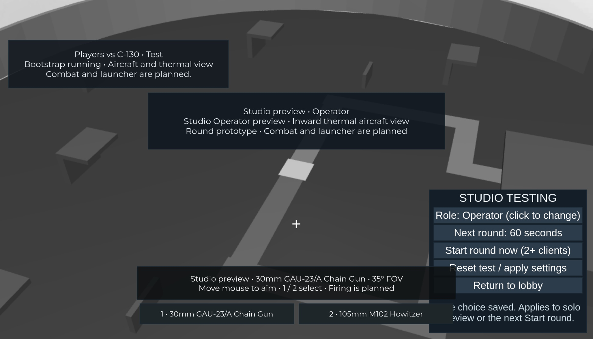

# Players vs C-130

**A Roblox game in development: one gunship against a united ground team.**

The intended game puts one C-130 operator above a circular industrial battlefield and 5–9 teammates on the ground. The ground team uses M-7 rifles and one recoverable rocket launcher to destroy the plane. Three direct rockets destroy an undamaged aircraft; rifle fire chips away at the same health pool.



*Current progress: solo Operator preview of the local aircraft/thermal prototype, captured in Studio on 2026-11-08. Firing and aircraft damage are planned.*

## What you can play today

The local build has a circular greybox battlefield, an orbiting C-130 and a round loop. Players can walk around a protected lobby deck. With 6–10 players, the server selects one operator and sends everyone else to sheltered ground positions. Operator turns rotate between eligible players, preferring those who have waited more rounds.

The C-130 circles the perimeter automatically. The operator looks inward toward map center through a grayscale thermal view, with solid cover occluding player highlights. Move the mouse to place the reticle within the view. Press **1** or click **30mm GAU-23/A Chain Gun** for the tighter **35°** view; press **2** or click **105mm M102 Howitzer** for the wider **60°** view. The camera keeps facing inward while you aim and switch profiles. These are targeting profiles: firing is not available yet.

Ground players use **WASD**, **Space** and the mouse to explore and watch the aircraft overhead. Follow the teal western route or ochre eastern route toward the gold center marker. Industrial walls and roofs provide cover, and an orange perimeter marks the edge. Leaving the battlefield or falling below it returns an active ground player to shelter. The marker reserves the future launcher location; there is no pickup or destructible cover yet.

A round panel shows phase, role, life state, remaining time and surviving ground players. Ground players can click **Surrender / spectate** or reset their character to give up their life. Death and reset do not respawn them during that round: they watch a living ground teammate instead. Late arrivals and reconnecting players wait for the next round. Resetting the operator's protected station character retains the assignment, aircraft and deadline. Leaving the operator role restores the normal camera and removes thermal effects.

The operator wins when all ground lives are gone or the timer expires; an operator disconnect gives the remaining ground team a forfeit win. Results lead to a restored map and a fresh lobby. Production defaults are ten-minute rounds. Firing, aircraft damage and the launcher are planned, so ground cannot yet earn an aircraft-destruction win through play. There is no published Roblox play link. See [P04](plans/04-aircraft-and-thermal.md) for aircraft/view evidence and limits, [P03](plans/03-rounds-and-roles.md) for rounds, and [P02](plans/02-warzone-map.md) for the map.

The HUD is a prototype: the round card covers part of the upper view, and Roblox's open team-chat panel can overlap its left side at smaller viewport sizes. The wider operator view can include an aircraft strip in the upper-left sky. Full player guidance and presentation polish are planned for P10.

The [roadmap](roadmap.md) tracks progress; the game described below is the planned MVP.

## Set up locally

For the complete local Studio workflow, use macOS with **Git**, **Python 3.10+**, system **curl**, and **Roblox Studio** installed. Sign in to Studio yourself and keep Play stopped while installing or connecting plugins. Setup downloads tools from GitHub and TestEZ from Wally, so network access is required. The setup/host checks also support Linux arm64/x86_64; automated Windows setup is not provided. See the [development guide](docs/development.md) for platform and tool details.

Clone the source and enter the checkout:

```sh
git clone https://github.com/hanegraaff/roblox-c130-extraction-shooter.git
cd roblox-c130-extraction-shooter
```

`main` includes the round prototype, perimeter aircraft, inward thermal view, weapon-linked zoom and Studio human-testing controls. Select and update the integrated source before building:

```sh
git fetch origin
git switch main
git pull --ff-only origin main
```

Use a PR's head branch only when reviewing an unmerged change.

If you will make changes, create a dedicated task branch from the selected source before editing; see the [branch rules](docs/development.md#branches-ci-and-review).

Install the pinned tools and dependencies, run the complete host gate, and make the tool commands available in this terminal:

```sh
python3 scripts/setup.py  # First-time setup; rerun if tool/dependency checks request it
python3 scripts/verify.py
export PATH="$HOME/.rokit/bin:$PATH"
rojo plugin install      # Install the matching Studio plugin once
```

The verifier builds `build/game.rbxlx` for local development and `build/tests.rbxlx` with automatic Studio test runners. A successful host run currently includes **30 unit and 18 integration tests**, formatting/lint/type checks, both builds, geometry checks and release isolation. It does not run Roblox Studio. The dependency and build directories are generated and stay out of Git.

## Play and develop locally with Rojo

Rojo's local server watches repository files and sends code/map changes to the Studio plugin. Keep the server terminal running while you work; **Ctrl+C** stops it. Reuse a matching server if it is already running.

For the development place, run:

```sh
rojo serve default.project.json --address 127.0.0.1 --port 34873
```

1. In Studio, use **File → Open from File** to open `build/game.rbxlx` as a local development document. Reuse it if it is already open.
2. Keep **Play stopped**. Open **Plugins → Rojo** and connect to `localhost:34873`. Confirm the project is **PlayersVsC130** before applying the mapping. If the newly installed toolbar button is absent in Edit mode, save work and restart Studio once. If only the panel is hidden, reopen it with the Rojo toolbar button; Play is not needed.
3. Click **Play**. The status panel reads **Development** / **Bootstrap running**, and the round panel shows a lobby waiting for six players. Your lobby character is protected and can move with WASD. A solo client cannot start a production round.
4. For solo exploration or a small local round, use the separate test mapping below. A single client automatically previews the battlefield. Two clients start real role/round testing; use three for teammate spectating while another ground player remains alive.
5. Click **Stop** before editing repository files. Let Rojo sync changes into this same document, inspect the expected change, and start a fresh Play session. Reopening a new build after every edit is unnecessary.

If Rojo reports **Http requests can only be executed by game server**, stop Play and reconnect in Edit mode. Keep a separate test document for the test mapping below. The [development guide](docs/development.md#sync-this-repository-with-studio) covers the guarded macOS launcher, MCP connection and further troubleshooting.

## Run local automated tests

Run the full host gate after code/configuration changes:

```sh
python3 scripts/verify.py
```

For real-engine tests, start the test sync server in another terminal with Rokit's tools on PATH:

```sh
export PATH="$HOME/.rokit/bin:$PATH"
rojo serve test.project.json --address 127.0.0.1 --port 34872
```

1. Open `build/tests.rbxlx` as a **separate local test document**. Keep Play stopped while connecting **Plugins → Rojo** to `localhost:34872`; confirm **PlayersVsC130Tests**. Never apply this mapping to a cloud/release place.
2. Click **Play**. The panel should read **Test**. The mapped TestEZ runners execute automatically; do not start a second manual run.
3. Open Studio's **Output** panel. Expect **57 server tests and 2 client tests**, with zero failures, skipped cases or errors. These cover rules, selection rejection, service lifecycle, status/character behavior, map queries, canonical aircraft poses, solid sight lines, boundary correction and rebuilds. After those suites pass, the test runner starts the round runtime. With one client, it automatically moves you to the battlefield for solo exploration. The HUD reads **Studio preview • Ground**. This bypasses the lobby location for testing; no opponent, active life or competitive round is created.
4. Click **Stop**, then **Play** again. Check fresh passing reports and one status panel plus one round panel. Stop before changing the mapping or source.
5. Use the **STUDIO TESTING** panel at the bottom right. Click **Role** to cycle Auto → Ground → Operator. With one client, the choice changes your solo preview immediately: Ground can walk, while Operator previews the inward thermal view. Use **1 / 2** or the named buttons to inspect both zoom profiles; this solo selection is cosmetic and does not grant an active role. Click **Next round** to cycle 30, 60, 180 or 600 seconds.
6. For a real role/round test, use Studio **Server & Clients** with **2 clients** (or **3** for teammate spectating). Choose your roles, then click **Start round now** to bypass the lobby wait. Two Operator choices, or everyone choosing Ground, produces an explanation rather than silently changing a tester's choice. **Auto** fills the required operator when nobody explicitly requests it.
7. **Reset test / apply settings** ends the local test and restores preview/lobby. Role and duration choices apply to the next explicit **Start round now**; they do not change an active role or deadline. Use **End Session** to close multiplayer test clients when finished.

For **solo exploration**, just click **Play** in the test document; no **Server & Clients** windows are needed. If the panel says **Development**, stop Play and connect this document to the test server on `localhost:34872`, confirming **PlayersVsC130Tests**.

Use **Return to lobby** to inspect the walkable lobby, or **Explore map (solo)** to return to preview. No Command Bar commands are required. Solo previews are clearly labelled and do not grant an active round life, opponent or weapons. The panel and all override/settings code are excluded from the release mapping; production still requires 6–10 players and uses its normal role selection. See [test-control evidence](docs/evidence/lobby-preview.md) for verified cases.

The [P04 multiplayer harness](docs/testing.md#run-the-p04-aircraft-harness) uses two actual clients to sample a full 90-second orbit, check both zoom profiles and rejected selections, test thermal fixtures, reset/reentry and operator departure. The [P03 multiplayer harness](docs/testing.md#run-the-p03-multiplayer-harness) separately starts three clients, adds a late spectator and drives three accelerated rounds. A single-client TestEZ pass does not establish replicated round behavior, and local rounds do not establish combat or release capacity.

After source changes, stop Play, rerun the host gate, verify Rojo delivered the candidate and start a fresh session. Open a generated artifact separately when checking file-load reconstruction. For a documentation-only change, `python3 scripts/check_repository.py` checks local links, JSON, mappings and assets. See the [testing guide](docs/testing.md#run-the-studio-smoke-suites) for structured server/client reports and required evidence.

## Current controls and planned combat

| Action available now | Ground player | C-130 operator |
| --- | --- | --- |
| Move / aim | WASD and mouse; Space to jump | Mouse moves the reticle within the inward view |
| Select targeting profile | — | 1 / named 30mm button; 2 / named 105mm button |
| Surrender / spectate | On-screen button during an active ground life | — |

The planned combat loop gives every ground player an **M-7 rifle** and puts one **rocket launcher** at the gold marker. Use cover and coordinated fire to wear down the aircraft. Three direct rockets destroy a full-health plane; prior rifle damage can reduce the rockets still needed. Aircraft destruction will win for the whole ground team, including eliminated teammates. The launcher will be droppable and recoverable after its carrier dies or disconnects, with one rocket replenished per reload and no separate ammo pickups. These handling choices are [tuning defaults](docs/decisions.md).

The operator's **30mm GAU-23/A Chain Gun** will provide faster precise fire; the **105mm M102 Howitzer** will provide slower heavy fire with a wider blast. Each will retain independent cooldown/reload state across switches. Solid cover will block damage as well as the current thermal highlighting.

The revised MVP will double the current battlefield diameter from 360 to 720 studs and add terrain plus two large buildings and one smaller building, each at least two stories with accessible upper floors. Mouse movement will pan the inward aircraft view while weapon zoom still applies.

Building wall and roof panels will visibly progress: three direct heavy-cannon hits produce a roughly half-destroyed panel, and three more remove it; sustained on-panel 30mm fire takes nine seconds to damage it. Real bounded fragments will fall and collide with scenery while remaining floors/stairs/frames stay stable. These mechanics will work with simple graphics; refined assets are later work. See the [construction](plans/13-terrain-and-buildings.md), [panning](plans/14-aircraft-panning.md) and [destruction](plans/07-destruction.md) plans.

The existing screenshot and controls show the smaller fixed-focus prototype, not these planned changes. The heavy weapon remains the 105mm M102, as confirmed for these new panel-damage rules.

Planned combat bindings are left mouse to fire, ground right mouse to aim, **1 / 2** for M-7/held launcher, **R** to reload, **E** to acquire the launcher and **G** to drop it. Firing, damage, ammunition/reload, pickup/drop, cover destruction and Help controls are not implemented yet. There is no independent operator zoom or free flight.

The intended complete round is gather → deploy → fight → team result → reset. The current prototype already handles roles, the orbit/view, no respawns, teammate spectating, late-arrival waiting, timeout/elimination/forfeit results and replay. Combat will add aircraft destruction as a playable ground victory path. The default round lasts ten minutes.

The input target is desktop keyboard and mouse; touch and gamepad are deferred. Damage, cadence, reload, zoom and orbit speed need later balance testing; the three-rocket full-health rule is fixed. The MVP has one map and partial cover destruction. Progression, purchases, vehicles and full building collapse are outside its scope.

## Follow development or contribute

- [Game design](game-design.md): intended rules and edge cases.
- [Roadmap](roadmap.md): capabilities and current status.
- [Requirements](requirements.md): acceptance obligations.
- [Development guide](docs/development.md): installation, builds, Studio and source synchronization.
- [Architecture](architecture.md): implemented boundaries and future systems.
- [Testing guide](docs/testing.md): automated gates and real-engine verification.

Source is maintained in [hanegraaff/roblox-c130-extraction-shooter](https://github.com/hanegraaff/roblox-c130-extraction-shooter). The repository retains its original name.
