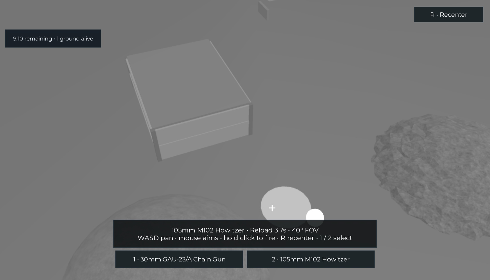

# Players vs C-130

**A Roblox game in development: one gunship against a united ground team.**

The intended game puts one C-130 operator above a circular industrial battlefield and 5–9 teammates on the ground. The ground team uses M-7 rifles and one recoverable rocket launcher to destroy the plane. Three direct rockets destroy an undamaged aircraft; rifle fire chips away at the same health pool.



*P05 combat stage: actual desktop Studio capture from an active two-client round on 2026-11-12. The 105mm weapon is reloading and its firing indicator is visible; the test-only control panel was hidden for the capture.*

## What you can play today

The local development build has a **720-stud-diameter battlefield**, eight grass/rock hills, two large buildings and one smaller building, an orbiting C-130 and a round loop. All three buildings have two usable floors connected by stairs. Their walls and roofs provide solid cover today; panel damage and falling fragments remain planned. Players can walk around a protected lobby deck. With 6–10 players, the server selects one operator and sends everyone else to sheltered ground positions. Operator turns rotate between eligible players, preferring those who have waited more rounds.

The C-130 circles the perimeter automatically. The operator looks inward through a grayscale thermal view and holds **WASD** to pan across the battlefield: **A** pans left and **D** pans right. On a touch device, use the matching on-screen arrows; a separate touch can aim at the world while an arrow is held. Mouse movement aims the reticle without panning. Releasing a direction holds the **viewing angle relative to the plane**, so the scenery changes smoothly as it circles. At the wide zoom, the level edge can enter roughly the outer quarter of the screen in each direction; curved edges can appear farther in at the corners. The tighter zoom retains the same angle and shows less beyond the edge. Press **R** or tap **Recenter** to return to the safe default view. Solid cover occludes player highlights. Press **1** or tap **30mm GAU-23/A Chain Gun** for the tighter **30°** view; press **2** or tap **105mm M102 Howitzer** for the wider **40°** view. Switching profiles preserves the pan angle. In an active round, hold **left mouse** to fire at a valid surface under the reticle, or hold **FIRE** on touch devices. Solo Operator preview does not fire. The server resolves shots from the aircraft muzzle; solid cover protects ground players.

Ground players use **WASD**, **Space** and the mouse to explore and watch the aircraft overhead. Follow the teal western route or ochre eastern route toward the gold center marker. Industrial walls, roofs and terrain provide cover, and an orange perimeter marks the edge. Explore the stairs and upper rooms in the two large buildings and the smaller outpost. Leaving the battlefield or falling below it returns an active ground player to shelter. The marker reserves the future launcher location; there is no pickup or destructible cover yet.

A round panel shows phase, role, life state, remaining time and surviving ground players. Ground players can click **Surrender / spectate** or reset their character to give up their life. Death and reset do not respawn them during that round: they watch a living ground teammate instead. Late arrivals and reconnecting players wait for the next round. Resetting the operator's protected station character retains the assignment, aircraft and deadline. Leaving the operator role restores the normal camera and removes thermal effects.

The operator wins when all ground lives are gone or the timer expires; an operator disconnect gives the remaining ground team a forfeit win. Results lead to a restored map and a fresh lobby. Production defaults are ten-minute rounds. Both gunship weapons and damage to exposed ground players are integrated on `main`. Aircraft damage and the launcher are planned, so ground cannot yet earn an aircraft-destruction win through play. There is no published Roblox play link. The [P05 plan](plans/05-gunship-combat.md) records passing two-client, native desktop and simulated-phone combat checks and remaining limitations; [P14](plans/14-aircraft-panning.md), [P13](plans/13-terrain-and-buildings.md), [P04](plans/04-aircraft-and-thermal.md), and [P03](plans/03-rounds-and-roles.md) record earlier capabilities.

The panning system keeps focus inside the battlefield and the camera at the orbiting aircraft. Typing in a text box or losing desktop window focus pauses panning; hovering actionable desktop UI blocks the keyboard pan. A fresh touch on the mobile pad resumes touch input after a window transition. The HUD is a prototype; the ground view still has a large round panel on phones. Full player guidance and presentation polish are planned for P10.

The [roadmap](roadmap.md) tracks progress; the controls and planned combat section below distinguishes current features from later work.

## Set up locally

For the complete local Studio workflow, use macOS with **Git**, **Python 3.10+**, system **curl**, and **Roblox Studio** installed. Sign in to Studio yourself and keep Play stopped while installing or connecting plugins. Setup downloads tools from GitHub and TestEZ from Wally, so network access is required. The setup/host checks also support Linux arm64/x86_64; automated Windows setup is not provided. See the [development guide](docs/development.md) for platform and tool details.

Clone the source and enter the checkout:

```sh
git clone https://github.com/hanegraaff/roblox-c130-extraction-shooter.git
cd roblox-c130-extraction-shooter
```

Select the integrated `main` branch before building this version:

```sh
git fetch origin
git switch main
git pull --ff-only origin main
```

`main` includes the verified P05 combat increment. Do not discard local edits when switching source.

If you will make changes, create a dedicated task branch from the selected source before editing; see the [branch rules](docs/development.md#branches-ci-and-review).

Install the pinned tools and dependencies, run the complete host gate, and make the tool commands available in this terminal:

```sh
python3 scripts/setup.py  # First-time setup; rerun if tool/dependency checks request it
python3 scripts/verify.py
export PATH="$HOME/.rokit/bin:$PATH"
rojo plugin install      # Install the matching Studio plugin once
```

The verifier builds `build/game.rbxlx` for local development and `build/tests.rbxlx` with automatic Studio test runners. A successful host run currently includes **50 unit and 33 integration tests**, formatting/lint/type checks, both builds, geometry checks and release isolation. It does not run Roblox Studio. The dependency and build directories are generated and stay out of Git.

## Play and develop locally with Rojo

Rojo's local server watches repository files and sends code/map changes to the Studio plugin. Keep the server terminal running while you work; **Ctrl+C** stops it. Reuse a matching server if it is already running.

For the development place, run:

```sh
rojo serve default.project.json --address 127.0.0.1 --port 34873
```

1. In Studio, use **File → Open from File** to open `build/game.rbxlx` as a local development document. Reuse it if it is already open.
2. Keep **Play stopped**. Open **Plugins → Rojo** and connect to `localhost:34873`. Confirm the project is **PlayersVsC130** before applying the mapping. If the newly installed toolbar button is absent in Edit mode, save work and restart Studio once. If only the panel is hidden, reopen it with the Rojo toolbar button; Play is not needed.
3. Click **Play**. The status panel reads **Development** / **Bootstrap running**, and the round panel shows a lobby waiting for six players. Your lobby character is protected and can move with WASD. A solo client cannot start a production round.
4. For solo exploration or a small local round, use the separate test mapping below. A single client automatically previews the battlefield. Two clients start real role/round testing; use three for teammate spectating while another ground player remains alive.
5. Click **Stop** before editing repository files. Let Rojo sync changes into this same document, inspect the expected change, and start a fresh Play session. Reopening a new build after every edit is unnecessary.

If Rojo reports **Http requests can only be executed by game server**, stop Play and reconnect in Edit mode. Keep a separate test document for the test mapping below. The [development guide](docs/development.md#sync-this-repository-with-studio) covers the guarded macOS launcher, MCP connection and further troubleshooting.

## Run local automated tests

Run the full host gate after code/configuration changes:

```sh
python3 scripts/verify.py
```

For real-engine tests, start the test sync server in another terminal with Rokit's tools on PATH:

```sh
export PATH="$HOME/.rokit/bin:$PATH"
rojo serve test.project.json --address 127.0.0.1 --port 34872
```

1. Open `build/tests.rbxlx` as a **separate local test document**. Keep Play stopped while connecting **Plugins → Rojo** to `localhost:34872`; confirm **PlayersVsC130Tests**. Never apply this mapping to a cloud/release place.
2. Click **Play**. The panel should read **Test**. The mapped TestEZ runners execute automatically; do not start a second manual run.
3. Open Studio's **Output** panel. The current source expects **104 server tests and 3 client tests**, with zero failures, skipped cases or errors. These cover rules, selection rejection, service lifecycle, status/character behavior, actual GUI-hover/text-focus blocking, building/story/panel geometry, terrain reconstruction, supported routes, canonical aircraft poses, solid sight lines, boundary correction and pristine resets. After those suites pass, the test runner starts the round runtime. With one client, it automatically moves you to the battlefield for solo exploration. The HUD reads **Studio preview • Ground**. This bypasses the lobby location for testing; no opponent, active life or competitive round is created.
4. Click **Stop**, then **Play** again. Check fresh passing reports and one status panel plus one round panel. Stop before changing the mapping or source.
5. Use the **STUDIO TESTING** panel at the bottom right. Click **Role** to cycle Auto → Ground → Operator. With one client, the choice changes your solo preview immediately: Ground can walk, while Operator previews the inward thermal view. Hold **WASD** to pan and move the mouse to aim, or use the touch directional pad and a separate aiming touch. Use **R / Recenter** to reset the safe view, and **1 / 2** or the named buttons to inspect both zoom profiles. Solo selection is cosmetic and does not grant an active role. Click **Next round** to cycle 30, 60, 180 or 600 seconds.
6. For a real role/round test, use Studio **Server & Clients** with **2 clients** (or **3** for teammate spectating). Choose your roles, then click **Start round now** to bypass the lobby wait. Two Operator choices, or everyone choosing Ground, produces an explanation rather than silently changing a tester's choice. **Auto** fills the required operator when nobody explicitly requests it.
7. **Reset test / apply settings** ends the local test and restores preview/lobby. Role and duration choices apply to the next explicit **Start round now**; they do not change an active role or deadline. Use **End Session** to close multiplayer test clients when finished.

For **solo exploration**, just click **Play** in the test document; no **Server & Clients** windows are needed. If the panel says **Development**, stop Play and connect this document to the test server on `localhost:34872`, confirming **PlayersVsC130Tests**.

Use **Return to lobby** to inspect the walkable lobby, or **Explore map (solo)** to return to preview. No Command Bar commands are required. Solo previews are clearly labelled and do not grant an active round life, opponent or weapons. The panel and all override/settings code are excluded from the release mapping; production still requires 6–10 players and uses its normal role selection. See [test-control evidence](docs/evidence/lobby-preview.md) for verified cases.

The [P14 pan harness](docs/testing.md#run-the-p14-panned-targeting-harness) requires two actual clients, a full orbit at each FOV, real terrain/upper-floor surface projections, selection coherence, role isolation and cleanup. Its automated pointer-input fixtures are separate from native mouse/keyboard/button review and 1280×720 / 1920×1080 rendered checks. The [P13 map harness](docs/testing.md#run-the-p13-expanded-map-harness) starts two actual clients, walks a ground avatar into all three upper floors, perturbs and resets the map twice, then requests a third actual late client to check rebuilt-map replication. The [P04 multiplayer harness](docs/testing.md#run-the-p04-aircraft-harness) uses two actual clients to sample a full 90-second orbit, check both zoom profiles and rejected selections, test thermal fixtures, reset/reentry and operator departure. The [P03 multiplayer harness](docs/testing.md#run-the-p03-multiplayer-harness) separately starts three clients, adds a late spectator and drives three accelerated rounds. The [P05 combat harness](docs/testing.md#run-the-p05-gunship-combat-harness) adds two-client firing, cover, rejection, result and reset checks. A single-client TestEZ pass does not establish replicated combat or release capacity.

After source changes, stop Play, rerun the host gate, confirm Rojo is connected to **PlayersVsC130Tests** on `localhost:34872`, verify it delivered the candidate and start a fresh session. If the sync server was restarted, reconnect the existing document's Rojo plugin in Edit before testing.

For fresh serialized-world acceptance through Studio MCP, build the probe from the selected checkout:

```sh
python3 scripts/build_studio_world_probe.py
```

Run the generated `build/studio-world-probe.luau` through MCP in the existing **Edit** document. It loads a newly built native world artifact, verifies source geometry and terrain restoration, then removes its fixture and restores prior terrain. This world-load check needs no new Studio process; normal Play server/client tests remain separate. See the [fresh-world procedure](docs/testing.md#check-a-fresh-native-world-load) for generated files, report checks and source identity.

For a documentation-only change, `python3 scripts/check_repository.py` checks local links, JSON, mappings and assets. See the [testing guide](docs/testing.md#run-the-studio-smoke-suites) for structured server/client reports and required evidence.

## Controls and planned combat

| Action available now | Ground player | C-130 operator |
| --- | --- | --- |
| Move / aim | WASD and mouse; Space to jump | WASD pans on desktop (A left, D right); touch arrows pan in their shown directions; mouse or a separate touch aims the reticle |
| Recenter view | — | R / Recenter button |
| Select weapon and zoom | — | 1 / named 30mm button; 2 / named 105mm button |
| Fire | Not yet available | Hold left mouse or the touch **FIRE** button at a valid aim point |
| Surrender / spectate | On-screen button during an active ground life | — |

The planned combat loop gives every ground player an **M-7 rifle** and puts one **rocket launcher** at the gold marker. Use cover and coordinated fire to wear down the aircraft. Three direct rockets destroy a full-health plane; prior rifle damage can reduce the rockets still needed. Aircraft destruction will win for the whole ground team, including eliminated teammates. The launcher will be droppable and recoverable after its carrier dies or disconnects, with one rocket replenished per reload and no separate ammo pickups. These handling choices are [tuning defaults](docs/decisions.md).

The operator's **30mm GAU-23/A Chain Gun** fires faster with a tighter view; the **105mm M102 Howitzer** fires a heavier, slower shot with a wider blast and view. The prototype defaults are 100 rounds per 30mm magazine, 0.15-second minimum cadence and five-second automatic reload; the 105mm holds one round and reloads automatically after four seconds. Switching retains each weapon's own ammunition and timing. Projectile and impact markers warn of incoming fire. Damage uses server-side swept sphere collision, then checks whether cover blocks the path from impact to each ground player's damage anchor. The values and visual presentation are tuning defaults, not final balance.

Building wall and roof panels will visibly progress: three direct heavy-cannon hits produce a roughly half-destroyed panel, and three more remove it; sustained on-panel 30mm fire takes nine seconds to damage it. Real bounded fragments will fall and collide with scenery while remaining floors/stairs/frames stay stable. These mechanics will work with simple graphics; refined assets are later work. See the [construction](plans/13-terrain-and-buildings.md), [panning](plans/14-aircraft-panning.md) and [destruction](plans/07-destruction.md) plans.

The heavy weapon remains the 105mm M102, as confirmed for the planned panel-damage rules.

Planned ground combat bindings are left mouse to fire, right mouse to aim, **1 / 2** for M-7/held launcher, **R** to reload, **E** to acquire the launcher and **G** to drop it. Ground firing, pickup/drop, cover destruction and Help controls are not implemented yet. There is no independent operator zoom or free flight.

The intended complete round is gather → deploy → fight → team result → reset. The current prototype already handles roles, the orbit/view, no respawns, teammate spectating, late-arrival waiting, timeout/elimination/forfeit results and replay. Later combat work will add aircraft destruction as a playable ground victory path. The default round lasts ten minutes.

Operator desktop keyboard/mouse and touch controls are present; operated desktop firing and simulated-phone simultaneous aiming, panning and firing have been checked. Gamepad and full ground mobile combat controls are future work. The two weapons have distinct size and cadence, though rapid 30mm effect phases are hard to distinguish. Damage, cadence, reload, zoom and orbit speed need later balance testing; the three-rocket full-health rule is fixed. The MVP has one map and planned physical cover destruction. [Future levels](plans/15-interchangeable-levels.md) will keep a circling C-130 and the same pan, zoom, combat and demolition systems while changing level geometry. Progression, purchases, vehicles and full building collapse are outside MVP scope.

## Follow development or contribute

- [Game design](game-design.md): intended rules and edge cases.
- [Roadmap](roadmap.md): capabilities and current status.
- [Requirements](requirements.md): acceptance obligations.
- [Development guide](docs/development.md): installation, builds, Studio and source synchronization.
- [Architecture](architecture.md): implemented boundaries and future systems.
- [Testing guide](docs/testing.md): automated gates and real-engine verification.

Source is maintained in [hanegraaff/roblox-c130-extraction-shooter](https://github.com/hanegraaff/roblox-c130-extraction-shooter). The repository retains its original name.
