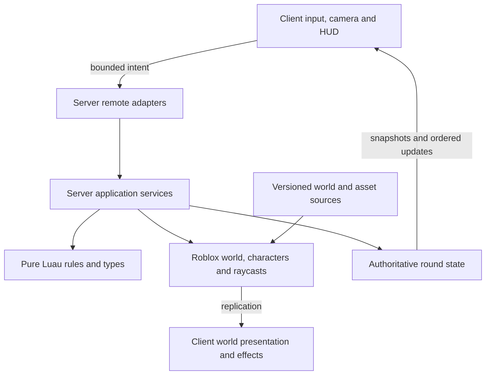

# Architecture

## Current state and target

The expanded-map candidate contains the foundation, 720-stud circular battlefield with bounded terrain and three two-story buildings, authoritative rounds and P04 perimeter aircraft with inward thermal view and weapon-linked zoom. Server-only rules assign roles, retain UserId membership, evaluate deadlines/results and reset the round; engine adapters own characters, teams, map rebuilds and replicated presentation attributes. The client displays round state, sends surrender intent and follows living teammates after elimination. [P03](plans/03-rounds-and-roles.md) records the candidate's verification evidence and limits; [P02](plans/02-warzone-map.md) records prior map acceptance. [P04](plans/04-aircraft-and-thermal.md) records aircraft/view acceptance. P13 owns the construction/validation record for the expanded map. Panned targeting (P14), combat, panel/fragment physics, aircraft health/damage and launcher systems below remain target architecture introduced incrementally by the [roadmap](roadmap.md).

Use a single Roblox place for lobby and battlefield, Luau for game code, and Git-first editing with Rojo for supported source/world synchronization. Roblox hosts the running experience; GitHub stores reconstructable source. No external application backend, persistent player inventory, or cross-server matchmaking is needed for the MVP.

## Studio MCP and repository synchronization

Roblox Studio's built-in MCP server is the primary interactive interface for inspecting the open place, making appropriate Studio-native changes, running supported playtests and obtaining real-engine evidence. Each call targets a specific Studio instance; identify the intended place before modifying it, especially when a development and test place are both open. Discover the available tools and Studio's version-specific `skill` guidance after connection; do not assume every playtest operation is exposed in every version.

MCP and Rojo have different responsibilities. Rojo maps repository-owned Luau and world definitions into Studio. MCP operates the live session but does not itself establish Git synchronization. Make script changes in the repository for managed paths, then sync and inspect in Studio; export deliberate Studio-authored models/world assets into the repository and manifest before considering an increment done. Do not let two agents mutate one live place simultaneously, and do not sync a test mapping into the release place. See [development setup](docs/development.md#connect-roblox-studio-mcp).

## Implemented foundation

`ServerScriptService.Server` starts `Bootstrap`, which validates public defaults and owns one `ReplicatedStorage.BootstrapStatus` Folder plus a Heartbeat connection. The release mapping then starts `GameRuntime` with production defaults: 6–10 players and 600-second rounds. Server-only `DevelopmentSettings` exists only in the test mapping, selects the **Test** label and defers gameplay startup to the test runner. That runner completes foundational TestEZ suites before starting the two-player-minimum test runtime, so map tests and round rebuilds do not race. The release label remains **Development**; no cloud publication is implied.

The client entrypoint waits for PlayerGui and server status, then starts `StatusPanel`. It also attaches one `RoundPanel` to `ReplicatedStorage.RoundState` and replaces it when the server owner changes. The controllers own their GUIs and listeners; stopping disconnects them and restores the local camera. `Lifecycle` composes nonyielding components with idempotent start/stop and rollback on partial start failure. Component cleanup callbacks must not throw or reenter the controller.

`Validation` accepts finite numbers and bounded flat scalar payloads. `Config` decodes validated public defaults, and `RateLimit` consumes a deterministic token bucket using caller-supplied monotonic seconds. `MatchService.command` adds active-ground role/life, round and sequence validation for surrender; `MatchRuntime` rate-limits its RemoteEvent. Future weapon adapters add equipment and world checks. Shared modules contain no secret authority state.

Pure modules with dependencies choose an explicit Instance require when `script` exists and a relative filesystem require under Lune. Standalone specs receive the actual rule module as a parameter; TestEZ wrappers pass actual mapped ModuleScripts to the same cases. This keeps one implementation usable in both runtimes without a virtual filesystem. See the [shared package](src/shared/README.md) for contracts.

## Implemented map and terrain ownership

`Workspace.World.Battlefield` comes entirely from the versioned [world definition](assets/world/Battlefield.model.json). `MapRules` validates finite coordinates, radius greater than eight studs, altitude greater than sixteen studs, kill threshold below ground, matching map/orbit centers and radii, and ground-level center focus. Defaults are center `(0,0,0)`, radius 360 studs, altitude 140 studs and recovery Y=−30. `orbit(settings, phaseRadians)` supplies the common perimeter geometry; `AircraftService` owns the actual moving model.

Server-only `MapService` validates geometry, supported/clear anchors and lobby separation with actual Workspace queries, then retains an unparented pristine clone. Its injected character provider and Heartbeat keep orchestration explicit. `GameRuntime` supplies only active living ground characters and disables the optional station exception. Exterior or below-threshold ground characters return to `Ground05` with velocities cleared. The protected lobby lies outside the disk at X=520; Waiting bodies can walk and only the assigned operator placeholder is anchored. Containment is not a general movement-exploit detector.

Pure `BuildingLayout` validates exactly two 64×48 and one 32×48-stud two-story footprints, stairs and complete wall/roof/interior panel registries. Server-only `BuildingGeometry` checks actual floor separation, tread geometry, headroom, swept entry corridors, five navigation markers and representative 32-stud room bays. It decorates building IDs, building-scoped story IDs (`01`/`02`), globally unique panel IDs, the Intact pivot and `Intact/Damaged/Destroyed:v1` variant contract. All 111 panels remain solid today; P07 owns damage, residual geometry and fragments. Floors, stairs and frames stay static.

Server-only `TerrainRecipe` reads the authored invisible descriptors for eight Grass/Rock caps. Manifest version 1 / seed 0 uses no randomness and four-stud voxels. Reconstruction clears only the axis-aligned owned volume `(-368,-112,-368)`–`(368,32,368)` and writes the fixed spheres. Invalid bounds, spheres or materials reject before terrain writes; unrelated terrain outside the box remains untouched. Terrain writes are nonyielding, while engine collision/query updates may converge afterward. The test suite permits a bounded five-second readiness wait.

`start()` validates, reconstructs terrain, decorates identities and connects containment. `stop()` disconnects Heartbeat while retaining the map and snapshot for restart. `rebuild()` restores the terrain recipe, replaces Battlefield from the pristine clone, decorates and validates; `MatchRuntime` invokes it during Resetting. `destroy()` idempotently stops containment, restores pristine geometry/terrain and releases the private snapshot; a destroyed owner cannot restart. Consumers must reacquire Instances after replacement. See the [server package](src/server/README.md), [world contract](assets/world/README.md) and [P13 record](plans/13-terrain-and-buildings.md).

## Implemented round ownership

`RoleService` selects one operator from unique eligible UserIds, excluding the previous operator when alternatives exist. It prefers the largest completed-round wait counter and breaks sorted ties deterministically from a seed. `RoundRules` owns legal phase edges and result ordering. `MatchService` composes them with injected monotonic time and life-cleanup callbacks; it has no Instances or network access. Snapshots copy members and results so callers cannot mutate authority.

The phase loop is Lobby → Deploying → Active → Results → Resetting → Lobby. Deployment waits for all assigned character loads, cancels to Lobby when an assigned player leaves, and aborts on dead/incomplete characters or timeout. Active membership remains keyed by UserId: departure removes the life, rejoin cannot restore it, and late joins are spectators. Deadline equality wins before destruction proposals; before expiry, aircraft destruction wins a mutual elimination. P03 provides the server-only destruction proposal seam; later combat supplies real damage.

`MatchRuntime` owns teams, noncolliding character groups, one heartbeat and the `RoundState.Surrender` RemoteEvent. `CharacterOwner` serializes yielding avatar loads, invalidates queued requests with tokens and uses a per-player load lease to keep an older runtime from destroying a newer character. Ground death/reset/surrender eliminates; operator reset replaces only the protected placeholder body. `GameRuntime` composes the map, round and aircraft owners explicitly; stop tears down aircraft, rounds and the map snapshot in that order. See package contracts for cleanup and load-drain behavior.

`RoundPanel` reads replicated phase/role/life/deadline/result attributes and computes its timer using `GetServerTimeNow`. Eliminated players and late spectators follow the lowest-UserId living ground teammate, falling back to a fixed overview when no target exists. Lobby restores the local character camera. There is no manual spectator target selector yet. `RoundPanel` delegates the living operator and labelled solo Operator preview to its owned `ThermalCameraController`; other roles retain normal round/spectator cameras.

## Target layers and dependencies



Rules do not depend on Roblox services, client presentation, network transport, or global clocks. Server services compose rules and adapters; clients present authoritative facts and may predict cosmetic feedback. Bootstrap scripts wire dependencies explicitly. Prefer constructor arguments or simple module parameters to a dependency-injection framework.

### Repository layout

```text
AGENTS.md                 Persistent project instructions
README.md                 Player-facing overview and actual availability
game-design.md            Rules, experience and scope
requirements.md           Requirement IDs and test obligations
architecture.md           Boundaries and technical decisions
roadmap.md                 Ordered status and milestone index
plans/*.md                One executable capability plan per file
docs/                     Setup, testing, decisions, conventions, evidence
.agents/skills/            Repository-local feature-loop skill
.codex/agents/             Developer, tester and writer instructions
.github/workflows/        Full non-Studio verification CI
src/shared/               Replicated types, public config and pure common rules
src/server/               Authoritative services, server-only rules and adapters
src/client/               Input, cameras, UI, audio and effects
assets/world/             Reconstructable static world definitions/exports
assets/models/            Templates for aircraft, cover and the single rocket launcher
assets/manifest.json      Provenance and cloud asset references
tests/unit/               Pure rules and boundary cases
tests/integration/        Service workflows with controlled adapters
tests/studio/             Real-engine server/client/replication suites
tests/fixtures/           Seeds, small test maps and doubles
scripts/                  Verification and build entrypoints
default.project.json      Release DataModel mapping; excludes tests
test.project.json         Test DataModel mapping; never published
rokit.toml                Pinned development tools
build/                    Generated artifacts; ignored by Git
```

### Roblox ownership

| Filesystem area | DataModel location | Ownership |
| --- | --- | --- |
| `src/shared` | `ReplicatedStorage.Shared` | Public types, presentation config, shared pure rules; no secrets |
| `src/server` | `ServerScriptService.Server` | Authoritative services and server-only rules |
| `src/client` | `StarterPlayer.StarterPlayerScripts.Client` | Per-player local controllers |
| `assets/models` | `ServerStorage.Assets` | Templates cloned by server; only needed instances replicate |
| `assets/world` | `Workspace.World` | Static map objects authored/exported under source control |
| `tests/unit`, `tests/integration`, `tests/studio/specs-server`, `tests/fixtures` | `ServerStorage.Tests` in test project only | Shared cases, server specs and fixtures |
| `tests/studio/server` | `ServerScriptService.ServerTests` in test project only | Automatic server TestEZ runner |
| `tests/studio/client` | `StarterPlayerScripts.ClientTests` in test project only | Automatic client TestEZ runner |
| `tests/studio/specs-client`, `Packages` | `ReplicatedStorage.ClientSpecs`, `ReplicatedStorage.TestPackages` in test project only | Client specs and locked TestEZ dependency |
| `tests/fixtures/DevelopmentSettings.luau` | `ServerStorage.DevelopmentSettings` in test project only | Server-only test label and deferred gameplay startup marker |

The release project excludes tests, test dependencies, fixtures and development overrides by construction, with generated-artifact inspection enforcing the boundary. Bootstrap must not run server-only modules on clients.

## Components to introduce as needed

| Component | Responsibility | First plan |
| --- | --- | --- |
| `Bootstrap`, shared validation and lifecycle | Implemented shell wiring, cleanup, structural decoding/rate helpers | P01 |
| Named remote adapters | Implemented surrender and aircraft-selection shape/role/life/round/replay/rate checks; firing/equipment validation added with combat | P03 onward |
| `MapService` | Implemented geometry/anchor/lobby validation, containment, bounded terrain reconstruction, multi-story buildings and pristine panel registry rebuild | P02; expanded P13 |
| `MatchService`, `RoleService`, `RoundRules` | Implemented roster, phase/deadline, round identity, assignment and outcome policy | P03 |
| `GameRuntime`, `MatchRuntime`, `CharacterOwner` | Implemented map/round composition, character ownership, replication and cleanup | P03 |
| `RoundPanel` | Implemented basic round HUD, surrender intent and teammate spectating | P03; presentation improved in P10 |
| `AircraftService`, `AircraftSelection`, `AircraftRules` | Implemented canonical perimeter orbit, validated aim geometry and authoritative targeting-profile selection; health/destruction remain planned | P04; health in P06 |
| `ThermalCameraController` | Implemented fixed-focus inward camera/zoom/occlusion; P14 adds bounded mouse pan, recenter and geometry-aware reticle projection | P04; panning P14 |
| `CombatService` with weapon rules | Validate intent, ammo/cooldown, flight/impact, damage resolution | P05–P06 |
| `DestructionService` | Per-panel heavy/sustained-fire progress, monotonic states, authoritative residual colliders and bounded server-owned fragment physics | P07 |
| `LauncherService` | One launcher identity, atomic ownership, drop/recovery and reload continuity | P08 |
| `MatchService` outcome integration | Aircraft destruction, ground elimination, timeout and forfeit resolution | P09 (basic outcomes P03/P06) |
| `GroundController`, `HUDController`, `SpectatorController` | Role-specific controls and complete player feedback | Introduced with features; completed P10 |

Use one combat orchestration boundary with weapon-specific modules rather than three independent damage systems. `MatchService` alone commits outcomes. Other services propose changes through explicit calls/events; they never independently set the winner. Keep reset and cleanup centralized while each component owns its resources.

## Authoritative state and timing

Use typed data records for round ID, phase, phase revision, roster by UserId, role/life state, deadline, aircraft health/state, per-weapon readiness, selected weapon, launcher ownership/location/reload state, and result. Instance Attributes can expose view state but are not the internal transaction mechanism.

Inject a monotonic clock and seeded random source into rules/services. Client HUDs derive countdowns from a replicated server deadline and synchronize with the platform's server clock. Never accept client timestamps to award hits, pickups or results. Deterministic tests advance a fake clock without real sleeps.

Each active-round command carries the current round ID and a per-player monotonic sequence. Reject commands from old rounds and repeated sequences. A result is committed once; subsequent commands observe a terminal phase. Follow the conflict order in [game-design.md](game-design.md). Teardown invalidates queued work with a generation/round token so an old projectile cannot damage the next round.

## Network contracts

Use a small named RemoteEvent surface, not an unrestricted generic RPC dispatcher. Prefer asynchronous requests and snapshots; avoid yielding RemoteFunction round trips for combat. Define Luau request types **and** runtime validation: types alone do not validate untrusted packets.

| Direction / intent | Minimal payload | Server derivation and validation |
| --- | --- | --- |
| Client → surrender (implemented) | round ID, sequence, `action = "Surrender"` | Exact three-field shape, active connected ground life, current round, increasing bounded integral sequence, deadline and per-player rate budget |
| Client → fire | round ID, sequence, weapon ID, bounded aim direction/point | Role/life, equipment, ammo, cooldown, finite values, origin, range, aim envelope, obstruction |
| Client → aircraft select (implemented) | exactly `roundId`, `sequence`, `weapon` (`GAU23`/`M102`) | Living connected operator, Active/unexpired round, increasing bounded integral sequence; six-token budget refilling at four/second; atomic acknowledged weapon/round/revision |
| Client → reload (planned) | round ID, sequence, owned/role-authorized weapon ID | Role, ammo/reload phase and independent cooldowns |
| Client → pickup/drop launcher | round ID, sequence, launcher ID | Existence, reach, life, current ownership, valid ground position, active phase |
| Client → sync request | bounded request token | Per-player rate budget; return only that role's permitted snapshot |
| Server → snapshot/update | round ID, revision, permitted state | Immutable view model; client discards stale rounds/revisions |
| Server → effects | round ID, shot/event ID, bounded effect data | Cosmetic only; client deduplicates and caps lifetime/count |

Aircraft destruction is computed from server-resolved damage, never a client win claim or rocket-hit count. Validate server-observed movement for implausible travel before granting launcher pickup or accepting a ground firing origin; reject or correct suspicious movement without automatically banning from a single noisy observation. Roblox character network ownership does not make client movement authoritative for rewards.

Apply cheap shape/size checks and per-player/per-action budgets before expensive raycasts. Bound strings, tables, vectors, shot counts and queued work. Tests cover NaN, infinity, malformed nested payloads, unknown IDs, replay, stale round IDs, floods, spectators and eliminated players. Rejected requests must leave state unchanged.

## Implemented aircraft and targeting view

`GameRuntime` starts one `AircraftService` from the Git-authored `ServerStorage.Assets.C130` template. Its `Hitbox` is the model PrimaryPart/pivot and sole queryable gameplay volume; `GAU23Muzzle` and `M102Muzzle` are named attachments reserved for later server firing origins. All parts are anchored, noncolliding and nontouching. Decorative parts are nonqueryable. The service rejects an existing owner or missing canonical template, and idempotent stop destroys the model, selection transport and three owned connections.

`AircraftRules.pose(map, settings, elapsedSeconds)` uses injected time to compute perimeter position and tangent, rejecting invalid settings/time or derived overflow. Production uses synchronized server seconds: radius 360 studs, altitude 140 studs and period 90 seconds, increasing phase from positive X toward positive Z. Orbit starts at phase zero, resets at deployment and return to Lobby, and freezes in Results/Resetting. Ordinary server replication carries this one canonical pose; there is no local smoothing shell. The two-client harness declares an eight-stud convergence bound, while sampled injected-time engine poses use 0.01-stud precision. These tolerances and observed results are recorded separately in P04.

Server-only `AircraftSelection` owns selected weapon, revision and accepted per-user sequences. `AircraftState.Selection` publishes them as one JSON string so round/weapon/revision are acknowledged together. The client sends bounded selection intent and changes weapon label, FOV and reticle projection only from a valid acknowledgement for its current round. Unknown, malformed, stale, replayed, wrong-role or terminal requests leave selection unchanged. Returning to Lobby forces the initial GAU23 profile even when the round ID has not changed. No ammunition, reload or cooldown state exists in P04; later combat must preserve its independent per-weapon readiness across this selection seam.

`ThermalCameraController` places a Scriptable camera at the replicated canonical aircraft position and faces ground-level map center independently of model heading. Keys 1/2 or named buttons choose the 35° GAU23 or wider 60° M102 profile. Mouse coordinates move a reticle inside the central 70% of the viewport without turning the view. Ground-plane projection is recomputed with the active FOV. The reticle marks geometry outside the allowed disk/height envelope as invalid; the server-only `AircraftService.aimAllowed(endpoint)` also tests actual solid Battlefield and Terrain obstruction. That seam does not fire or apply damage.

Local color correction supplies grayscale/high contrast and `Highlight.DepthMode = Occluded` lets solid cover hide player highlights. Active living ground characters and explicitly tagged thermal fixtures are presented; clients gain no damage or visibility authority. Role loss or owner removal destroys thermal GUI/effects/highlights and role input listeners, restoring captured camera/FOV/mouse settings. `RoundPanel` resumes ground, teammate spectator or lobby view. A labelled test-only solo Operator preview permits cosmetic profile choices while its player remains Waiting in Lobby.

For the bounded MVP map, `Workspace.StreamingEnabled` is explicitly false (D11). This avoids a remote camera looking at absent scenery. If profiling forces streaming, treat that as a deliberate architecture revision: persistent aircraft, controlled replication focus, target-area acquisition/loading states, re-stream-safe effects and 10-player visibility tests. Projectile swept collision, damage, health, panel openings and physical fragments remain later combat/destruction work.

## Panned targeting target (P14)

The implemented map/terrain ownership above replaces the smaller prototype geometry. P13 reserves Intact pivots and variant metadata; P07 will supply damaged residual geometry and physical fragments. Whole-map cloning alone does not restore Terrain voxels, so the bounded recipe remains part of each reset.

P14 keeps the camera position at the canonical aircraft but derives orientation from a bounded, mouse-panned battlefield focus, initialized/recentered to map center. Inject delta time and pointer input into pure pan rules. Preserve world-space focus across orbit motion and acknowledged zoom changes; clamp every update and revalidate on role/round/map changes. Height-aware projection must hit actual terrain/building surfaces instead of assuming every target is Y = 0. The server retains its own disk/height/range and muzzle-obstruction checks; local pan is presentation, not authority or a high-rate pan remote. Restore input/camera settings and clear pan state at teardown. P14 supersedes the remaining fixed-focus/flat-ground projection assumptions; the implemented view above still uses map-center focus today.

## Weapon, launcher and result invariants

Use explicit weapon configurations for `GAU23`, `M102`, `M7` and `RocketLauncher`, with the exact player-facing names from the design. Aircraft weapons are role equipment; every ground player spawns with the M-7, while only the launcher carrier can fire rockets. Keep readiness by weapon ID; selection cannot reset cooldown, reload progress or ammunition. Store launcher reload state on the round-owned launcher identity, not the current holder.

Derive integer aircraft maximum health as three times direct rocket damage. Apply each direct rocket impact once, with no duplicate splash to the same aircraft; first/second hits alone leave a pristine plane alive and the third destroys it. M-7 damage is small and positive, reducing the same health pool. No regeneration, falloff or armor modifier can break the three-hit contract. AircraftService proposes destruction to MatchService; MatchService alone commits the immediate team result and cancels pending combat.

LauncherService transitions one identity between Available, Held and Recovering; it never creates one copy per player. A short atomic non-yielding claim prevents raced pickups. Death/disconnect/drop preserves reload timing and makes it recoverable; invalid positions return it to the authored anchor. Replenishing one-round reload is the current supply default. Reset disposes the old identity and creates exactly one new launcher.

P03/P06 establish basic win proposals; P09 validates their combined timing/disconnect behavior. Follow game-design.md for deadline precedence, same-step mutual kills, forfeits and late projectiles. There is no collectible-progress or escape-zone service.

## Assets, destruction and reconstruction

Prefer text `.rbxmx` model exports and `.model.json` definitions for reviewable assets; retain source meshes/textures or their reproducible provenance when practical. Large binary exports require a documented storage/LFS decision. `assets/manifest.json` records stable internal IDs, source/author/license, local file, Roblox asset ID if any, and upload owner when known.

Each authored Part/SpawnLocation in `.model.json` uses a twelve-component canonical `CFrame` (translation followed by row-major rotation). `Position`/`Orientation` aliases are forbidden because their presence in generated XML does not ensure Studio loads the intended pose. Artifact inspection compares every authored part's finite pose, positive dimensions, shape and collision/query/touch flags in both builds, with five deliberate corruption probes. Studio loaded-transform assertions and world queries remain required: reproducible serialization alone does not prove engine reconstruction.

Static map files and server-cloned templates have separate ownership. Do not synchronize a live simulation back as authored source. Studio edits to managed objects must be exported to the mapped source and verified with a clean build. Avoid mixed ownership of the same Instance subtree.

DestructionService owns a server-only record keyed by stable panel ID and round generation: Intact/Damaged/Destroyed stage, persistent heavy-hit credit, uncommitted sustained-30mm credit, last valid on-panel impact time and applied shot IDs. Do not derive structural damage from player-health damage or accept client panel/hit-duration claims. CombatService supplies deduplicated server-resolved direct impacts using the configured weapon cadence. Use a normalized stage budget of three heavy hits or nine seconds of valid 30mm fire; D33 defines proposed mixing/interruption behavior. P05 must expose enough shot identity/time/profile/impact data to integrate P07 without reimplementing projectile authority.

At each stage boundary, atomically swap prefabricated residual geometry at the same pivot/ID; Damaged opens roughly half the original face and Destroyed removes all panel colliders. Replicate authoritative stage/progress for simple visible hit cues and late-join reconstruction. Resolve the whole damage batch against pre-impact geometry before any swaps, so a new opening cannot amplify its creating blast. Remaining solids block weapon/thermal queries; holes do not. Static frames/floors/stairs preserve upper-floor access without structural simulation.

Separate authoritative residual geometry from bounded unanchored physics fragments. Server ownership and collision groups let fragments fall and contact static scenery, while excluding characters, other debris and combat/thermal queries. Enforce bounded impulses, live-fragment cap and lifetime; cap overflow can omit older debris without changing panel state. Physical trajectories are presentation; only server panel geometry determines cover, damage and movement. Validate actual falling/contact and ownership in Studio, not with a particle screenshot. Teardown cancels work, clears fragments, disconnects listeners and rebuilds terrain/structures/panel progress exactly. Late joiners reconstruct current panel state rather than replaying old fragment bursts.

## Tooling and verification

Run `python3 scripts/setup.py` for the pinned tools, locked TestEZ and hash-checked Roblox engine definitions, then `python3 scripts/verify.py` for the complete non-Studio gate. It runs repository checks, StyLua, Selene, strict Roblox-aware analysis, deterministic Lune unit/service suites, deliberate failure/empty/type probes, both Rojo builds, canonical authored-geometry/corruption checks and XML release-isolation inspection. Missing tools, failed or empty suites fail the gate.

The test mapping runs separate server and client TestEZ bootstraps in real Studio Play contexts and publishes structured JSON reports. Those runs establish mapped imports and engine behavior separately from the host gate. Ordinary Linux CI runs the host gate and cannot replace required Studio evidence.

See [testing](docs/testing.md) for acceptance levels and [development](docs/development.md) for source/release workflow. A tool change needs updated pins, commands and successful clean-build evidence.

## Platform references

- [Rojo project format](https://rojo.space/docs/v7/project-format/) defines DataModel mappings and ignores.
- [Roblox client/server security](https://create.roblox.com/docs/scripting/security/client-server-boundary) informs validation at every remote boundary.
- [Roblox streaming](https://create.roblox.com/docs/workspace/streaming) describes the camera/world availability tradeoff.
- [Studio testing modes](https://create.roblox.com/docs/studio/testing-modes) separates client, server and multiplayer validation.
- [TestEZ bootstrap](https://roblox.github.io/testez/getting-started/running-tests/) is the engine-suite entrypoint.
- [Lune](https://lune-org.github.io/docs/getting-started/1-installation/) provides standalone Luau execution, not a complete live Roblox server.

## Local solo preview

The test-only runner installs `LocalTestControls` in ordinary Studio sessions. A single client's ready Waiting character is moved to Ground05 (Ground preview) or the Operator station and marked `LocalMapPreview`/`LocalPreviewRole` for a clear client label; phase, role, life and competitive population rules remain unchanged. Server-only BindableFunctions allow returning to the lobby or re-entering preview. Owned heartbeat containment recovers invalid preview positions, invalidates preview on phase change/departure, and disconnects on teardown. All shortcut code lives under the excluded test mapping; production owns no test shortcut transport.

`HumanTestSession` owns the test-only settings transport and manual runtime restarts. A fresh runtime/normal RoleService seed enforces requested roles without a production override hook or fake player. Requests validate shape, action/value, rate, sequence and session generation. The actual map reset path and avatar-drain ownership precede a replacement runtime. The client-only test panel sends intent and presents server feedback. All control logic is under the excluded test mapping; the production client merely understands the clearly labelled preview presentation.
