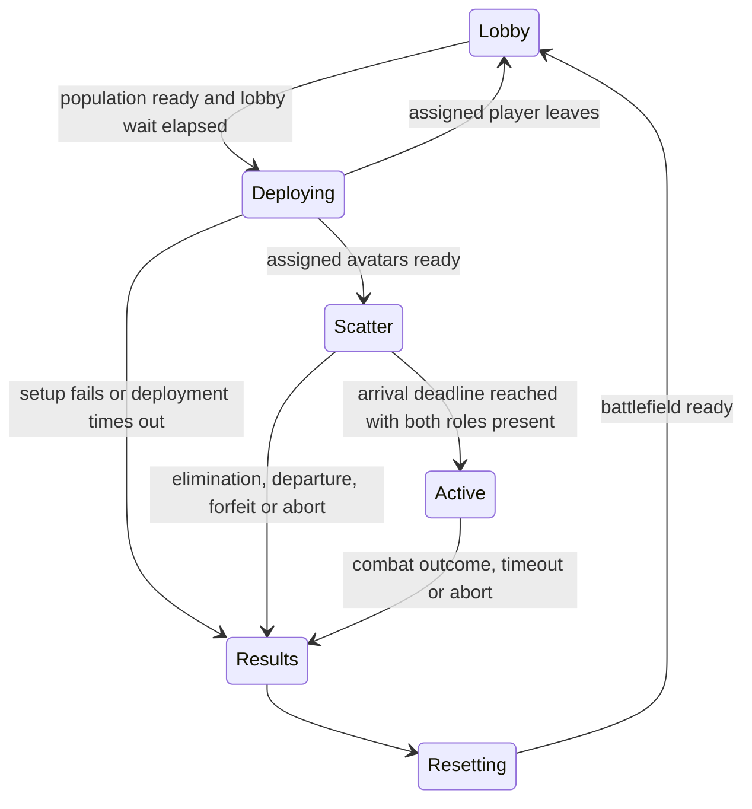
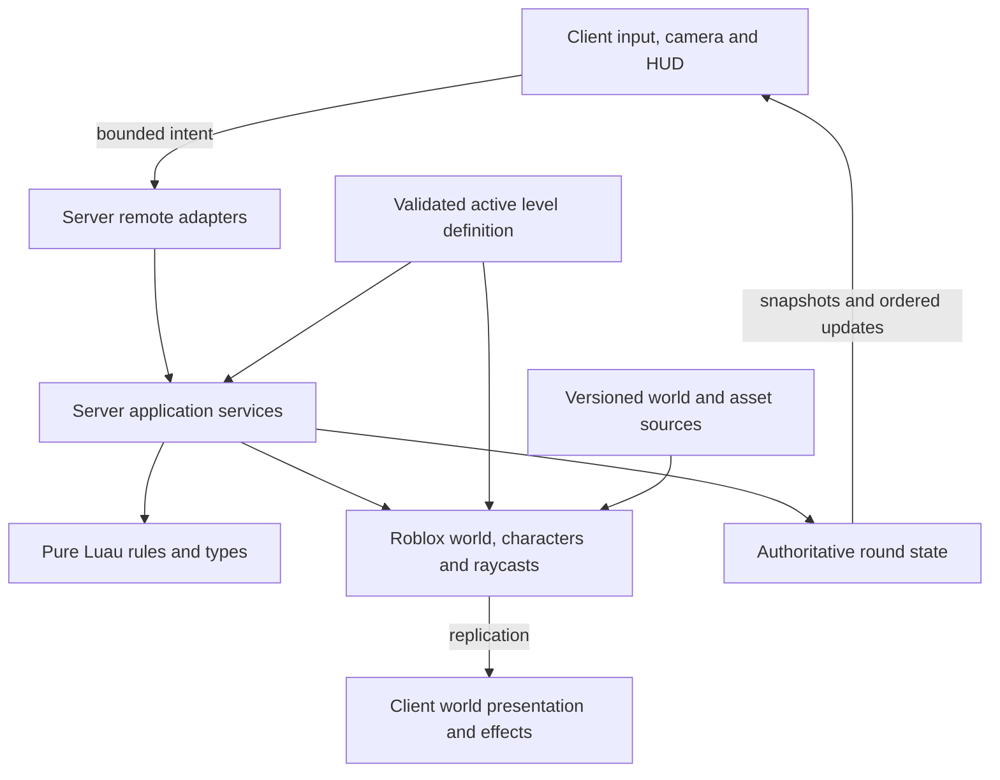

# Architecture

`main` includes integrated P18 rebalancing: deployment Ground-roster health, one-howitzer/two-earned-second panel destruction, square camera bounds, four landmark launchers and white Ground targets against a darker fully desaturated world. The [P18 record](plans/18-game-rebalancing.md) identifies verification and integration source separately; local implementation does not establish future Roblox publication or live capacity/performance acceptance.

The integrated gunship uses a 25-stud howitzer blast around confirmed contacts. Clients receive a presentation stream for gunship shells and Ground rockets. The lobby provides protected return after elimination, opt-in theater spectating and a two-minute intermission. Ground gets a 20-second head start before aircraft arrival. The integrated game includes the P25 weapon settings and the lobby balance editor. The P27 branch adds Ground mouse look, a raised aim point for both Ground weapons and a compact touch HUD. [P27 controls](plans/27-ground-aim-and-mobile-controls.md) · [P19 weapon impacts](plans/19-weapon-impacts.md) · [P23 round flow](plans/23-lobby-return-and-intermission.md) · [P24 aircraft arrival](plans/24-ground-scatter-and-aircraft-arrival.md) · [P25 weapon balance](plans/25-weapon-cooldowns-and-rifle-ammo.md)

## Current state and target

The experience has one 720-stud circular battlefield, authoritative rounds, a circling aircraft with thermal panning and weapon-linked zoom, recoverable launchers, persistent destruction, ordered results and replay. Startup reconstructs the managed Outpost, Vesper Array, Sandbreak bunker, Salt Flats hangar and Prism Seedship before the map owner captures its reset snapshot. Both roles see shared aircraft health and weapon readiness. Clients own Ground indoor zoom, teammate spectating and session-local audiovisual settings. Additional levels remain future work.

Server-only services own roles, UserId membership, deadlines, readiness, damage and results. Engine adapters own characters, map reconstruction and replicated presentation. Clients display state, send bounded intent and manage role cameras; they never award structural or player damage.

Use a single Roblox place for lobby and battlefield, Luau for game code, and Git-first editing with Rojo for supported source/world synchronization. Roblox hosts the running experience; GitHub stores reconstructable source. No external application backend, persistent player inventory, or cross-server matchmaking is needed for the MVP.

## Studio MCP and repository synchronization

Roblox Studio's built-in MCP server is the primary interactive interface for inspecting the open place, making appropriate Studio-native changes, running supported playtests and obtaining real-engine evidence. Each call targets a specific Studio instance; identify the intended place before modifying it, especially when a development and test place are both open. Discover the available tools and Studio's version-specific `skill` guidance after connection; do not assume every playtest operation is exposed in every version.

MCP and Rojo have different responsibilities. Rojo maps repository-owned Luau and world definitions into Studio. MCP operates the live session but does not itself establish Git synchronization. Make script changes in the repository for managed paths, then sync and inspect in Studio; export deliberate Studio-authored models/world assets into the repository and manifest before considering an increment done. Do not let two agents mutate one live place simultaneously, and do not sync a test mapping into the release place. See [development setup](docs/development.md#connect-roblox-studio-mcp).

## Implemented foundation

`ServerScriptService.Server` starts `Bootstrap`, which validates public defaults and owns one `ReplicatedStorage.BootstrapStatus` Folder plus a Heartbeat connection. The release mapping then starts `GameRuntime` with production defaults of 2–10 players and 600-second rounds. The test mapping's server-only `DevelopmentSettings` selects the **Test** label and defers gameplay startup to the test runner. That runner completes foundational TestEZ suites before starting its own runtime, so map tests and round rebuilds do not race. The release label is **Development**.

The client entrypoint waits for PlayerGui and server status, then starts `StatusPanel` and the local aircraft propeller owner. It attaches `RoundPanel`, `GroundCombatController`, `GroundIndoorCamera`, `GroundInput` and `BalancePanel` to `ReplicatedStorage.RoundState` and replaces these owners when the server owner changes. The bootstrap panel hides once the round HUD owns the view. The entrypoint keeps one local settings record across round-owner replacements. Controllers own their GUIs and listeners, and teardown disconnects them and restores the local camera. `Lifecycle` composes nonyielding components with idempotent start/stop and rollback on partial start failure. Component cleanup callbacks must avoid throwing or reentering the controller.

`Validation` accepts finite numbers and bounded flat scalar payloads. `Config` decodes validated public defaults, and `RateLimit` consumes a deterministic token bucket using caller-supplied monotonic seconds. `MatchService.command` adds active-ground role/life, round and sequence validation for surrender; `MatchRuntime` rate-limits its RemoteEvent. The P06 implementation validates ground equipment and server-derived world checks at its weapon boundary. Shared modules contain no secret authority state.

Pure modules with dependencies choose an explicit Instance require when `script` exists and a relative filesystem require under Lune. Standalone specs receive the actual rule module as a parameter; TestEZ wrappers pass actual mapped ModuleScripts to the same cases. This keeps one implementation usable in both runtimes without a virtual filesystem. See the [shared package](src/shared/README.md) for contracts.

## Live balance settings

The lobby editor calls the server through `BalanceAdmin`. `BalanceSchema` defines the public field names, units and limits. `BalanceRuntime` checks the sender, resolves the owner, and keeps each server’s cache up to date. `BalanceService` submits edits through DataStore `UpdateAsync`. On each attempt, `BalanceRecord` checks the current permission list and expected revision before producing the next record. **Save preset** updates the library. **Apply preset** selects a saved snapshot for live use. **Save & apply** commits both changes in a single revision. A rollback creates a new revision from the previous live values.

The persistent store holds the presets and tester list. Cross-server notifications carry a revision number. Servers fetch the saved record and periodically refresh to recover missed messages. A waiting lobby uses the latest minimum. Deployment captures one active preset for the combat clock, character and aircraft health, weapon services and destructible panels. The result captures the latest intermission deadline. The gameplay frame reads captured values synchronously. Ordinary Studio runs offline. A Studio test harness can inject isolated storage, identities and notifications. [Owner guide](docs/balance.md) · [Acceptance criteria](plans/26-live-balance-panel.md)

## Implemented map and terrain ownership

`Workspace.World.Battlefield` comes entirely from the versioned [world definition](assets/world/Battlefield.model.json). `MapRules` validates finite coordinates, radius greater than eight studs, altitude greater than sixteen studs, kill threshold below ground, matching map/orbit centers and radii, and ground-level center focus. Defaults are center `(0,0,0)`, radius 360 studs, altitude 140 studs and recovery Y=−30. `orbit(settings, phaseRadians)` supplies the common perimeter geometry; `AircraftService` owns the actual moving model.

### Level interchange boundary (target architecture)

The MVP has one level and its current `MapRules.defaults`, `TerrainRecipe` and
`Workspace.World.Battlefield` are fixed to it. They do **not** yet provide a level
selector or a second level. The archived P15 proposal described replacing these single-level constants with a
validated, immutable `LevelDefinition` chosen by the server at a lobby/reset
boundary. One active level owns one generation token. Clients receive only the
public level ID, bounds and presentation metadata; the server retains authoritative
geometry, panel and spawn state.

| Level-owned definition | Shared consumer and invariant |
| --- | --- |
| Stable level ID/version, world/terrain recipe and asset provenance | `MapService` validates, constructs, resets and reconstructs one active level; late joiners receive its current geometry/state. |
| Playable horizontal footprint and recovery bounds | Ground containment, server aim validation, launcher placement and ranges use the playable disk. Camera panning consumes the separate world-aligned bounding square; extending the view does not extend the combat footprint. |
| Orbit center, radius, altitude and phase origin | `AircraftService` always places exactly one C-130 on a circular orbit enclosing the playable footprint. Camera origin follows its canonical pose; shared pan rules bound the target point independently. |
| Aim height envelope, queryable cover and target surface registry | Camera projection, server muzzle obstruction, thermal occlusion and combat queries share level geometry but retain their own authority boundaries. |
| Spawn/station/launcher anchors and stable building/panel IDs with Intact/Damaged/Destroyed variants | Role deployment and launcher/cover lifecycle validate level data. `DestructionService` applies the same heavy/30mm thresholds and fragment limits to every level. |

`AircraftPanRules` and zoom profiles stay in core shared/client modules. The
client samples WASD or a touch directional pad into the same signed camera axes;
the level’s bounding square limits the world-aligned focus without clipping the
projected view against the combat disk. Mouse/touch aiming supplies reticle
pixels independently. Combat resolves every shot and panel hit against the active
level generation, then the shared damage/destruction rules decide state changes.
Level packages contain geometry and parameters, not duplicate weapon, health,
pan, zoom or demolition implementations.

That proposal would require tests for at least two distinct definitions (including a nonidentical size
or shape), repeated switch/reset, stale event rejection, panel reconstruction,
aim/cover consistency, two-client replication and late join. Moving from the
current equal-radius circular `MapRules` validator to a general footprint/orbit
contract is part of that work; this document does not claim it already exists.

Server-only `MapService` validates geometry, supported/clear anchors and lobby separation with actual Workspace queries, then retains an unparented pristine clone. Its injected character provider and Heartbeat keep orchestration explicit. `GameRuntime` supplies only active living ground characters and disables the optional station exception. Exterior or below-threshold ground characters return to `Ground05` with velocities cleared. The protected lobby lies outside the disk at X=520; Waiting bodies can walk and only the assigned operator placeholder is anchored. Containment is not a general movement-exploit detector.

P22's Rojo mappings mount one `LobbyStation` with `LobbyArt` and `LobbyCollision` siblings. The visual model uses anchored native MeshParts. Independent colliders support the three rooms and define walls, thresholds, and furniture contact. `LobbyGeometry` validates the joined floor footprint and tests the whole station against the playable disk. Lobby parts remain outside the battle panel registries. The pristine Battlefield clone supplies both lobby folders on round reset. [Native lobby source and placement](assets/imports/lobby-interior/README.md)

Pure `BuildingLayout` validates the primitive two-large/one-small building contract and its versioned imported replacements. `BuildingGeometry` checks floors, stairs, headroom, entry routes, navigation markers and panel identities. The Edit map retains 111 formal-building panels and 76 starting-shelter panels; runtime imports replace those roots and add the Seedship registry before snapshotting. DestructionRuntime consumes every validated registry instead of assuming a fixed global panel count. Direct `PanelRegistries` StringValues name a Battlefield child Folder, not an arbitrary recursive path. Floors, stairs and supporting frames remain static.

Server-only `TerrainRecipe` validates and restores the authored material/relief rasters from `Battlefield.TerrainRecipe` at four-stud voxel resolution. The level owns a bounded terrain volume, palette and deterministic recipe; invalid authoring rejects before writes and terrain outside that volume stays untouched. Terrain operations do not yield, while collision/query updates may converge afterward. The engine suite uses bounded readiness waits. See the current [world contract](assets/world/README.md#terrain-authoring-and-restoration) for recipe version and regeneration commands.

`start()` validates, reconstructs terrain, decorates identities and connects containment. `stop()` disconnects Heartbeat while retaining the map and snapshot for restart. `rebuild(preserveLobby?)` restores the terrain recipe, replaces Battlefield from the pristine clone, decorates and validates. P23 round reset preserves the live `LobbyStation` subtree by reparenting it within Workspace while the surrounding map is replaced. Battlefield consumers reacquire the new Instances. `destroy()` idempotently stops containment, restores pristine geometry and terrain, and releases the private snapshot. [Server package](src/server/README.md) · [World contract](assets/world/README.md) · [P13 record](plans/13-terrain-and-buildings.md)

## Implemented round ownership

`RoleService` selects one operator from unique eligible UserIds, excluding the previous operator when alternatives exist. It prefers the largest completed-round wait counter and breaks sorted ties deterministically from a seed. `RoundRules` owns legal phase edges and result ordering. `MatchService` composes them with injected monotonic time and life-cleanup callbacks; it has no Instances or network access. Snapshots copy members and results so callers cannot mutate authority.

Scatter runs between deployment and combat. The roster and maximum aircraft health lock at deployment. The server holds Ground avatars at their spawns until the assigned roster is ready. Scatter releases them together and starts a 20-second arrival deadline. Once the deadline passes, the next eligible server step starts the orbit and the full 600-second combat clock. Ground keeps its position and equipment. [P24 aircraft arrival](plans/24-ground-scatter-and-aircraft-arrival.md)



An assigned body lost during deployment aborts if its player remains connected at the readiness check. The 120-second intermission starts at result commit and persists through reset. Redeployment requires expiry, eligible population and a ready map. A departure or late arrival does not change the deadline. Round membership and consumed lives stay keyed by UserId.

`MatchRuntime` owns teams, noncolliding character groups and the `RoundState.Surrender` RemoteEvent. Death, surrender and owned-body removal revoke one Ground life during Scatter or Active. If a departure also arrives in the same step, `MatchService` can attribute the body removal to that departure while preserving a confirmed death. Eliminated players, reconnecting players and late arrivals receive a protected lobby body. Results sends the remaining players to the lobby and keeps existing lobby bodies in place. `CharacterOwner` coalesces identical placement requests and uses request tokens and a per-player lease to invalidate stale avatar loads. It defers physical placement until combat and launcher cleanup for the frame. Operator reset during Scatter or Active replaces only the protected station body. `GameRuntime` disconnects its combat frame before stopping owners in reverse acquisition order. [Server package contracts](src/server/README.md)

`RoundState.DeadlineSeconds` carries the current Scatter or Active deadline. Ground's `RoundPanel` and the operator's `AircraftArrival` overlay derive the same arrival countdown using `GetServerTimeNow`. Touch Ground presentation uses a single-line timer in the top safe area and leaves room for contextual launcher actions. Touch operator presentation uses the same short text over the full blackout. The overlay uses `OperatorArrivalRoundId` to cover the viewport at assignment, even while round attributes are arriving. `ThermalCameraController` commits the matching round's view at render priority Camera + 3, using a single sample of the canonical Hitbox position. The overlay checks that render at priority Last before uncovering the viewport. `RoundPanel` uses `IntermissionUntil` for the lobby countdown. A single `RoundState.Result` JSON attribute carries `roundId`, `winner`, `reason` and optional `userId`, `weapon` and `shotId`. The client displays the matching round's winning team and reason through intermission. Aircraft destruction credits the server-resolved lethal shot, and C-130 wins credit the assigned operator. Forfeit and abort results carry their own reasons without impact credit.

### Player presentation

`PlayerPresentation` maps replicated facts into deterministic view, readiness,
result and action feedback, and resolves the selected ID from an eligible
spectator roster. It owns no Instances or transport. `RoundPanel` renders the
aircraft health bar and routes desktop settings and spectator controls. On
touch, the round and weapon HUDs put time, health and readiness near the
screen edges. Safe-area layout leaves room for native controls and contextual game buttons. Menus suspend combat input. The server validates gameplay actions.

`TheaterSpectating` attaches a local proximity prompt to the existing TV for eligible lobby players once combat starts. The controller suspends lobby avatar movement while watching and releases it on exit or loss of eligibility. It owns no server transport or combat authority.

`SpectatorCamera` filters targets to living Ground players in the current round
with a live Humanoid in Workspace. It retains the selected target when eligible
and cycles by UserId. With no eligible target it owns a local inert camera
subject for the neutral overview. The living operator and labelled solo
Operator preview use `ThermalCameraController`. Results releases the active
role or spectator camera and returns to the local character as its lobby body becomes ready.

`PresentationEffects` reads the replicated warning, impact and result facts.
It owns temporary local effects and two Roblox-bundled sound references. The
effect level scales audible cues and optional pulse and flash intensity. The
independent shake level briefly affects the local lobby camera after aircraft destruction.
Readable warning and result text stays
available at each setting. Phase and round changes clear transient effects.
The P19 `WeaponImpactEffects` client also uses that setting for impact bursts and rocket smoke.
It owns up to 12 anchored local impact bursts and eight smoke trails. A heavy burst can replace an older light burst at capacity. Full M102 uses an expanding fireball and a longer plume. Reduced uses a shorter, smaller effect. Distance and the thermal view trim particle counts while keeping the Full blast readable. Existing trails stop emitting when flight ends and fade, and accepted impact bursts can finish into Results. Round changes, resetting and muting clear active effects. `WeaponAudio` owns delayed positional playback with per-weapon and per-surface mixes, four preloaded samples, a bundled fallback and bounded voice and queue counts. At Results entrance it clears muzzle cues and admits fresh impacts for 0.75 seconds so the shot that ended the round can be heard. Both owners use server facts. The local settings record is session-scoped. [Client package contracts](src/client/README.md) · [Asset provenance](assets/manifest.json)

`GroundInput` captures the desktop pointer after Roblox updates the native
Custom camera. It turns the local character upright toward the displayed
view's horizontal heading. Roblox supplies view-relative movement, mouse and
touch rotation, pitch limits and requested zoom. Left Alt frees the cursor
and suspends firing while held. Opening a local overlay or the Roblox menu
hands back pointer and rotation ownership and pauses avatar movement. Focus
loss, role or character changes and teardown release owned settings.

`GroundIndoorCamera` adapts the local Ground view in level-authored interiors.
Its render callbacks run immediately before and after the stock camera. It
restores the previous stock frame before Roblox processes input and occlusion,
then moves the rendered camera along the stock focus ray as room clearance
requires. The Outpost workshop and upstairs command room supply five-stud
caps. Leaving those volumes restores the native zoom. Room metadata belongs
to the active Battlefield and describes camera presentation.

`GroundCombatController` samples the resulting camera at priority Camera + 2.
It rounds one viewport pixel at horizontal center and uses
`GroundCameraRules.reticleY` for its raised height. Both weapon rays use that
pixel. The drawn reticle converts it through the measured GUI origin and inset.
The server receives a target point, derives the attack origin, checks cover
and resolves the resulting hit.

For a Waiting player's Custom camera, the same owner sweeps from the stock focus to the stock eye against the current `LobbyCollision` folder. It shortens the rendered distance around walls and furniture while preserving the stock rotation and the user's zoom. It refreshes the query scope when the station is replaced. [P22 camera and walking checks](docs/testing.md#verify-the-p22-waiting-lobby)

## Target layers and dependencies



Rules do not depend on Roblox services, client presentation, network transport, or global clocks. Server services compose rules and adapters; clients present authoritative facts and may predict cosmetic feedback. Bootstrap scripts wire dependencies explicitly. Prefer constructor arguments or simple module parameters to a dependency-injection framework.

### Repository layout

```text
AGENTS.md                 Persistent project instructions
README.md                 Player-facing overview and actual availability
game-design.md            Rules, experience and scope
requirements.md           Requirement IDs and test obligations
architecture.md           Boundaries and technical decisions
roadmap.md                 Ordered status and milestone index
plans/*.md                One executable capability plan per file
docs/                     Setup, testing, decisions, conventions, evidence
.agents/skills/            Repository-local feature-loop skill
.codex/agents/             Developer, tester and writer instructions
.github/workflows/        Full non-Studio verification CI
src/shared/               Replicated types, public config and pure common rules
src/server/               Authoritative services, server-only rules and adapters
src/client/               Input, cameras, UI, audio and effects
assets/world/             Reconstructable static world definitions/exports
assets/models/            Templates for aircraft, cover and launcher presentation
assets/manifest.json      Provenance and cloud asset references
tests/unit/               Pure rules and boundary cases
tests/integration/        Service workflows with controlled adapters
tests/studio/             Real-engine server/client/replication suites
tests/fixtures/           Seeds, small test maps and doubles
scripts/                  Verification and build entrypoints
default.project.json      Release DataModel mapping; excludes tests
test.project.json         Test DataModel mapping; never published
rokit.toml                Pinned development tools
build/                    Generated artifacts; ignored by Git
```

### Roblox ownership

| Filesystem area | DataModel location | Ownership |
| --- | --- | --- |
| `src/shared` | `ReplicatedStorage.Shared` | Public types, presentation config, shared pure rules; no secrets |
| `src/server` | `ServerScriptService.Server` | Authoritative services and server-only rules |
| `src/client` | `StarterPlayer.StarterPlayerScripts.Client` | Per-player local controllers |
| `assets/models` | `ServerStorage.Assets` | Templates cloned by server; only needed instances replicate |
| `assets/world` | `Workspace.World` | Static map objects authored/exported under source control |
| `tests/unit`, `tests/integration`, `tests/studio/specs-server`, `tests/fixtures` | `ServerStorage.Tests` in test project only | Shared cases, server specs and fixtures |
| `tests/studio/server` | `ServerScriptService.ServerTests` in test project only | Automatic server TestEZ runner |
| `tests/studio/client` | `StarterPlayerScripts.ClientTests` in test project only | Automatic client TestEZ runner |
| `tests/studio/specs-client`, `Packages` | `ReplicatedStorage.ClientSpecs`, `ReplicatedStorage.TestPackages` in test project only | Client specs and locked TestEZ dependency |
| `tests/studio/support/P11Metrics.luau` | `ReplicatedStorage.P11Metrics` in test project only | Bounded frame and memory summaries shared by actual Studio clients and server |
| `tests/fixtures/DevelopmentSettings.luau` | `ServerStorage.DevelopmentSettings` in test project only | Server-only test label and deferred gameplay startup marker |

The release project excludes tests, test dependencies, fixtures and development overrides by construction, with generated-artifact inspection enforcing the boundary. Bootstrap must not run server-only modules on clients.

## Components to introduce as needed

| Component | Responsibility | First plan |
| --- | --- | --- |
| `Bootstrap`, shared validation and lifecycle | Implemented shell wiring, cleanup, structural decoding/rate helpers | P01 |
| Named remote adapters | Implemented surrender, aircraft-selection and gunship-fire shape/role/life/round/replay/rate checks; P06 implementation adds ground equipment and fire/reload validation | P03 onward |
| `MapService` | Implemented geometry/anchor/lobby validation, containment, bounded terrain reconstruction, multi-story buildings and pristine panel registry rebuild | P02; expanded P13 |
| `MatchService`, `RoleService`, `RoundRules` | Implemented roster, phase/deadline, round identity, assignment and outcome policy | P03 |
| `GameRuntime`, `MatchRuntime`, `CharacterOwner` | Implemented map/round composition, character ownership, replication and cleanup | P03 |
| `RoundPanel` | Round HUD, readable results, aircraft health bar and session-local settings | P03, P09, P10 |
| `AircraftService`, `AircraftSelection`, `AircraftRules` | Implemented canonical perimeter orbit, validated aim geometry and authoritative targeting-profile selection; P06 implementation adds health/destruction | P04; health in P06 |
| `ThermalCameraController`, `AircraftPanRules` | Core operator square panning, held map focus, recenter, acknowledged zoom and actual-surface reticle projection; local thermal appearance/masking owns no hit authority | P04; P14; revised P18 |
| `CombatService` / `CombatRuntime` | Validates gunship intent/readiness and resolves server-side flight, impact and ground damage | P05; ground combat P06 |
| `PanelDamageRules`, `DestructionService`, `DestructionRuntime` | Implemented server-only stage arithmetic, ordered shot outcomes, replicated progress, residual colliders and bounded fragments | P07 |
| `LauncherService`, `LauncherRuntime`, `LauncherGeometry` | One identity, atomic ownership, reload-preserving recovery, validated rocket flights and primitive representations | P08 |
| `MedkitService`, `MedkitRuntime` | Per-round site availability, server-validated prompt use, health restoration and pickup cleanup | P30 |
| `MatchService` outcome integration | Aircraft destruction, ground elimination, timeout and forfeit resolution | P09 (basic outcomes P03/P06) |
| `GroundCombatController`, `PlayerPresentation`, `SpectatorCamera`, `PresentationEffects` | Ground control and readiness, pure presentation rules, teammate cycling, neutral camera and local effects | P06, P08, P10 |

Use one combat orchestration boundary with weapon-specific modules rather than three independent damage systems. `MatchService` alone commits outcomes. Other services propose changes through explicit calls/events; they never independently set the winner. Keep reset and cleanup centralized while each component owns its resources.

## Authoritative state and timing

Use typed data records for round ID, phase, phase revision, roster by UserId, role/life state, deadline, aircraft health/state, per-weapon readiness, selected weapon, launcher ownership/location/reload state, and result. Instance Attributes can expose view state but are not the internal transaction mechanism.

Inject a monotonic clock and seeded random source into rules/services. Client HUDs derive countdowns from a replicated server deadline and synchronize with the platform's server clock. Never accept client timestamps to award hits, pickups or results. Deterministic tests advance a fake clock without real sleeps.

Custom combat commands carry the current round ID and a per-player monotonic sequence. The server rejects commands from old rounds and repeated sequences. The medkit's native prompt binds the site and generation on the server. A single committed result makes the round terminal for later commands. Teardown invalidates queued work with a generation or round token. [Round and result rules](game-design.md#round-states-and-result-conflicts)

`GameRuntime` advances the canonical aircraft pose and calls `MatchRuntime.step` from one Heartbeat with sampled server time. The phase synchronization callback updates aircraft presence before the new phase is published. During Scatter, `MatchService.step` resolves life and departure outcomes before opening combat. Launcher pickup, drop and recovery and medkit use can follow a nonterminal step. Fire and weapon selection require Active, and early fire requests never enter the damage batch or spend ammunition. During combat, `MatchService.step` admits damage strictly before the deadline and fixes that time for the whole batch. Gunship sweeps and blast rays, queued M-7 rays and existing rocket sweeps query the cover present at the start of that batch. The structural owner then applies panel changes. `MatchService` resolves aircraft destruction before Ground elimination, checks departure outcomes and commits at most one result before launcher or medkit interactions run. At the combat deadline, the damage batch is skipped. A terminal result keeps aircraft health and any revealed orbit fixed, clears combat flights and closes battlefield interactions. Reset rebuilds pristine map state and clears effects, equipment and presentation for the next round.

## Network contracts

Use a small named RemoteEvent surface, not an unrestricted generic RPC dispatcher. Prefer asynchronous requests and snapshots; avoid yielding RemoteFunction round trips for combat. Define Luau request types **and** runtime validation: types alone do not validate untrusted packets.

| Direction / intent | Minimal payload | Server derivation and validation |
| --- | --- | --- |
| Client → surrender (implemented) | round ID, sequence, `action = "Surrender"` | Exact three-field shape, living connected Ground member in Scatter or unexpired Active, current round, increasing bounded integral sequence and per-player rate budget |
| Client → fire | round ID, sequence, weapon ID, bounded aim direction/point | Unexpired Active phase, role/life, equipment, ammo, cooldown, finite values, origin, range, aim envelope, obstruction |
| Client → aircraft select (implemented) | exactly `roundId`, `sequence`, `weapon` (`GAU23`/`M102`) | Living connected operator, Active/unexpired round, increasing bounded integral sequence; six-token budget refilling at four/second; atomic acknowledged weapon/round/revision |
| Client → M-7 reload (implemented) | exactly `roundId`, `sequence` | Active equipped Ground life, partial or empty magazine, no reload already pending, bounded sequence and request budget |
| Client → launcher Pickup / Drop | exactly round ID, sequence, launcher ID | Scatter or unexpired Active, current identity, increasing sequence, live connected Ground membership and request budget. Pickup also shares movement/origin authority, 8-stud reach and solid-world sight line |
| Client → launcher Fire | exactly round ID, sequence, launcher ID, finite x/y/z target | Unexpired Active, current live Ground carrier, held/equipped Tool, reload deadline and bounded server-head-to-target range. Server sweeps the resulting flight |
| Client → medkit Use | Native `ProximityPrompt.Triggered` | Server-owned prompt binds site and round. The server checks the current living Ground body, phase, request budget, eight-stud root reach, solid-world sight and missing health. |
| Server → medkit feedback | Current Humanoid health, `MedkitHealAmount`, `MedkitHealUntil` | Confirmed restored HP and expiry in server seconds drive the local health row. The spent case and prompt disappear from the replicated world. |
| Server → M-7 readiness | Tool attributes `Ammo`, `MaxAmmo`, `NextFire`, `ReloadUntil`, `UnlimitedReserve` | The server replicates the current magazine and absolute timing in seconds. `UnlimitedReserve = true` tells the desktop and touch HUDs to show ∞ |
| Server → aircraft arrival timing | `RoundState.RoundId`, `Phase`, `DeadlineSeconds` and operator's `OperatorArrivalRoundId` | Roll the roster once, publish the Scatter deadline after readiness, then replace it with the combat deadline at reveal. The operator's assignment arms the cover |
| Server → result and timing | `RoundState.Result` JSON with round ID, winner, reason and optional attribution. `IntermissionUntil` is an absolute server-clock deadline in seconds | `MatchService` commits both on the result update. Clients display the matching result through intermission. New deployment clears the previous result and intermission deadline |
| Client → sync request (target) | bounded request token | Per-player rate budget; return only that role's permitted snapshot |
| Server → snapshot/update | round ID, revision, permitted state | Immutable view model; client discards stale rounds/revisions |
| Server → weapon audio | round ID, cue ID, origin, server time, optional shooter and optional surface kind | `RoundState.WeaponAudio` sends unreliable presentation cues after accepted shots and resolved impacts. Clients cap and expire the queue, apply a local propagation delay and clear playback on mute or reset. Results prunes muzzle cues and admits impact cues for 0.75 seconds |
| Server → weapon impact | weapon, round ID, shot ID, contact, unit normal, coarse surface kind and server time | `RoundState.WeaponImpact` reliably carries each server-confirmed collision. Clients admit fresh, matching-round identities once before rendering. Structural hit IDs stay in server combat bookkeeping and diagnostic state |

Aircraft destruction is computed from server-resolved damage, never a client win claim or rocket-hit count. Validate server-observed movement for implausible travel before granting launcher pickup or accepting a ground firing origin; reject or correct suspicious movement without automatically banning from a single noisy observation. Roblox character network ownership does not make client movement authoritative for rewards.

Apply cheap shape/size checks and per-player/per-action budgets before expensive raycasts. Bound strings, tables, vectors, shot counts and queued work. Tests cover NaN, infinity, malformed nested payloads, unknown IDs, replay, stale round IDs, floods, spectators and eliminated players. Rejected requests must leave state unchanged.

### Studio combat diagnostics

P11's Studio coordinator sends bounded test commands to real clients, which
call the production combat remotes. The clients also acknowledge replicated
state and supply local frame and memory observations. Server runtime
`resources()` snapshots expose queue sizes and peaks, projectiles, effects,
structural work, fragments and owned connections to the coordinator. Replay and
soak compare live resources after both roles reach fresh Lobby characters.
Client reports and resource snapshots are observational. The test transport,
coordinator and sample reducers belong to the test mapping. P19Profile reuses P11's workload and timing for the current four-launcher battlefield. It targets live panels and falls back to terrain after panel targets run out. Its client probe counts frames from receipt of an on-screen contact to the first matching burst ready at PreRender and records peak local bursts and trails. The test-only Replay scenario runs five real-client resets after howitzer and rocket traffic, including empty-air rocket expiry. Operated review establishes rendered appearance and audible feedback. [P19 procedure](docs/testing.md#run-p19-weapon-impact-checks) · [Historical P11 procedure](docs/testing.md#run-the-p11-performance-harness)

## Implemented aircraft and targeting view

`GameRuntime` starts one `AircraftService` from `ServerStorage.Assets.C130` and `C130PaintedSkin`. `AircraftRig` replaces the covered visible shapes with three imported MeshParts and binds the detached clone to its transparent `Hitbox`, which serves as the PrimaryPart, pivot and only live anchor. Ground weapon rays and sweeps query designated solid shapes and circular cylinders inset within the rounded airframe. The Hitbox, textured skin and rotors stay outside those queries. The entire assembly has collision and touch disabled. `GAU23Muzzle` and `M102Muzzle` align with the visible bores and supply server firing origins. `AircraftService` rejects a duplicate owner or invalid template and releases its model, selection remote and connections on stop. [Model contract](assets/models/README.md) · [Editable aircraft](assets/blender/c130/README.md)

AircraftService places the detached rig at arrival, then moves only its anchored root. The welded airframe and four motor-linked hubs follow the root. `AircraftPropellers` reads the model's synchronized flight and result timestamps and changes the four motor transforms locally. The cosmetic spin holds at the result time, and the next arrival starts from a fresh epoch. Both operator zooms mask the aircraft's parts locally. [Flight, combat and replay verification](docs/testing.md#verify-the-c-130-flight-model)

`AircraftRules.pose(map, settings, elapsedSeconds)` uses injected time to compute perimeter position and tangent, rejecting invalid settings/time or derived overflow. Production uses synchronized server seconds with a radius of 360 studs, altitude of 140 studs and period of 90 seconds. The phase increases from positive X toward positive Z. The model is detached from Workspace during Deploying and Scatter, so its surfaces and muzzles are absent from play. At reveal the server parents the model at phase zero with the current round ID and sets the orbit epoch. A revealed orbit freezes in Results. The model is detached during Resetting and returns to phase zero for the Lobby orbit. Ordinary server replication carries this canonical pose. The two-client aircraft harness declares an eight-stud convergence bound, while sampled injected-time engine poses use 0.01-stud precision. [Aircraft orbit evidence](plans/04-aircraft-and-thermal.md)

Server-only `AircraftSelection` owns selected weapon, revision and accepted per-user sequences. `AircraftState.Selection` publishes them as one JSON string so round/weapon/revision are acknowledged together. The client sends bounded selection intent and changes weapon label, FOV and reticle projection only from a valid acknowledgement for its current round. Unknown, malformed, stale, replayed, wrong-role or terminal requests leave selection unchanged. Returning to Lobby forces the initial GAU23 profile even when the round ID has not changed. P05 combat owns independent readiness across this selection seam; profile changes do not refill or reset either weapon.

`ThermalCameraController` places a Scriptable camera at the replicated canonical aircraft position. Pure `AircraftPanRules` stores focus as a world-aligned X/Z offset from map center. WASD/touch directions use the rendered camera basis, then clamp each component independently to ±360 studs. Only those square edges block movement; the unblocked component can slide and reverse without accumulating hidden offset. Releasing input holds the map target while the aircraft continues its unchanged orbit. `viewFits` validates finite square focus, viewport and lens inputs; it no longer clips the view against a disk, frustum or pitch limit. The 30° GAU23 / 40° M102 defaults keep the same pan envelope through selection. R / Recenter and fresh role/round entry return focus to map center. The projected canonical-right basis remains finite through overhead views and can roll when viewing a square corner beyond the orbit; focused operated review is separate from mathematical validity.

Directional input drives pan independently of aim. `AircraftPanRules.raster` rounds/clamps the displayed mouse/touch reticle once to integer pixels inside the central 70%; the same viewport integers drive ray projection and published pixels; a measured ScreenGui origin converts them to GUI-local drawing offsets, including mobile safe-area shifts and odd viewports. Each rendered projection raycasts actual collidable Battlefield/Terrain geometry at the active FOV. One frame publishes map-local and world focus, viewport, camera, reticle pixels, first hit and endpoint together for diagnostic/fixture observation. `Battlefield/AimEnvelope/MinimumY` and `MaximumY` NumberValues author the current Y=−1…64-stud bounds; AircraftService validates and captures them on startup and replicates presentation values. Its server-only `aimAllowed(endpoint)` checks the disk/envelope and actual solid-world obstruction from the acknowledged selected weapon’s muzzle attachment, allowing 0.5 studs at the first surface. A local aim indicator never authorizes hits; P05 sends bounded fire intent but introduces no high-rate pan remote.

The operator camera owns a local noncolliding, nonqueryable ground backdrop below the level for views beyond the disk. Its extent is computed by `AircraftPanRules.backdropHalfExtent`; it supplies presentation beyond the combat disk and does not restrict square panning. Its dark neutral RGB `(38,42,45)` is independent of the invisible GroundDisk proxy. The backdrop is destroyed on camera teardown, cannot alter server visibility or aim validation, and is not playable terrain.

The operator uses white `Highlight` fill/outline with `DepthMode = Occluded`, so real cover hides Ground targets. Its camera-owned ColorCorrectionEffect fully desaturates the 3D world, including imported texture colors, and applies the tuned darker grayscale grade. `ThermalCosmetics` locally dims scenery Parts/surfaces and the authored Terrain palette while preserving structural silhouettes, detail and real openings; saved colors and temporary surface clones are restored on removal/stop. Late SurfaceAppearance arrival/removal releases the previous tint and reacquires the current surface without compounding colors. Non-cover flags hide eligible dressing/debris. The operator owner also masks BaseParts of the canonical direct-child `Workspace.Aircraft` locally through `LocalTransparencyModifier`, preserving exact original values across added parts, model replacement and role/owner teardown. Ground clients still see the plane, and server hit/query/collision/physics state is unchanged. Role loss releases the thermal GUI, effects, highlights and input listeners, restores captured camera/FOV/mouse state and returns ownership to Ground, spectator or lobby view. The user accepts red on gray or white on darker monochrome; this candidate implements white on monochrome. Exact grade values live in decisions, while fresh rendered contrast remains the acceptance criterion.

For the bounded MVP map, `Workspace.StreamingEnabled` is explicitly false (D11). This avoids a remote camera looking at absent scenery. If profiling forces streaming, treat that as a deliberate architecture revision: persistent aircraft, controlled replication focus, target-area acquisition/loading states, re-stream-safe effects and 10-player visibility tests. P05 supplies swept projectile collision and ground-character damage; P06 supplies aircraft health/destruction. P07 adds authoritative panel openings and bounded physical fragments; they do not change camera ownership.

## Panned targeting (P14)

`AircraftPanRules` is shared deterministic presentation math with no transport or hit authority. Defaults are 120 studs/second, normalized diagonal motion and a 0.1-second per-update cap. Invalid/nonfinite input rejects without mutation. Positive horizontal input follows the rendered right direction, including outward square-corner views. `ThermalCameraController.input` preserves raw viewport pointer coordinates and uses current GuiInset only for GUI hit queries; `touchInput` separately converts touch content coordinates to viewport pixels. Pad touches and a separate aiming touch have distinct ownership. Actionable UI, text/window focus loss and role cleanup suspend/release owned input; Ground movement remains unchanged.

`ThermalCameraController.new` and `RoundPanel.new` accept an optional nonyielding input provider. Production omits it and uses UserInputService. Engine fixtures can inject raw pointer/recenter/profile intent through this normal boundary after stopping the original owner; they never assign focus or introduce a second active camera. Native input, rendered occlusion and viewport usability were reviewed separately for P14; its actual acceptance is recorded in the plan. P05 firing controls and effects received their own operated desktop and simulated-phone review; see the plan for source-specific evidence.

MapService retains terrain/building reconstruction ownership. P07 consumes its registered panel IDs and Intact pivots; it does not duplicate map, pan or zoom rules.

## Gunship combat (P05)

`GameRuntime` composes the map, match, aircraft and combat owners, with reverse-order cleanup. `CombatService` owns deterministic fire validation and independent weapon readiness. The engine `CombatRuntime` derives role, selected weapon, muzzle and server time, rate-limits requests, sweeps a 0.05-stud-radius sphere through level/character geometry and ignores flights with no collision. If the muzzle begins inside solid Battlefield cover, initial overlap resolves it conservatively without splash. The BasePart overlap query does not detect Terrain containing a muzzle; future levels must address that limitation. The active level supplies disk and authored height bounds; collision checks include the active Battlefield and Terrain. `CombatViewRules` validates the client-claimed focus, aspect, target and replicated camera position against permitted view geometry with a symmetric 1.25-second orbit-position tolerance plus one stud and a raster margin of 1% of the viewport per edge. This establishes that a claimed view is permitted, not that it is the actual client camera.

With the shipped preset, GAU23 holds 100 rounds, has a 0.15-second minimum cadence and a five-second automatic reload. It travels at 650 studs/second for up to two seconds and applies 25 damage to exposed targets within four studs. M102 holds one shell, reloads automatically **12 seconds** from each accepted shot and applies 100 damage to exposed targets within 25 studs. Its shell travels at 300 studs/second for up to four seconds. Both use a 900-stud range ceiling. Switching retains each weapon's ammunition and timers. The server measures distance from contact and traces toward each active Ground root from a small offset along the surface normal. The shot-local `DamageRules` ledger caps direct or splash damage at current and maximum health, once per live target. [P25 weapon balance](plans/25-weapon-cooldowns-and-rifle-ammo.md)

On a normal swept M102 collision, `BlastGeometry.exposedPanels` queries nearby collidable parts in the active Battlefield. It matches them against the live registered solids, measures the nearest point on each candidate collider and traces to it against pre-flush level cover. A 0.005-stud endpoint tolerance handles a floor or road touching the sampled panel surface. Cover earlier on the ray still blocks. Each exposed in-range panel enters the shot's structural outcome once. Terrain, roads, scenery and building surfaces all supply valid blast centers. A ground strike near a building can open its exposed panels, and an empty ground strike still emits a cosmetic contact. Floors, stairs and supports do not enter the panel list. The separate Salt Flats aircraft wreck keeps its direct-hit rule.

A nonyielding typed impact callback carries round/shot ID, profile, hit position, optional panel ID, impact time and accepted `firedAt`. Observers must not mutate colliders. P07 receives every accepted shot outcome through a separate ordered ledger and flushes geometry only after all sweeps and player-damage queries in that Heartbeat batch. Initial muzzle overlaps use that same batch. Readiness and impact attributes replicate presentation state. Automated and operated combat acceptance is recorded in [P05](plans/05-gunship-combat.md); P14 evidence alone does not prove combat.

## Ground combat (P06)

`GameRuntime` composes the existing aircraft and gunship owners with `GroundCombatRuntime`. For each active living ground player the server owns one M-7 Tool, individual rifle readiness, shared aircraft health and `GroundFire`/`GroundReload` intents. The server checks role, life, equipped ownership and rate, then runs a nonmutating fire preflight for bounded payload, sequence, aim, range and readiness before expensive movement and geometry queries; it never accepts a claimed origin, hit, damage or victory. `GroundMovementGuard` samples server-observed root positions each Heartbeat and before fire with a bounded movement budget; its 45-stud burst, 70-stud/second refill and 8-stud recovery radius are tuning defaults, as is an 8-stud maximum head/root offset. A suspicious jump quarantines firing until return near the last trusted point or an explicit trusted server spawn/map correction. The guard issues no automatic ban and is not a complete anti-cheat; severe latency or unusual legitimate movement may require returning or tuning. `GroundOriginGeometry` separately checks root/head BasePart overlaps and the Battlefield/Terrain segment in both directions. Its Terrain test combines six-axis inward/outward collision rays with a 4-stud occupied-voxel fallback for deep interiors; failed queries explicitly reject firing. It is conservative rather than an exact signed-distance test for arbitrary caves, so unusual terrain can still reject valid fire and merits playtesting. Cover blocks the ray and friendly fire is off. Fire/reload and tools are torn down at reset, role loss or owner stop. The server owns a primitive noncolliding held-rifle model and resolves the first hit along the bounded server ray, including solid cover and visible aircraft surfaces. The server resolves the ray in the admitted damage batch and then animates a noninteractive tracer from its origin to the resolved endpoint; the visible segment is at most 3 studs long. Cosmetic travel uses 1200 studs/second with a 0.15-second minimum (up to 1 second at the 1200-stud range), followed by a 0.1-second terminal hold; a brief flash appears at the held rifle barrel. The travel animation does not delay or predict damage. Replicated `GroundShot` includes the server-awarded aircraft-hit fact and clears on reset. The client flashes the shooter’s reticle for its own current-round server-resolved rifle shot. On source `0ab3607`, the user reported visible tracers aligned with the crosshair and aircraft damage; independent same-shot observations matched 12 shots, including eight damaging hits. The P06 plan records its earlier acceptance/regression evidence; the P07 plan records the revised candidate’s current verification scope. Both roles receive an aircraft-health readout. Clients render ammunition and reload timing and send a bounded target through the shared Ground reticle.

The movement budget permits short rapid relocation within its available burst and does not sweep the traveled path for walls. It therefore bounds movement-based firing-origin abuse but does not eliminate possible teleport or cover bypass. This is a code-derived limitation rather than a confirmed exploit.

The M-7 has a 30-round magazine, unlimited reserve, a 0.15-second minimum cadence and a 1200-stud server range. A living equipped user can reload a partial or empty magazine in two seconds. `GroundCombatService` starts the deadline from accepted reload intent and rejects fire until the magazine refills. `GroundCombatRuntime` cancels pending reloads at equipment retirement after death, departure or round end. A new round clears the old readiness and accepted sequences. [Server package contracts](src/server/README.md#p06-ground-combat)

The current P06 source is integrated on `main`. Its host, two-/three-client, P05/P14 regression, operated desktop and simulated-phone results are recorded in [P06](plans/06-ground-combat.md), with source-specific Studio evidence and documented limitations. Future level contracts must retain authoritative solid geometry and aircraft hitbox access.

## Progressive panel destruction (P07)

`PanelDamageRules` is deterministic server-only stage arithmetic; `DestructionService` is its ordered accepted-shot ledger. A direct M102 impact sets a registered panel straight to Destroyed/Total. Same-panel GAU23 fire earns elapsed server `firedAt` intervals: positive credit gives Light, one earned second produces Damaged/Heavy, and two total earned seconds produce Destroyed/Total. Fractional surplus carries across the one-second intermediate boundary. The first valid/resumed hit earns zero. Threshold tolerance remains 1e-7 seconds; CombatService’s 1e-9-second readiness tolerance admits floating-point cadence rounding only. The one-second intermediate opening is a documented presentation default under D87.

The default continuity gap is 0.225 seconds (1.5 × the 0.15-second cadence). Under the user's D51 revision, accepted misses, obstruction, target/weapon changes, reload or eligibility loss break continuity without clearing any earned per-panel credit. The first impact after a break earns zero elapsed time. An ordered barrier waits for earlier accepted in-flight outcomes, preserves their earned credit and then clears only the timing anchor; later shots cannot earn paused time across it. Malformed, unauthorized, stale, duplicate and cadence-rejected requests cannot mutate progress. D51 retains earned credit across interruptions; P18/D82 replaces the old heavy-hit and nine-second thresholds.

CombatRuntime sends every accepted shot's eventual outcome with round ID, shot ID, weapon, `firedAt` and an optional direct panel ID. An M102 outcome can also include a bounded server-derived `blastPanelIds` list, even when direct panel ID is absent. DestructionRuntime identifies only actual solids belonging to the current registered panel Models. Misses, expiration and obstruction without eligible panels consume an empty outcome so they cannot stall the ordered frontier. DestructionService copies and deduplicates the list, buffers up to 512 out-of-order outcomes and scores only in accepted shot order. An M102 outcome sets each distinct eligible panel to Total once. These modules apply the same rules to all level-supplied building registries, including Sandbreak.

DestructionRuntime owns the engine boundary. `sync(roundId)` reacquires the current Battlefield by Instance identity and invalidates old generations, including map replacement while the completed round ID remains unchanged. `resolve(outcome)` updates the ledger without changing collision. The shared combat frame completes gunship sweeps, player blast sight-line queries, M-7 rays and rocket sweeps against pre-flush cover before calling `flush(nowSeconds)`. The newly installed opening becomes available to later batches. Initial muzzle overlaps join the same batch. Terminal phase or deadline cancellation closes the ledger and rejects pending outcomes while retaining earned damage until reset. Impact observers must not yield, reenter or change geometry.

`PanelGeometry` wraps each authored panel in a stable identity Model, preserving its panel ID, Intact pivot, thickness and original clone. Damaged geometry scales the two 25%-width side strips along the longest face axis, leaving a central 50% opening. Destroyed retains the identity without solids. D52 adds a separate Pristine/Light/Heavy/Total appearance: positive credit gives persistent Light scars, structural stage 1 stays visibly Heavy at zero local progress, and stage 2 has no panel. D54 proposes hue-independent crack/luminance cues on both faces with Concrete/Slate rather than glowing CrackedLava. Cosmetic marks cannot collide, enter queries or identify as real panel colliders. Floors, stairs and frames remain static; genuine holes have no invisible full-panel collider. Stage/progress/credit/appearance replicate as current state.

The panel registry includes every battlefield building and the starting shelter. D53 replaces seven legacy permanent surfaces with 76 panels, making 187 in that primitive revision; P17 added one Outpost partition for 188 total before the later landmark replacements and Seedship registry. No duplicate old collider may remain; spawn anchors and existing entrances stay fixed. The separate waiting lobby and standalone nonbuilding barriers remain outside the damage registry. The shelter is an ancillary one-floor structure, not a fourth formal two-story-building requirement. The same rules, geometry and fragment owner consume every registered surface; no map-specific damage implementation is added.

`PanelFragments` owns one Workspace folder and the global `PanelFragments`/`PanelStatic` collision groups exclusively. Defaults emit four server-network-owned Parts per transition, retire the oldest at a 48-live cap and expire each after eight seconds. Initial linear speed is at most 12 studs/second, angular speed at most 4 radians/second; dimensions are capped at 1.5 studs per axis with density 1, bounding generated mass to 3.375 and initial linear momentum to 40.5 mass·studs/second. Gravity/contact evolve velocity afterward. Fragments collide only with owned anchored scenery and Terrain, excluding characters and each other. They have no damage callback, forces or structural constraints. Their trajectories cannot decide cover state.

Query safety uses the explicit Battlefield/Terrain/character include filters and collision-group matrix as well as `CanQuery = false`; that flag alone does not exclude a collidable Part from every query mode. Combat, movement-origin and thermal queries must keep fragments outside their authoritative query sets. New code must not replace these filters with an unrestricted Workspace query. `clear()` removes all fragments; `stop()` also restores captured scenery/Terrain collision groups and unregisters the owned groups. DestructionRuntime's idempotent stop restores captured pristine panel Parts. Map reset removes fragments, reacquires fresh panels and clears stage, progress, pending outcomes and continuity. All public runtime calls are nonyielding; teardown owns no delayed debris tasks.

The [P07 plan](plans/07-destruction.md) records deterministic, engine, two-client and operated acceptance separately. D50 removes a real late-join scenario from the current gate while retaining runtime spectator authority. Geometry/property checks alone do not establish rendered thermal legibility or operated readability. The revised source has fresh automated and human-observed evidence; earlier counts still validate only their recorded source.

## Weapon, launcher and result invariants

Use explicit weapon configurations for `GAU23`, `M102`, `M7` and `RocketLauncher`, with the exact player-facing names from the design. Aircraft weapons are role equipment; every ground player spawns with the M-7, while only the launcher carrier can fire rockets. Keep readiness by weapon ID; selection cannot reset cooldown, reload progress or ammunition. Store launcher reload state on the round-owned launcher identity, not the current holder.

`AircraftHealth.maximumFor(groundCount)` validates an integral 1–9 Ground deployment roster and returns 1,000 health per Ground player. The maximum stays fixed throughout the round. P25 awards 150 for a direct rocket collision and 5 for a direct M-7 hit. Both paths share the same server owner, which caps awards at remaining health and deduplicates shot identities. `GroundCombatRuntime` sends lethal shot attribution to `MatchService`, which commits one team result within the admitted step.

Each server-only `LauncherService` instance owns one round- and site-scoped identity (`launcher:<roundId>:<site>`) and transitions Available → Held → Recovering → Available. Pickup is atomic and nonyielding. One FIFO serves the four sites and prevents the same user from acquiring a second launcher. Shot credits include the site so simultaneous first shots hit the shared aircraft health ledger independently. Rejected shape, round, sequence, eligibility or readiness leaves ownership and ammunition unchanged. Accepted per-user sequence history and the 15-second reload deadline stay on that identity through transfers. `clear()` makes it Inactive. A different round's `reset()` creates one loaded launcher with a fresh identity.

`LauncherRuntime` composes the service with the existing ground owner and level anchors. Remote receipt spends a shared per-player eight-token budget refilling six per second, performs bounded validation and queues at most 32 requests. Existing flights advance within the damage batch. Pickup, drop, fire and recovery run after outcome evaluation. Pickup and fire use `GroundCombatRuntime.validateGround` and its movement/origin guard. Pickup additionally needs a clear solid-world sight line within eight studs. The server derives rocket origin from the character head, requires the equipped launcher Tool and caps range at 1200 studs.

Rockets move linearly at 240 studs/second and sweep a 0.2-stud sphere through Battlefield, Terrain and the canonical aircraft. `GroundCombatRuntime.rocketCast` returns the first collision and awards shared aircraft damage only for a direct aircraft hit. The first contact ends the flight and emits the P19 impact. A miss expires after five seconds or 1200 studs. After an accepted shot, the launch effect can start at the equipped model’s `Muzzle` and blend onto the server sweep over the first 16 studs. The effect uses the head origin when the offset is invalid, is more than four studs away, or is blocked by cover along the head-to-muzzle connection or bounded cosmetic flight segment. The client follows the replicated cosmetic rocket with local smoke. Its position cannot alter the server sweep, impact or damage. Already-fired rockets can outlive a dead shooter while another ground player keeps the round active. A terminal phase, a new round or `stop()` invalidates pending requests and flights.

`LauncherGeometry` clones the server-only `DepotLauncher` template to present each site’s launcher as an available Model or held Tool. `GroundContact` aligns the model’s resting side with the support surface while the model pivot stays at the gameplay position used for pickup. `CarryGrip` places the lower grip in the native Tool hand joint. The parts cannot collide, touch or enter world queries, and thermal rendering treats them as non-cover. While a launcher is held, the runtime samples the last trusted supported ground position. A drop, death, character removal or disconnect preserves readiness and recovers the launcher there. A 12-stud downward floor probe, slope and 4×6×4-stud clearance checks determine valid recovery positions. An invalid position falls back to the site’s original validated anchor. The runtime reacquires the current anchors after map reconstruction. `stop()` disconnects transport, Heartbeat and player observers and removes the owned models, tools, flights and queued work. [Editable source and placement frames](assets/blender/rocket-launcher/README.md) · [P29 native verification](docs/testing.md#verify-the-depot-launcher-model)

`GroundCombatController` shows launcher ownership on desktop and contextual launcher actions on touch. It sends E/PICK UP or G/DROP intent and uses native tool slots or touch M-7/ROCKET buttons for selection. Switching equipment cannot reset either weapon. Aircraft health remains the team's damage guide; it does not promise a fixed remaining rocket count after rifle damage. The [P08 evidence](docs/evidence/p08-launcher.md) records eleven passing native cases with three initial/peak actual clients and two after intentional carrier departure, plus fresh 156-server/seven-per-client smoke. D59 excludes unsupported actual same-identity reconnect from acceptance; runtime rejoin authority remains covered by service tests.

The design defines deadline precedence, same-step mutual kills, forfeits and late projectiles. The P09 record maps these outcomes and replay invariants to deterministic and Studio evidence. [Round rules](game-design.md#round-states-and-result-conflicts), [P09 record](plans/09-match-outcomes.md)

## Battlefield medkits

The P30 candidate maps five site markers into `Workspace.World.Battlefield.MedkitAnchors` and the native model into `ServerStorage.Assets.FieldMedkit`. `MedkitRuntime` resolves floor contact and clearance after map reconstruction, then creates one inert case and native prompt per site in `Workspace.Medkits` at Scatter or Active. The anchors provide each site's identity and pose. Cases sit independently of destructible panels and their visual parts carry `ThermalNonCover`.

The server processes prompt intents after damage and results. It rechecks the deployed round, living Ground body, reach and current solid cover, then applies `MedkitService`'s capped heal and removes the case in the same nonyielding step. Entering Results clears any remaining cases and pending uses. Each deployment creates a fresh ledger using its captured balance preset. [Server package contract](src/server/README.md#battlefield-medkits) · [Editable model and export](assets/blender/medkit/README.md)

## Assets, destruction and reconstruction

Prefer text `.rbxmx` model exports and `.model.json` definitions for reviewable assets; retain source meshes/textures or their reproducible provenance when practical. Large binary exports require a documented storage/LFS decision. `assets/manifest.json` records stable internal IDs, source/author/license, local file, Roblox asset ID if any, and upload owner when known.

Each authored Part/SpawnLocation in `.model.json` uses a twelve-component canonical `CFrame` (translation followed by row-major rotation). `Position`/`Orientation` aliases are forbidden because their presence in generated XML does not ensure Studio loads the intended pose. Artifact inspection compares every authored part's finite pose, positive dimensions, shape and collision/query/touch flags in both builds, with five deliberate corruption probes. Studio loaded-transform assertions and world queries remain required: reproducible serialization alone does not prove engine reconstruction.

Static map files and server-cloned templates have separate ownership. Do not synchronize a live simulation back as authored source. Studio edits to managed objects must be exported to the mapped source and verified with a clean build. Avoid mixed ownership of the same Instance subtree.

The source includes the original normalized two-strip [PanelResidual template](assets/models/PanelResidual.model.json). DestructionRuntime scales it for primitive wall/roof/interior panels. Imported Outpost panels instead use approved material-specific variants and rectangle proxies, plus material MeshPart fragments; their actual mesh/texture references and ownership are managed in Git. Fragments are transient runtime content, not authored map state. Never export them, projectile effects or damaged live state as pristine source. The [progressive destruction contract](#progressive-panel-destruction-p07) governs their lifecycle.

### Blender source and material-aware panel assets

The [P16 review package](assets/blender/military-outpost/README.md) retains an
editable, self-contained Blender 5.3.0 outpost under
`assets/blender/military-outpost/` and game exports under
`assets/exports/military-outpost/`. It supplies a versioned panel catalog for
six material/shape families, dimensions, center pivots, Pristine/Light/Heavy/Total
meshes, explicit collision-proxy candidates and bounded material-matched fragments.
Its identity migration preserves 25 legacy panel IDs/pivots and declares one new
partition plus fixed apertures. Inventory and reusable-kit mappings connect
named editable components to placed assembly and floor-centered prop exports.

The asset checker covers all authored files under `world`, `models`, `blender`
and `exports`, and requires content hashes for every Blender source/export.
The portable audit measures actual OBJ triangle projections, proxy coverage,
UV/material references, fragment bounds, budgets and package dependencies.
Hash-bound clean Blender reopen/FBX-import reports are checked in; CI validates
their relation to the candidate without running a fresh Blender process.
Saved-source renders and explicit human approval are additional acceptance
evidence. The user explicitly approved source revision `e8fb840` on 2026-11-13;
the [approval record](docs/evidence/p16/human-approval.json) binds the exact
Blender hash. Asset bytes remain unchanged by that external record.

Original baked PNGs and explicit material constants provide export equivalents
for the source materials. Blender cameras/review lighting stay outside Rojo
runtime mappings. The 32×48-stud footprint and floor levels remain authored
construction inputs; the external balcony/stair and declared aperture migration
need actual P17 clearance/cover checks. Local Blender round trips do not infer
Roblox import success, thermal visibility, runtime physics or upload permission.

The P17 candidate replaces only the smaller Outpost using managed
`MilitaryOutpost` and `MaterialPanels` templates in `ServerStorage.Assets`.
`GameRuntime` invokes `OutpostReconstruction.install` before constructing
`MapService`, so pristine reset snapshots contain the integrated building.
`prepare` validates references, geometry, support contracts, IDs and inert
content before world mutation; installation exposes commit/rollback ownership.
It retains the canonical site, 25 original pivots and world anchors, with one
added partition and 188 active panels overall. The source base world remains
primitive for reconstructable replacement and rollback. Actual native navigation
and regression acceptance must still confirm the integrated geometry.

Generated `ApprovedOutpost` data retains family dimensions, approved rectangle
proxies and source-file hashes. Its generator pins the approved Blender,
catalog and package-lock hashes before reading exports. The P16 bytes remain
unchanged. A material-split GLB derivative preserves approved triangles, corner
UVs and material boundaries. Native assembly/library receipts and twelve
source-bound PNG color-map references drive deterministic managed-template
compilation. See the [import package](assets/imports/military-outpost/README.md)
for actual IDs, owner and reconstruction commands.

`PanelAssetRules` checks finite rigid transforms, bounds and receipt identities.
`PanelAssetCatalog.load` validates the private material tree and rejects missing
variants, invalid references/geometry and unintended content before ownership
mutation. `PanelGeometry` accepts a validated material identity Model as well as
primitive Parts. The rotation-only `PanelAssetBasis` attribute maps canonical
family coordinates to preserved legacy panel frames without changing pivots.
`MaterialPanelGeometry` installs Pristine/Light/Heavy/Total cosmetic meshes and
exact rectangle collision/query proxies; Total has no solids. Panel-owned
lights/conduits/dressing persist at Pristine/Light and are removed for Heavy/Total,
then restored with pristine state. Stage-local progress tints the imported base
appearance. Primitive panels retain generic scars/two-strip residuals.
`PanelFragments` clones material MeshPart templates through the same bounded
server-owned lifecycle. Shared damage timing, ordered impacts, thresholds and
reset authority remain in the existing rules/services; there is no new remote.

Shared `AssetMaterial.read(mesh)` validates readable compiled v1 material
attributes from exactly one SurfaceAppearance in ordinary server/client code.
The contract contains the material key, four compiled map references and the
approved color-PNG digest. Runtime code never reads protected SurfaceAppearance
map properties or Content variants. Compiler/artifact/Edit audits bind actual
serialized slots to those attributes and the source receipt. This separates
metadata validity from actual Instance preload, asset access and rendered
appearance; public replicated metadata grants no new client authority.

Shared `AssetMesh.validate(mesh)` separately checks public intrinsic MeshSize
and collision/render fidelity against five readable native attributes. MeshId
plus target Size alone is insufficient. The managed compiler preserves genuine
engine InitialSize, PhysicalConfigData, PhysicsData and AeroMeshData from a
hash-bound 407-profile RBXM/receipt (87 PreciseConvexDecomposition, 320 Box) for
2,332 template uses. These bytes are not inferred from normalized geometry.
Host audits bind payloads and metadata; runtime checks are nonyielding ordinary
API reads. Rendering, UV appearance, contact and multiplayer fidelity remain
independent native acceptance, with previous pre-constructor results historical.

Source roughness, metalness and emission scalars remain metadata. The current
Roblox reconstruction repairs base-color textures but does not reproduce those
scalars as SurfaceAppearance maps. That visual compromise requires A6 approval.
`ThermalCosmetics`, owned by the operator camera, locally hides classified
non-cover art that cannot collide or enter queries. A narrow exception also hides
server-marked, non-querying, unanchored fragment visuals in the owned PanelFragments
collision group with touch disabled; their scenery contact does not make them
cover. The operator additionally masks the canonical Aircraft Model locally so its body cannot obstruct that view; its exact per-part transparency modifiers restore on model replacement or view teardown, while Ground visibility and authoritative queries remain unchanged. Real solid/queryable building cover keeps native Occluded-highlight depth; Ground views retain furnishings. The owner restores transparency, colors, temporary surfaces and listeners at role/map/fragment teardown, including late material-surface arrival/removal.
Actual rendered readability and performance remain separate engine checks.

MapService retains pristine rebuild/registry ownership, and consumers reacquire
fresh panel references after replacement. The original empty-cosmetic proxy
fixtures and the new managed-template/thermal fixtures each retain their narrow
assertion scope. Neither source inspection nor a successful build proves native
asset loading, avatar traversal, thermal cover, fragment contact, two-client reset
or workload budgets. P16 approval and P17's identified in-game A6 approval are
separate. D63 continues to place P17 before P09; the completed P08 source remains
present and requires applicable regressions. This changes one building on the
current level and does not implement P15 level selection.

## Tooling and verification

Run `python3 scripts/setup.py` for the pinned tools, locked TestEZ and hash-checked Roblox engine definitions, then `python3 scripts/verify.py` for the complete non-Studio gate. It runs repository and asset-manifest checks, the portable Blender-package audit and rejection tests, StyLua, Selene, strict Roblox-aware analysis, deterministic Lune unit/service suites, deliberate failure/empty/type probes, both Rojo builds, canonical authored-geometry/corruption checks and XML release-isolation inspection. Missing tools, failed or empty suites fail the gate.

The test mapping runs separate server and client TestEZ bootstraps in real Studio Play contexts and publishes structured JSON reports. Those runs establish mapped imports and engine behavior separately from the host gate. Ordinary Linux CI runs the host gate and cannot replace required Studio evidence.

See [testing](docs/testing.md) for acceptance levels and [development](docs/development.md) for source/release workflow. A tool change needs updated pins, commands and successful clean-build evidence.

## Platform references

- [Rojo project format](https://rojo.space/docs/v7/project-format/) defines DataModel mappings and ignores.
- [Roblox client/server security](https://create.roblox.com/docs/scripting/security/client-server-boundary) informs validation at every remote boundary.
- [Roblox streaming](https://create.roblox.com/docs/workspace/streaming) describes the camera/world availability tradeoff.
- [Studio testing modes](https://create.roblox.com/docs/studio/testing-modes) separates client, server and multiplayer validation.
- [TestEZ bootstrap](https://roblox.github.io/testez/getting-started/running-tests/) is the engine-suite entrypoint.
- [Lune](https://lune-org.github.io/docs/getting-started/1-installation/) provides standalone Luau execution, not a complete live Roblox server.

## Local solo preview

The test-only runner installs `LocalTestControls` in ordinary Studio sessions. A single client's ready Waiting character is moved to Ground05 (Ground preview) or the Operator station and marked `LocalMapPreview`/`LocalPreviewRole` for a clear client label; phase, role, life and competitive population rules remain unchanged. Server-only BindableFunctions allow returning to the lobby or re-entering preview. Owned heartbeat containment recovers invalid preview positions, invalidates preview on phase change/departure, and disconnects on teardown. All shortcut code lives under the excluded test mapping; production owns no test shortcut transport.

`HumanTestSession` owns the test-only settings transport and manual runtime restarts. A fresh runtime/normal RoleService seed enforces requested roles without a production override hook or fake player. Requests validate shape, action/value, rate, sequence and session generation. The actual map reset path and avatar-drain ownership precede a replacement runtime. The client-only test panel sends intent and presents server feedback. All control logic is under the excluded test mapping; the production client merely understands the clearly labelled preview presentation.
