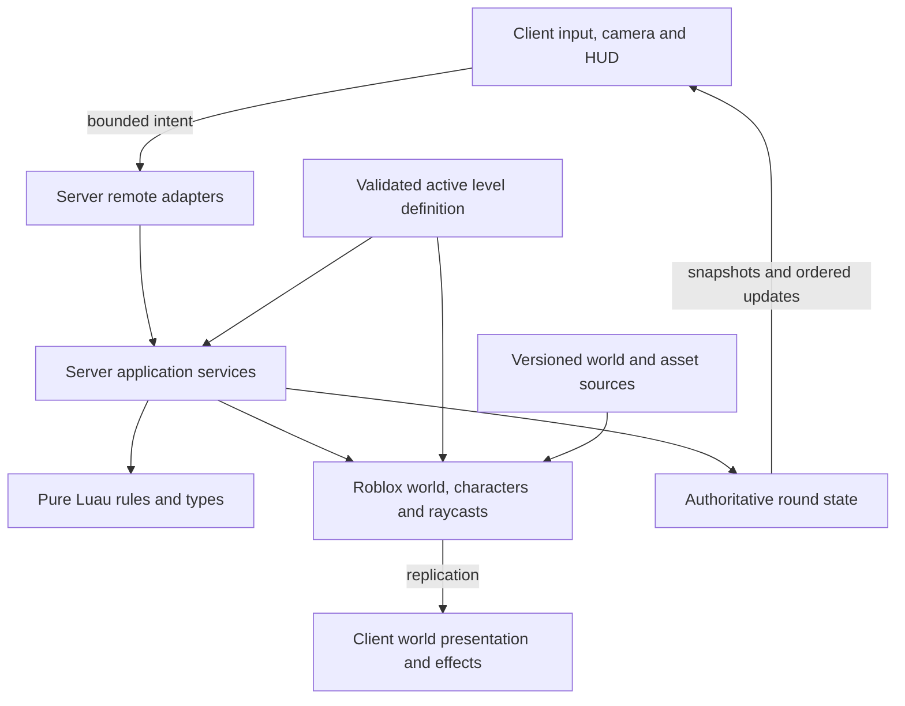

# Architecture

## Current state and target

Integrated `main`, including [PR #30](https://github.com/hanegraaff/roblox-c130-extraction-shooter/pull/30) through [PR #29](https://github.com/hanegraaff/roblox-c130-extraction-shooter/pull/29), contains the 720-stud circular battlefield, bounded terrain and three two-story buildings; authoritative rounds; a perimeter aircraft with inward thermal view, directional panning and weapon-linked zoom; gunship and M-7 combat; aircraft health/results; and persistent per-panel damage, distinct appearance tiers, registered starting-shelter destruction, residual collision and physical fragments. P07 implementation and source-specific acceptance evidence are tracked in the [plan](plans/07-destruction.md), with matching merge trees and a fresh main gate in the [integration record](docs/evidence/p07-integration.md). Current P07, P05 and P14 automated regressions pass in their documented contexts; the focused falling-fragment observation is also confirmed by the user in a live-clock demonstration with a disclosed Ground watch camera. The candidate on `docs/studio-supported-acceptance` adds one recoverable player launcher through shared aircraft-health and ground-origin authority. Its [P08 record](plans/08-rocket-launcher.md) and [evidence](docs/evidence/p08-launcher.md) record all eleven native P08 scenarios passing on harness `07e77ea` with production/UI `ef7826b`. D59 removes unsupported actual same-identity reconnect from acceptance; runtime rejoin protections remain covered by service tests. The supported P08 checks pass, with integration still pending. Additional levels remain future work.

Server-only services own roles, UserId membership, deadlines, readiness, damage and results. Engine adapters own characters, map reconstruction and replicated presentation. Clients display state, send bounded intent and manage role cameras; they never award structural or player damage.

Use a single Roblox place for lobby and battlefield, Luau for game code, and Git-first editing with Rojo for supported source/world synchronization. Roblox hosts the running experience; GitHub stores reconstructable source. No external application backend, persistent player inventory, or cross-server matchmaking is needed for the MVP.

## Studio MCP and repository synchronization

Roblox Studio's built-in MCP server is the primary interactive interface for inspecting the open place, making appropriate Studio-native changes, running supported playtests and obtaining real-engine evidence. Each call targets a specific Studio instance; identify the intended place before modifying it, especially when a development and test place are both open. Discover the available tools and Studio's version-specific `skill` guidance after connection; do not assume every playtest operation is exposed in every version.

MCP and Rojo have different responsibilities. Rojo maps repository-owned Luau and world definitions into Studio. MCP operates the live session but does not itself establish Git synchronization. Make script changes in the repository for managed paths, then sync and inspect in Studio; export deliberate Studio-authored models/world assets into the repository and manifest before considering an increment done. Do not let two agents mutate one live place simultaneously, and do not sync a test mapping into the release place. See [development setup](docs/development.md#connect-roblox-studio-mcp).

## Implemented foundation

`ServerScriptService.Server` starts `Bootstrap`, which validates public defaults and owns one `ReplicatedStorage.BootstrapStatus` Folder plus a Heartbeat connection. The release mapping then starts `GameRuntime` with production defaults: 6–10 players and 600-second rounds. Server-only `DevelopmentSettings` exists only in the test mapping, selects the **Test** label and defers gameplay startup to the test runner. That runner completes foundational TestEZ suites before starting the two-player-minimum test runtime, so map tests and round rebuilds do not race. The release label remains **Development**; no cloud publication is implied.

The client entrypoint waits for PlayerGui and server status, then starts `StatusPanel`. It also attaches one `RoundPanel` to `ReplicatedStorage.RoundState` and replaces it when the server owner changes. The controllers own their GUIs and listeners; stopping disconnects them and restores the local camera. `Lifecycle` composes nonyielding components with idempotent start/stop and rollback on partial start failure. Component cleanup callbacks must not throw or reenter the controller.

`Validation` accepts finite numbers and bounded flat scalar payloads. `Config` decodes validated public defaults, and `RateLimit` consumes a deterministic token bucket using caller-supplied monotonic seconds. `MatchService.command` adds active-ground role/life, round and sequence validation for surrender; `MatchRuntime` rate-limits its RemoteEvent. The P06 implementation validates ground equipment and server-derived world checks at its weapon boundary. Shared modules contain no secret authority state.

Pure modules with dependencies choose an explicit Instance require when `script` exists and a relative filesystem require under Lune. Standalone specs receive the actual rule module as a parameter; TestEZ wrappers pass actual mapped ModuleScripts to the same cases. This keeps one implementation usable in both runtimes without a virtual filesystem. See the [shared package](src/shared/README.md) for contracts.

## Implemented map and terrain ownership

`Workspace.World.Battlefield` comes entirely from the versioned [world definition](assets/world/Battlefield.model.json). `MapRules` validates finite coordinates, radius greater than eight studs, altitude greater than sixteen studs, kill threshold below ground, matching map/orbit centers and radii, and ground-level center focus. Defaults are center `(0,0,0)`, radius 360 studs, altitude 140 studs and recovery Y=−30. `orbit(settings, phaseRadians)` supplies the common perimeter geometry; `AircraftService` owns the actual moving model.

### Level interchange boundary (target architecture)

The MVP has one level and its current `MapRules.defaults`, `TerrainRecipe` and
`Workspace.World.Battlefield` are fixed to it. They do **not** yet provide a level
selector or a second level. P15 will replace these single-level constants with a
validated, immutable `LevelDefinition` chosen by the server at a lobby/reset
boundary. One active level owns one generation token. Clients receive only the
public level ID, bounds and presentation metadata; the server retains authoritative
geometry, panel and spawn state.

| Level-owned definition | Shared consumer and invariant |
| --- | --- |
| Stable level ID/version, world/terrain recipe and asset provenance | `MapService` validates, constructs, resets and reconstructs one active level; late joiners receive its current geometry/state. |
| Playable horizontal footprint and recovery bounds | Ground containment, client pan clamp, server aim validation, launcher placement and range checks use the same footprint. The current implementation is a disk; later footprints may differ. |
| Orbit center, radius, altitude and phase origin | `AircraftService` always places exactly one C-130 on a circular orbit enclosing the playable footprint. Camera origin follows its canonical pose and remains inward-facing. |
| Aim height envelope, queryable cover and target surface registry | Camera projection, server muzzle obstruction, thermal occlusion and combat queries share level geometry but retain their own authority boundaries. |
| Spawn/station/launcher anchors and stable building/panel IDs with Intact/Damaged/Destroyed variants | Role deployment and launcher/cover lifecycle validate level data. `DestructionService` applies the same heavy/30mm thresholds and fragment limits to every level. |

`AircraftPanRules` and zoom profiles stay in core shared/client modules. The
client samples WASD or a touch directional pad into the same signed camera axes;
the level footprint bounds the whole projected view as the held offset rotates
with the aircraft. Mouse/touch aiming supplies reticle
pixels independently. Combat resolves every shot and panel hit against the active
level generation, then the shared damage/destruction rules decide state changes.
Level packages contain geometry and parameters, not duplicate weapon, health,
pan, zoom or demolition implementations.

P15 must test at least two distinct definitions (including a nonidentical size
or shape), repeated switch/reset, stale event rejection, panel reconstruction,
aim/cover consistency, two-client replication and late join. Moving from the
current equal-radius circular `MapRules` validator to a general footprint/orbit
contract is part of that work; this document does not claim it already exists.

Server-only `MapService` validates geometry, supported/clear anchors and lobby separation with actual Workspace queries, then retains an unparented pristine clone. Its injected character provider and Heartbeat keep orchestration explicit. `GameRuntime` supplies only active living ground characters and disables the optional station exception. Exterior or below-threshold ground characters return to `Ground05` with velocities cleared. The protected lobby lies outside the disk at X=520; Waiting bodies can walk and only the assigned operator placeholder is anchored. Containment is not a general movement-exploit detector.

Pure `BuildingLayout` validates exactly two 64×48 and one 32×48-stud two-story footprints, stairs and complete wall/roof/interior panel registries. Server-only `BuildingGeometry` checks actual floor separation, tread geometry, headroom, swept entry corridors, five navigation markers and representative 32-stud room bays. It decorates building IDs, building-scoped story IDs (`01`/`02`), globally unique panel IDs, the Intact pivot and `Intact/Damaged/Destroyed:v1` variant contract. The three formal buildings supply 111 panels; the starting shelter adds 76, for 187 registered panels. Its level descriptor is the direct map-folder reference `PanelRegistries/SpawnShelter` (`StringValue.Value = "SpawnShelterPanels"`), not an arbitrary recursive path. DestructionRuntime captures all registries into stable identity Models and supplies their shared damage geometry. Floors, stairs and frames stay static.

Server-only `TerrainRecipe` reads the authored invisible descriptors for eight Grass/Rock caps. Manifest version 1 / seed 0 uses no randomness and four-stud voxels. Reconstruction clears only the axis-aligned owned volume `(-368,-112,-368)`–`(368,32,368)` and writes the fixed spheres. Invalid bounds, spheres or materials reject before terrain writes; unrelated terrain outside the box remains untouched. Terrain writes are nonyielding, while engine collision/query updates may converge afterward. The test suite permits a bounded five-second readiness wait.

`start()` validates, reconstructs terrain, decorates identities and connects containment. `stop()` disconnects Heartbeat while retaining the map and snapshot for restart. `rebuild()` restores the terrain recipe, replaces Battlefield from the pristine clone, decorates and validates; `MatchRuntime` invokes it during Resetting. `destroy()` idempotently stops containment, restores pristine geometry/terrain and releases the private snapshot; a destroyed owner cannot restart. Consumers must reacquire Instances after replacement. See the [server package](src/server/README.md), [world contract](assets/world/README.md) and [P13 record](plans/13-terrain-and-buildings.md).

## Implemented round ownership

`RoleService` selects one operator from unique eligible UserIds, excluding the previous operator when alternatives exist. It prefers the largest completed-round wait counter and breaks sorted ties deterministically from a seed. `RoundRules` owns legal phase edges and result ordering. `MatchService` composes them with injected monotonic time and life-cleanup callbacks; it has no Instances or network access. Snapshots copy members and results so callers cannot mutate authority.

The phase loop is Lobby → Deploying → Active → Results → Resetting → Lobby. Deployment waits for all assigned character loads, cancels to Lobby when an assigned player leaves, and aborts on dead/incomplete characters or timeout. Active membership remains keyed by UserId: departure removes the life, rejoin cannot restore it, and late joins are spectators. Deadline equality wins before destruction proposals; before expiry, aircraft destruction wins a mutual elimination. P03 provides the server-only destruction proposal seam; later combat supplies real damage.

`MatchRuntime` owns teams, noncolliding character groups, one heartbeat and the `RoundState.Surrender` RemoteEvent. `CharacterOwner` serializes yielding avatar loads, invalidates queued requests with tokens and uses a per-player load lease to keep an older runtime from destroying a newer character. Ground death, unexpected owned-character removal or raw Model destruction, reset or surrender eliminates. Humanoid.Died, Player.CharacterRemoving and the owned Model.Destroying signal consume that generation once, including when Destroy leaves Player.Character referencing an unparented model. Internal clear/replacement disconnects those callbacks before destroying the old body. Operator reset replaces only the protected placeholder body. `GameRuntime` explicitly composes map, round, aircraft, destruction, gunship, ground-combat and launcher owners. Stop releases launcher, ground combat, gunship combat, destruction, aircraft, rounds and finally the map snapshot; partial startup rolls back in reverse acquisition order. See package contracts for cleanup and load-drain behavior.

`RoundPanel` reads replicated phase/role/life/deadline/result attributes and computes its timer using `GetServerTimeNow`. Eliminated players and late spectators follow the lowest-UserId living ground teammate, falling back to a fixed overview when no target exists. Lobby restores the local character camera. There is no manual spectator target selector yet. `RoundPanel` delegates the living operator and labelled solo Operator preview to its owned `ThermalCameraController`; other roles retain normal round/spectator cameras.

## Target layers and dependencies



Rules do not depend on Roblox services, client presentation, network transport, or global clocks. Server services compose rules and adapters; clients present authoritative facts and may predict cosmetic feedback. Bootstrap scripts wire dependencies explicitly. Prefer constructor arguments or simple module parameters to a dependency-injection framework.

### Repository layout

```text
AGENTS.md                 Persistent project instructions
README.md                 Player-facing overview and actual availability
game-design.md            Rules, experience and scope
requirements.md           Requirement IDs and test obligations
architecture.md           Boundaries and technical decisions
roadmap.md                 Ordered status and milestone index
plans/*.md                One executable capability plan per file
docs/                     Setup, testing, decisions, conventions, evidence
.agents/skills/            Repository-local feature-loop skill
.codex/agents/             Developer, tester and writer instructions
.github/workflows/        Full non-Studio verification CI
src/shared/               Replicated types, public config and pure common rules
src/server/               Authoritative services, server-only rules and adapters
src/client/               Input, cameras, UI, audio and effects
assets/world/             Reconstructable static world definitions/exports
assets/models/            Templates for aircraft, cover and the single rocket launcher
assets/manifest.json      Provenance and cloud asset references
tests/unit/               Pure rules and boundary cases
tests/integration/        Service workflows with controlled adapters
tests/studio/             Real-engine server/client/replication suites
tests/fixtures/           Seeds, small test maps and doubles
scripts/                  Verification and build entrypoints
default.project.json      Release DataModel mapping; excludes tests
test.project.json         Test DataModel mapping; never published
rokit.toml                Pinned development tools
build/                    Generated artifacts; ignored by Git
```

### Roblox ownership

| Filesystem area | DataModel location | Ownership |
| --- | --- | --- |
| `src/shared` | `ReplicatedStorage.Shared` | Public types, presentation config, shared pure rules; no secrets |
| `src/server` | `ServerScriptService.Server` | Authoritative services and server-only rules |
| `src/client` | `StarterPlayer.StarterPlayerScripts.Client` | Per-player local controllers |
| `assets/models` | `ServerStorage.Assets` | Templates cloned by server; only needed instances replicate |
| `assets/world` | `Workspace.World` | Static map objects authored/exported under source control |
| `tests/unit`, `tests/integration`, `tests/studio/specs-server`, `tests/fixtures` | `ServerStorage.Tests` in test project only | Shared cases, server specs and fixtures |
| `tests/studio/server` | `ServerScriptService.ServerTests` in test project only | Automatic server TestEZ runner |
| `tests/studio/client` | `StarterPlayerScripts.ClientTests` in test project only | Automatic client TestEZ runner |
| `tests/studio/specs-client`, `Packages` | `ReplicatedStorage.ClientSpecs`, `ReplicatedStorage.TestPackages` in test project only | Client specs and locked TestEZ dependency |
| `tests/fixtures/DevelopmentSettings.luau` | `ServerStorage.DevelopmentSettings` in test project only | Server-only test label and deferred gameplay startup marker |

The release project excludes tests, test dependencies, fixtures and development overrides by construction, with generated-artifact inspection enforcing the boundary. Bootstrap must not run server-only modules on clients.

## Components to introduce as needed

| Component | Responsibility | First plan |
| --- | --- | --- |
| `Bootstrap`, shared validation and lifecycle | Implemented shell wiring, cleanup, structural decoding/rate helpers | P01 |
| Named remote adapters | Implemented surrender, aircraft-selection and gunship-fire shape/role/life/round/replay/rate checks; P06 implementation adds ground equipment and fire/reload validation | P03 onward |
| `MapService` | Implemented geometry/anchor/lobby validation, containment, bounded terrain reconstruction, multi-story buildings and pristine panel registry rebuild | P02; expanded P13 |
| `MatchService`, `RoleService`, `RoundRules` | Implemented roster, phase/deadline, round identity, assignment and outcome policy | P03 |
| `GameRuntime`, `MatchRuntime`, `CharacterOwner` | Implemented map/round composition, character ownership, replication and cleanup | P03 |
| `RoundPanel` | Implemented basic round HUD, surrender intent and teammate spectating | P03; presentation improved in P10 |
| `AircraftService`, `AircraftSelection`, `AircraftRules` | Implemented canonical perimeter orbit, validated aim geometry and authoritative targeting-profile selection; P06 implementation adds health/destruction | P04; health in P06 |
| `ThermalCameraController`, `AircraftPanRules` | P14 implements verified inward WASD/touch pad pan, recenter, acknowledged zoom and actual-surface reticle projection on `main` | P04; panning P14 |
| `CombatService` / `CombatRuntime` | Validates gunship intent/readiness and resolves server-side flight, impact and ground damage | P05; ground combat P06 |
| `PanelDamageRules`, `DestructionService`, `DestructionRuntime` | Implemented server-only stage arithmetic, ordered shot outcomes, replicated progress, residual colliders and bounded fragments | P07 |
| `LauncherService`, `LauncherRuntime`, `LauncherGeometry` | Candidate: one identity, atomic ownership, reload-preserving recovery, validated real rocket flights and primitive representations | P08 |
| `MatchService` outcome integration | Aircraft destruction, ground elimination, timeout and forfeit resolution | P09 (basic outcomes P03/P06) |
| `GroundController`, `HUDController`, `SpectatorController` | Role-specific controls and complete player feedback | Introduced with features; completed P10 |

Use one combat orchestration boundary with weapon-specific modules rather than three independent damage systems. `MatchService` alone commits outcomes. Other services propose changes through explicit calls/events; they never independently set the winner. Keep reset and cleanup centralized while each component owns its resources.

## Authoritative state and timing

Use typed data records for round ID, phase, phase revision, roster by UserId, role/life state, deadline, aircraft health/state, per-weapon readiness, selected weapon, launcher ownership/location/reload state, and result. Instance Attributes can expose view state but are not the internal transaction mechanism.

Inject a monotonic clock and seeded random source into rules/services. Client HUDs derive countdowns from a replicated server deadline and synchronize with the platform's server clock. Never accept client timestamps to award hits, pickups or results. Deterministic tests advance a fake clock without real sleeps.

Each active-round command carries the current round ID and a per-player monotonic sequence. Reject commands from old rounds and repeated sequences. A result is committed once; subsequent commands observe a terminal phase. Follow the conflict order in [game-design.md](game-design.md). Teardown invalidates queued work with a generation/round token so an old projectile cannot damage the next round.

## Network contracts

Use a small named RemoteEvent surface, not an unrestricted generic RPC dispatcher. Prefer asynchronous requests and snapshots; avoid yielding RemoteFunction round trips for combat. Define Luau request types **and** runtime validation: types alone do not validate untrusted packets.

| Direction / intent | Minimal payload | Server derivation and validation |
| --- | --- | --- |
| Client → surrender (implemented) | round ID, sequence, `action = "Surrender"` | Exact three-field shape, active connected ground life, current round, increasing bounded integral sequence, deadline and per-player rate budget |
| Client → fire | round ID, sequence, weapon ID, bounded aim direction/point | Role/life, equipment, ammo, cooldown, finite values, origin, range, aim envelope, obstruction |
| Client → aircraft select (implemented) | exactly `roundId`, `sequence`, `weapon` (`GAU23`/`M102`) | Living connected operator, Active/unexpired round, increasing bounded integral sequence; six-token budget refilling at four/second; atomic acknowledged weapon/round/revision |
| Client → M-7 reload (implemented) | exactly `roundId`, `sequence` | Active equipped ground life, readiness, bounded sequence and request budget; gunship reload is automatic |
| Client → launcher Pickup / Drop (P08 candidate) | exactly round ID, sequence, launcher ID | Current identity, increasing sequence, live connected Ground membership, request budget; pickup also shares movement/origin authority, 8-stud reach and solid-world sight line |
| Client → launcher Fire (P08 candidate) | exactly round ID, sequence, launcher ID, finite x/y/z target | Same authority plus held/equipped Tool, reload deadline and bounded server-head-to-target range; server sweeps the resulting flight |
| Client → sync request (target) | bounded request token | Per-player rate budget; return only that role's permitted snapshot |
| Server → snapshot/update | round ID, revision, permitted state | Immutable view model; client discards stale rounds/revisions |
| Server → effects | round ID, shot/event ID, bounded effect data | Cosmetic only; client deduplicates and caps lifetime/count |

Aircraft destruction is computed from server-resolved damage, never a client win claim or rocket-hit count. Validate server-observed movement for implausible travel before granting launcher pickup or accepting a ground firing origin; reject or correct suspicious movement without automatically banning from a single noisy observation. Roblox character network ownership does not make client movement authoritative for rewards.

Apply cheap shape/size checks and per-player/per-action budgets before expensive raycasts. Bound strings, tables, vectors, shot counts and queued work. Tests cover NaN, infinity, malformed nested payloads, unknown IDs, replay, stale round IDs, floods, spectators and eliminated players. Rejected requests must leave state unchanged.

## Implemented aircraft and targeting view

`GameRuntime` starts one `AircraftService` from the Git-authored `ServerStorage.Assets.C130` template. Its `Hitbox` remains the canonical model PrimaryPart/pivot; the P06 implementation also makes all 15 visible authored aircraft parts queryable, including wings and tail, while all 16 parts remain anchored, noncolliding and nontouching. `GAU23Muzzle` and `M102Muzzle` are named attachments used as server firing origins. The P06 record documents aircraft damage, operated review and its two-client acceptance/P05/P14 regressions on that earlier source; The P07 plan records current-source engine/regression evidence and the remaining acceptance gaps. The service rejects an existing owner or missing canonical template, and idempotent stop destroys the model, selection transport and three owned connections.

`AircraftRules.pose(map, settings, elapsedSeconds)` uses injected time to compute perimeter position and tangent, rejecting invalid settings/time or derived overflow. Production uses synchronized server seconds: radius 360 studs, altitude 140 studs and period 90 seconds, increasing phase from positive X toward positive Z. Orbit starts at phase zero, resets at deployment and return to Lobby, and freezes in Results/Resetting. Ordinary server replication carries this one canonical pose; there is no local smoothing shell. The two-client harness declares an eight-stud convergence bound, while sampled injected-time engine poses use 0.01-stud precision. These tolerances and observed results are recorded separately in P04.

Server-only `AircraftSelection` owns selected weapon, revision and accepted per-user sequences. `AircraftState.Selection` publishes them as one JSON string so round/weapon/revision are acknowledged together. The client sends bounded selection intent and changes weapon label, FOV and reticle projection only from a valid acknowledgement for its current round. Unknown, malformed, stale, replayed, wrong-role or terminal requests leave selection unchanged. Returning to Lobby forces the initial GAU23 profile even when the round ID has not changed. P05 combat owns independent readiness across this selection seam; profile changes do not refill or reset either weapon.

The P14 `ThermalCameraController` places a Scriptable camera at the replicated canonical aircraft position. Pure `AircraftPanRules` integrates signed WASD/touch-pad axes into a ground focus in the aircraft's rotating local frame. `worldFocus` rotates that held offset with the server-owned orbit; the plane pose, speed and tangent remain untouched, and the relative camera angle stays steady instead of spinning around a near-underfoot world point. `viewFits` requires ground intersections at the 25% and 75% positions on both viewport centerlines to remain within the flat playable disk, with a two-stud inset. Thus the level boundary can enter the outer quarter of each centerline; a circular boundary may expose more at the corners. All four corner rays must point downward, and pitch is limited to 80° as a tunable guard against a straight-down view. Each axis clips at this boundary. The current 30° GAU23 / 40° M102 defaults leave usable pan range at desktop and phone aspect ratios. Unusually wide windows can narrow the displayed lens to a supported FOV. Both profiles use the wide lens for pan bounds, preserving the held local offset through acknowledged selection; the tighter lens therefore shows less beyond an edge. R / Recenter and fresh role/round entry return to a safe default inward view. The projected canonical-right basis and keys 1/2/named buttons retain the existing camera and server selection seams.

Directional input drives pan independently of aim. `AircraftPanRules.raster` rounds/clamps the displayed mouse/touch reticle once to integer pixels inside the central 70%; the same viewport integers drive ray projection and published pixels; a measured ScreenGui origin converts them to GUI-local drawing offsets, including mobile safe-area shifts and odd viewports. Each rendered projection raycasts actual collidable Battlefield/Terrain geometry at the active FOV. One frame publishes orbit-local and rotated world focus, viewport, camera, reticle pixels, first hit and endpoint together for diagnostic/fixture observation. `Battlefield/AimEnvelope/MinimumY` and `MaximumY` NumberValues author the current Y=−1…32-stud bounds; AircraftService validates and captures them on startup and replicates presentation values. Its server-only `aimAllowed(endpoint)` checks the disk/envelope and actual solid-world obstruction from the acknowledged selected weapon’s muzzle attachment, allowing 0.5 studs at the first surface. A local aim indicator never authorizes hits; P05 sends bounded fire intent but introduces no high-rate pan remote.

The operator camera owns a local noncolliding, nonqueryable ground backdrop below the level for views beyond the disk. Its scaled brick mesh and corner-ray limit share a radius bound that covers all aircraft phases. The backdrop is destroyed on camera teardown, cannot alter server visibility or aim validation, and is not playable terrain.

Local color correction supplies grayscale/high contrast and `Highlight.DepthMode = Occluded` lets solid cover hide player highlights. Active living ground characters and explicitly tagged thermal fixtures are presented; clients gain no damage or visibility authority. Role loss or owner removal destroys thermal GUI/effects/highlights and role input listeners, restoring captured camera/FOV/mouse settings. `RoundPanel` resumes ground, teammate spectator or lobby view. A labelled test-only solo Operator preview permits cosmetic profile choices while its player remains Waiting in Lobby.

For the bounded MVP map, `Workspace.StreamingEnabled` is explicitly false (D11). This avoids a remote camera looking at absent scenery. If profiling forces streaming, treat that as a deliberate architecture revision: persistent aircraft, controlled replication focus, target-area acquisition/loading states, re-stream-safe effects and 10-player visibility tests. P05 supplies swept projectile collision and ground-character damage; P06 supplies aircraft health/destruction. P07 adds authoritative panel openings and bounded physical fragments; they do not change camera ownership.

## Panned targeting (P14)

`AircraftPanRules` is shared deterministic presentation math, with no transport or hit authority. Defaults are 120 studs/second, normalized diagonal motion, a 0.1-second per-update cap and the quarter-screen view boundary for the current level. Invalid/nonfinite input rejects without mutation. Positive horizontal input follows the rendered camera's right vector and decreases orbit-local Z; A/left arrow moves left, D/right arrow moves right. The public nonyielding `ThermalCameraController.input` adapter preserves raw mouse viewport coordinates and subtracts current GuiInset only for GUI-content hit queries. `touchInput` instead tests the raw GUI-content touch point and converts it to viewport coordinates for the camera ray; processed input, focused text and actionable GUI cannot claim world aim. Operator WASD and touch-pad holds drive the same signed axes; ground movement remains normal. Pad touches and a separate world-view aiming touch have distinct ownership. The controller suspends pan over actionable desktop UI, text focus and window focus loss, clears held touch ownership on focus loss, restores captured camera/FOV/mouse state on role loss and disconnects all touch/input/render observers at owner stop.

`ThermalCameraController.new` and `RoundPanel.new` accept an optional nonyielding input provider. Production omits it and uses UserInputService. Engine fixtures can inject raw pointer/recenter/profile intent through this normal boundary after stopping the original owner; they never assign focus or introduce a second active camera. Native input, rendered occlusion and viewport usability were reviewed separately for P14; its actual acceptance is recorded in the plan. P05 firing controls and effects received their own operated desktop and simulated-phone review; see the plan for source-specific evidence.

MapService retains terrain/building reconstruction ownership. P07 consumes its registered panel IDs and Intact pivots; it does not duplicate map, pan or zoom rules.

## Gunship combat (P05)

`GameRuntime` composes the map, match, aircraft and combat owners, with reverse-order cleanup. `CombatService` owns deterministic fire validation and independent weapon readiness. The engine `CombatRuntime` derives role, selected weapon, muzzle and server time, rate-limits requests, sweeps a 0.05-stud-radius sphere through level/character geometry and ignores flights with no collision. If the muzzle begins inside solid Battlefield cover, initial overlap resolves it conservatively without splash. The BasePart overlap query does not detect Terrain containing a muzzle; future levels must address that limitation. The active level supplies disk and authored height bounds; collision checks include the active Battlefield and Terrain. `CombatViewRules` validates the client-claimed focus, aspect, target and replicated camera position against permitted view geometry with a symmetric 1.25-second orbit-position tolerance plus one stud and a raster margin of 1% of the viewport per edge. This establishes that a claimed view is permitted, not that it is the actual client camera.

The current defaults are 100 GAU23 rounds at a 0.15-second minimum cadence with a five-second automatic reload, 650 studs/second, up to two seconds of flight and 25 damage within a four-stud blast; M102 holds one round, reloads in four seconds, has a one-second minimum cadence, travels at 300 studs/second for up to four seconds and applies 100 damage within 18 studs. Both use a 900-stud range ceiling. These values are tuning defaults, not selected balance. Switching retains each profile's ammunition and timers. Server-side impact uses a `DamageRules` ledger to cap damage by current and maximum health and award each live ground target at most once per shot; it samples line of sight from just before the collision to its root against unchanged level solids; direct hits apply once and solid cover can block splash. This is an approximation, not pressure simulation.

A nonyielding typed impact callback carries round/shot ID, profile, hit position, optional panel ID, impact time and accepted `firedAt`. Observers must not mutate colliders. P07 receives every accepted shot outcome through a separate ordered ledger and flushes geometry only after all sweeps and player-damage queries in that Heartbeat batch. Initial muzzle overlaps use that same batch. Readiness and impact attributes replicate presentation state. Automated and operated combat acceptance is recorded in [P05](plans/05-gunship-combat.md); P14 evidence alone does not prove combat.

## Ground combat (P06)

`GameRuntime` composes the existing aircraft and gunship owners with `GroundCombatRuntime`. For each active living ground player the server owns one M-7 Tool, individual rifle readiness, shared aircraft health and `GroundFire`/`GroundReload` intents. The server checks role, life, equipped ownership and rate, then runs a nonmutating fire preflight for bounded payload, sequence, aim, range and readiness before expensive movement and geometry queries; it never accepts a claimed origin, hit, damage or victory. `GroundMovementGuard` samples server-observed root positions each Heartbeat and before fire with a bounded movement budget; its 45-stud burst, 70-stud/second refill and 8-stud recovery radius are tuning defaults, as is an 8-stud maximum head/root offset. A suspicious jump quarantines firing until return near the last trusted point or an explicit trusted server spawn/map correction. The guard issues no automatic ban and is not a complete anti-cheat; severe latency or unusual legitimate movement may require returning or tuning. `GroundOriginGeometry` separately checks root/head BasePart overlaps and the Battlefield/Terrain segment in both directions. Its Terrain test combines six-axis inward/outward collision rays with a 4-stud occupied-voxel fallback for deep interiors; failed queries explicitly reject firing. It is conservative rather than an exact signed-distance test for arbitrary caves, so unusual terrain can still reject valid fire and merits playtesting. Cover blocks the ray and friendly fire is off. Fire/reload and tools are torn down at reset, role loss or owner stop. The server owns a primitive noncolliding held-rifle model and resolves the first hit along the bounded server ray, including solid cover and visible aircraft surfaces. The server immediately resolves the hitscan and then animates a noninteractive tracer from its origin to the resolved endpoint; the visible segment is at most 3 studs long. Cosmetic travel uses 1200 studs/second with a 0.15-second minimum (up to 1 second at the 1200-stud range), followed by a 0.1-second terminal hold; a brief flash appears at the held rifle barrel. The travel animation does not delay or predict damage. Replicated `GroundShot` includes the server-awarded aircraft-hit fact and is cleared on reset; clients flash the shooter’s reticle for its own current-round server-resolved shot and display AIRCRAFT HIT −5 for 1.2 seconds only on confirmed aircraft damage. On source `0ab3607`, the user reported visible tracers aligned with the crosshair and aircraft damage; independent same-shot observations matched 12 shots, including eight damaging hits. The P06 plan records its earlier acceptance/regression evidence; the P07 plan records the revised candidate’s current verification scope. Both roles receive a dedicated aircraft-health readout. Clients render ammo/reload and send aim intent from desktop pointer or touch viewport center; they do not authorize damage.

The movement budget permits short rapid relocation within its available burst and does not sweep the traveled path for walls. It therefore bounds movement-based firing-origin abuse but does not eliminate possible teleport or cover bypass. This is a code-derived limitation rather than a confirmed exploit.

The initial defaults are 5 aircraft health units per direct M-7 hit, magazine 30, reserve 120, cadence 0.15 seconds, reload 2 seconds and server range 1200 studs. `AircraftHealth` derives maximum 300 from a 100-unit direct rocket hit, clamps health and deduplicates each shot. The P08 candidate uses this same health owner through server-only `rocketCast`; the existing sweep/impact seams remain available to engine fixtures. Players acquire the one map launcher rather than receiving it with their initial loadout. `MatchService` remains the only result owner. Combat owners submit destruction and elimination facts; `MatchRuntime` defers outcome evaluation until Heartbeat callbacks have submitted that step, retaining deadline-first and pre-deadline destruction-before-elimination precedence.

The current P06 source is integrated on `main`. Its host, two-/three-client, P05/P14 regression, operated desktop and simulated-phone results are recorded in [P06](plans/06-ground-combat.md), with source-specific Studio evidence and documented limitations. Future level contracts must retain authoritative solid geometry and aircraft hitbox access.

## Progressive panel destruction (P07)

`PanelDamageRules` is deterministic, server-only stage arithmetic; `DestructionService` is its ordered accepted-shot ledger. Each panel starts Intact (0), becomes Damaged (1), then Destroyed (2). A stage budget is nine equivalent seconds: a direct M102 hit contributes three persistent heavy seconds, so a pristine panel changes at the third and sixth heavy hits. Same-panel GAU23 fire contributes the elapsed server `firedAt` difference between consecutive accepted shot outcomes. The first valid hit contributes zero. Nine valid seconds advance each stage, with a 1e-7-second threshold tolerance; a 1e-9-second CombatService readiness tolerance admits floating-point cadence rounding only. Completed stages discard surplus credit, while uninterrupted 30mm timing can continue into the next stage.

The default continuity gap is 0.225 seconds (1.5 × the 0.15-second cadence). Under the user's D51 revision, accepted misses, obstruction, target/weapon changes, reload or eligibility loss break continuity without clearing any earned per-panel credit. The first impact after a break earns zero elapsed time. An ordered barrier waits for earlier accepted in-flight outcomes, preserves their earned credit and then clears only the timing anchor; later shots cannot earn paused time across it. Malformed, unauthorized, stale, duplicate and cadence-rejected requests cannot mutate progress. D51 supersedes the older partial-credit reset default; numerical/mixing defaults and three/six-hit / nine-second thresholds remain.

CombatRuntime sends every accepted shot's eventual outcome, including misses and expiration, with round ID, shot ID, weapon, firedAt and an optional server-derived panel ID. DestructionRuntime identifies only actual solids belonging to the current registered panel Models; copied/unknown tags, supports and old-map solids are normalized to a no-panel outcome so they cannot stall the ordered frontier. DestructionService buffers out-of-order completion and scores only in accepted shot order; its frontier deduplicates finished shots and bounds unresolved outcomes to 512. Clients provide neither panel identity nor duration/damage authority. Only the level-supplied panel registries enter the ledger, including the starting shelter's exterior; supporting floors/stairs/frames, generic nonbuilding `Breakable` barriers and terrain do not. These modules apply the same thresholds to all registered geometry; P15 must still supply and validate a second level definition.

DestructionRuntime owns the engine boundary. `sync(roundId)` reacquires the current Battlefield by Instance identity and invalidates old generations, including map replacement while the completed round ID remains unchanged. `resolve(outcome)` updates the ledger without changing collision. CombatRuntime completes **all** projectile sweeps and player blast sight-line queries against pre-flush cover, then calls `flush(nowSeconds)`. Thus the blast and other projectiles in the creating batch cannot exploit the new hole. A later batch can. Initial muzzle overlaps are queued into this same batch. Terminal phase/deadline cancellation closes the ledger generation and rejects pending outcomes/barriers while retaining all earned damage/appearance until reset. It does not finish old flights. `reset` opens a pristine generation. Impact observers must not yield, reenter or change geometry.

`PanelGeometry` wraps each authored panel in a stable identity Model, preserving its panel ID, Intact pivot, thickness and original clone. Damaged geometry scales the two 25%-width side strips along the longest face axis, leaving a central 50% opening. Destroyed retains the identity without solids. D52 adds a separate Pristine/Light/Heavy/Total appearance: positive credit gives persistent Light scars, structural stage 1 stays visibly Heavy at zero local progress, and stage 2 has no panel. D54 proposes hue-independent crack/luminance cues on both faces with Concrete/Slate rather than glowing CrackedLava. Cosmetic marks cannot collide, enter queries or identify as real panel colliders. Floors, stairs and frames remain static; genuine holes have no invisible full-panel collider. Stage/progress/credit/appearance replicate as current state.

The active coverage revision adds the starting shelter's entire wall/roof union to level-supplied panel registries, alongside the three multi-story buildings. D53 proposes replacing seven legacy permanent surfaces with 76 panels, for 187 total. No duplicate old collider may remain; spawn anchors and existing entrances stay fixed. The separate outside waiting lobby and standalone nonbuilding barriers are unchanged. The shelter is an ancillary one-floor structure, not a fourth formal two-story-building requirement. The same rules, geometry and fragment owner consume every registered surface; no map-specific damage implementation is added.

`PanelFragments` owns one Workspace folder and the global `PanelFragments`/`PanelStatic` collision groups exclusively. Defaults emit four server-network-owned Parts per transition, retire the oldest at a 48-live cap and expire each after eight seconds. Initial linear speed is at most 12 studs/second, angular speed at most 4 radians/second; dimensions are capped at 1.5 studs per axis with density 1, bounding generated mass to 3.375 and initial linear momentum to 40.5 mass·studs/second. Gravity/contact evolve velocity afterward. Fragments collide only with owned anchored scenery and Terrain, excluding characters and each other. They have no damage callback, forces or structural constraints. Their trajectories cannot decide cover state.

Query safety uses the explicit Battlefield/Terrain/character include filters and collision-group matrix as well as `CanQuery = false`; that flag alone does not exclude a collidable Part from every query mode. Combat, movement-origin and thermal queries must keep fragments outside their authoritative query sets. New code must not replace these filters with an unrestricted Workspace query. `clear()` removes all fragments; `stop()` also restores captured scenery/Terrain collision groups and unregisters the owned groups. DestructionRuntime's idempotent stop restores captured pristine panel Parts. Map reset removes fragments, reacquires fresh panels and clears stage, progress, pending outcomes and continuity. All public runtime calls are nonyielding; teardown owns no delayed debris tasks.

The [P07 plan](plans/07-destruction.md) records deterministic, engine, two-client and operated acceptance separately. D50 removes a real late-join scenario from the current gate while retaining runtime spectator authority. Geometry/property checks alone do not establish rendered thermal legibility or operated readability. The revised source has fresh automated and human-observed evidence; earlier counts still validate only their recorded source.

## Weapon, launcher and result invariants

Use explicit weapon configurations for `GAU23`, `M102`, `M7` and `RocketLauncher`, with the exact player-facing names from the design. Aircraft weapons are role equipment; every ground player spawns with the M-7, while only the launcher carrier can fire rockets. Keep readiness by weapon ID; selection cannot reset cooldown, reload progress or ammunition. Store launcher reload state on the round-owned launcher identity, not the current holder.

Derive integer aircraft maximum health as three times direct rocket damage. Apply each direct rocket impact once, with no duplicate splash to the same aircraft; first/second hits alone leave a pristine plane alive and the third destroys it. M-7 damage is small and positive, reducing the same health pool. No regeneration, falloff or armor modifier can break the three-hit contract. AircraftService proposes destruction to MatchService; MatchService alone commits the immediate team result and cancels pending combat.

The P08 candidate's server-only `LauncherService` owns one round-scoped identity (`launcher:<roundId>`) and transitions Available → Held → Recovering → Available. Pickup is atomic and nonyielding; rejected shape, round, sequence, eligibility or readiness leaves ownership/ammunition unchanged. Accepted per-user sequence history and the four-second reload deadline stay on that identity through transfers. `clear()` makes it Inactive; a different round's `reset()` creates one fresh identity/readiness state, while same-round reset cannot refill it.

`LauncherRuntime` composes the service with the existing ground owner and level anchors. Remote receipt spends a shared per-player eight-token budget refilling six/second, performs cheap bounded validation and queues at most 32 requests. Deferred processing follows MatchRuntime's outcome commit, so Results/deadline/aircraft destruction wins over pickup and recovery. Pickup and fire use `GroundCombatRuntime.validateGround` and its existing movement/origin guard; pickup additionally needs a clear solid-world sight line within eight studs. The server derives rocket origin from the character head, requires the actual equipped launcher Tool, and rejects targets beyond 1200 studs.

Rockets move linearly at 240 studs/second and sweep a 0.2-stud sphere through Battlefield, Terrain and the canonical aircraft. `GroundCombatRuntime.rocketCast` returns the first collision and awards shared aircraft damage only for a direct aircraft hit; obstruction ends the flight, while a miss expires after five seconds or 1200 studs. Cosmetic rocket Parts cannot collide or decide hits. Already-fired rockets can outlive a dead shooter while another ground player keeps the round active. Terminal phases, a new round or stop invalidate pending requests/flights.

`LauncherGeometry` constructs the single available Model or held Tool from original primitives. Representations are noncolliding/nonqueryable and never define authority. While held, the runtime samples last trusted supported ground positions. Drop, death, character removal or disconnect preserves readiness and recovers there; a 12-stud downward floor probe, slope and 4×6×4-stud clearance checks reject invalid positions and fall back to the original validated anchor. The runtime reacquires current anchors after map reconstruction. `stop()` idempotently disconnects transport/Heartbeat/player observers and removes models, tools, flights and queued work. The manifest records these runtime-generated primitives; no live damaged state or effects are exported as authored map assets.

`GroundCombatController` presents team ownership and current equipped readiness, sends E/PICK UP or G/DROP intent, and uses native tool slots or touch M-7/ROCKET buttons for selection. Switching equipment cannot reset either weapon. Aircraft health remains the team's damage guide; it does not promise a fixed remaining rocket count after rifle damage. The [P08 evidence](docs/evidence/p08-launcher.md) records eleven passing native cases with three initial/peak actual clients and two after intentional carrier departure, plus fresh 156-server/seven-per-client smoke. D59 excludes unsupported actual same-identity reconnect from acceptance; runtime rejoin authority remains covered by service tests.

P03/P06 establish basic win proposals; P09 validates their combined timing/disconnect behavior. Follow game-design.md for deadline precedence, same-step mutual kills, forfeits and late projectiles. There is no collectible-progress or escape-zone service.

## Assets, destruction and reconstruction

Prefer text `.rbxmx` model exports and `.model.json` definitions for reviewable assets; retain source meshes/textures or their reproducible provenance when practical. Large binary exports require a documented storage/LFS decision. `assets/manifest.json` records stable internal IDs, source/author/license, local file, Roblox asset ID if any, and upload owner when known.

Each authored Part/SpawnLocation in `.model.json` uses a twelve-component canonical `CFrame` (translation followed by row-major rotation). `Position`/`Orientation` aliases are forbidden because their presence in generated XML does not ensure Studio loads the intended pose. Artifact inspection compares every authored part's finite pose, positive dimensions, shape and collision/query/touch flags in both builds, with five deliberate corruption probes. Studio loaded-transform assertions and world queries remain required: reproducible serialization alone does not prove engine reconstruction.

Static map files and server-cloned templates have separate ownership. Do not synchronize a live simulation back as authored source. Studio edits to managed objects must be exported to the mapped source and verified with a clean build. Avoid mixed ownership of the same Instance subtree.

The source includes the original normalized two-strip [PanelResidual template](assets/models/PanelResidual.model.json). DestructionRuntime scales it to each registered wall/roof/interior panel; no external art or cloud reference is required. Runtime fragments are generated primitives, not authored map content. Never export them, projectile effects or damaged live state as pristine source. The [progressive destruction contract](#progressive-panel-destruction-p07) governs their lifecycle.

### Blender source and material-aware panel assets

The [P16 review package](assets/blender/military-outpost/README.md) retains an
editable, self-contained Blender 5.3.0 outpost under
`assets/blender/military-outpost/` and game exports under
`assets/exports/military-outpost/`. It supplies a versioned panel catalog for
six material/shape families, dimensions, center pivots, Pristine/Light/Heavy/Total
meshes, explicit collision-proxy candidates and bounded material-matched fragments.
Its identity migration preserves 25 legacy panel IDs/pivots and declares one new
partition plus fixed apertures. Inventory and reusable-kit mappings connect
named editable components to placed assembly and floor-centered prop exports.

The asset checker covers all authored files under `world`, `models`, `blender`
and `exports`, and requires content hashes for every Blender source/export.
The portable audit measures actual OBJ triangle projections, proxy coverage,
UV/material references, fragment bounds, budgets and package dependencies.
Hash-bound clean Blender reopen/FBX-import reports are checked in; CI validates
their relation to the candidate without running a fresh Blender process.
Saved-source renders and explicit human approval are additional acceptance
evidence. The user explicitly approved source revision `e8fb840` on 2026-11-13;
the [approval record](docs/evidence/p16/human-approval.json) binds the exact
Blender hash. Asset bytes remain unchanged by that external record.

Original baked PNGs and explicit material constants provide export equivalents
for the source materials. Blender cameras/review lighting stay outside Rojo
runtime mappings. The 32×48-stud footprint and floor levels remain authored
construction inputs; the external balcony/stair and declared aperture migration
need actual P17 clearance/cover checks. Local Blender round trips do not infer
Roblox import success, thermal visibility, runtime physics or upload permission.

[P17](plans/17-integrate-military-outpost.md) will replace only the smaller
Outpost using the human-approved package. Current `PanelGeometry` clones
primitive Parts and applies generic scars/residuals, so mesh import alone cannot
consume the new variants. Extend the shared asset/reconstruction boundary to
select validated material-specific visuals, authoritative collision/query
proxies and safe fragments. Preserve `PanelDamageRules`/`DestructionService`
timing, damage authority and lifecycle. Material does not change durability.
Keep existing primitive panels compatible; missing variants, bad IDs/geometry
and stale reset references need explicit validation. Mesh appearance and proxy
geometry must agree for actual openings and thermal/weapon obstruction.

MapService retains pristine rebuild and registry ownership. Every new imported
template needs a managed source/export and manifest record; deliberate Studio
placement must return to Git. P16's Blender approval and P17's actual engine,
two-client/reset and human presentation gates are distinct. This boundary is
building-asset data for the current level, not an implementation of P15 level
selection or a claim that material-aware authored variants already work.
The user-directed D63 order schedules P16 then P17 before continuing P09;
P17 consumes the P07/P13/P14 core without requiring P08 to start. Preserve and
regression-test completed P08 source when present in the selected branch.

## Tooling and verification

Run `python3 scripts/setup.py` for the pinned tools, locked TestEZ and hash-checked Roblox engine definitions, then `python3 scripts/verify.py` for the complete non-Studio gate. It runs repository and asset-manifest checks, the portable Blender-package audit and rejection tests, StyLua, Selene, strict Roblox-aware analysis, deterministic Lune unit/service suites, deliberate failure/empty/type probes, both Rojo builds, canonical authored-geometry/corruption checks and XML release-isolation inspection. Missing tools, failed or empty suites fail the gate.

The test mapping runs separate server and client TestEZ bootstraps in real Studio Play contexts and publishes structured JSON reports. Those runs establish mapped imports and engine behavior separately from the host gate. Ordinary Linux CI runs the host gate and cannot replace required Studio evidence.

See [testing](docs/testing.md) for acceptance levels and [development](docs/development.md) for source/release workflow. A tool change needs updated pins, commands and successful clean-build evidence.

## Platform references

- [Rojo project format](https://rojo.space/docs/v7/project-format/) defines DataModel mappings and ignores.
- [Roblox client/server security](https://create.roblox.com/docs/scripting/security/client-server-boundary) informs validation at every remote boundary.
- [Roblox streaming](https://create.roblox.com/docs/workspace/streaming) describes the camera/world availability tradeoff.
- [Studio testing modes](https://create.roblox.com/docs/studio/testing-modes) separates client, server and multiplayer validation.
- [TestEZ bootstrap](https://roblox.github.io/testez/getting-started/running-tests/) is the engine-suite entrypoint.
- [Lune](https://lune-org.github.io/docs/getting-started/1-installation/) provides standalone Luau execution, not a complete live Roblox server.

## Local solo preview

The test-only runner installs `LocalTestControls` in ordinary Studio sessions. A single client's ready Waiting character is moved to Ground05 (Ground preview) or the Operator station and marked `LocalMapPreview`/`LocalPreviewRole` for a clear client label; phase, role, life and competitive population rules remain unchanged. Server-only BindableFunctions allow returning to the lobby or re-entering preview. Owned heartbeat containment recovers invalid preview positions, invalidates preview on phase change/departure, and disconnects on teardown. All shortcut code lives under the excluded test mapping; production owns no test shortcut transport.

`HumanTestSession` owns the test-only settings transport and manual runtime restarts. A fresh runtime/normal RoleService seed enforces requested roles without a production override hook or fake player. Requests validate shape, action/value, rate, sequence and session generation. The actual map reset path and avatar-drain ownership precede a replacement runtime. The client-only test panel sends intent and presents server feedback. All control logic is under the excluded test mapping; the production client merely understands the clearly labelled preview presentation.
