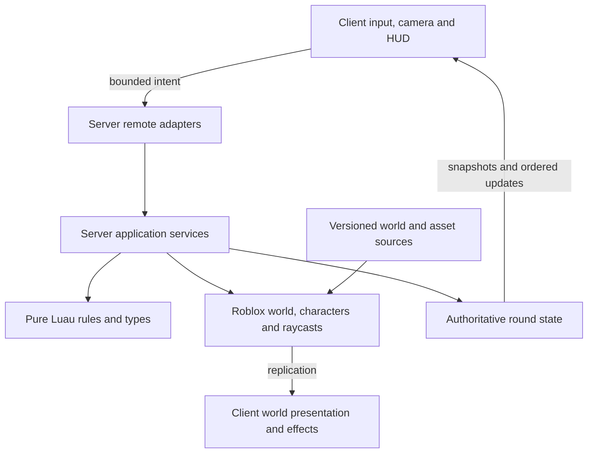

# Architecture

## Current state and target

The repository currently contains design documents, source/package boundaries, Rojo mappings, and a scaffold verification workflow. It intentionally contains no gameplay implementation. The systems below are the **target architecture** introduced incrementally by the [roadmap](roadmap.md). Do not create empty service classes for every future component.

Use a single Roblox place for lobby and battlefield, Luau for game code, and Git-first editing with Rojo for supported source/world synchronization. Roblox hosts the running experience; GitHub stores reconstructable source. No external application backend, persistent player inventory, or cross-server matchmaking is needed for the MVP.

## Layers and dependencies



Rules do not depend on Roblox services, client presentation, network transport, or global clocks. Server services compose rules and adapters; clients present authoritative facts and may predict cosmetic feedback. Bootstrap scripts wire dependencies explicitly. Prefer constructor arguments or simple module parameters to a dependency-injection framework.

### Repository layout

```text
AGENTS.md                 Persistent project instructions
README.md                 Player-facing overview and actual availability
game-design.md            Rules, experience and scope
requirements.md           Requirement IDs and test obligations
architecture.md           Boundaries and technical decisions
roadmap.md                 Ordered status and milestone index
plans/*.md                One executable capability plan per file
docs/                     Setup, testing, decisions, conventions, evidence
.agents/skills/            Repository-local feature-loop skill
.codex/agents/             Developer, tester and writer instructions
.github/workflows/        Scaffold CI; expanded by Plan 01
src/shared/               Replicated types, public config and pure common rules
src/server/               Authoritative services, server-only rules and adapters
src/client/               Input, cameras, UI, audio and effects
assets/world/             Reconstructable static world definitions/exports
assets/models/            Templates for aircraft, cover and mission items
assets/manifest.json      Provenance and cloud asset references
tests/unit/               Pure rules and boundary cases
tests/integration/        Service workflows with controlled adapters
tests/studio/             Real-engine server/client/replication suites
tests/fixtures/           Seeds, small test maps and doubles
scripts/                  Verification and build entrypoints
default.project.json      Release DataModel mapping; excludes tests
test.project.json         Test DataModel mapping; never published
rokit.toml                Pinned development tools
build/                    Generated artifacts; ignored by Git
```

### Roblox ownership

| Filesystem area | DataModel location | Ownership |
| --- | --- | --- |
| `src/shared` | `ReplicatedStorage.Shared` | Public types, presentation config, shared pure rules; no secrets |
| `src/server` | `ServerScriptService.Server` | Authoritative services and server-only rules |
| `src/client` | `StarterPlayer.StarterPlayerScripts.Client` | Per-player local controllers |
| `assets/models` | `ServerStorage.Assets` | Templates cloned by server; only needed instances replicate |
| `assets/world` | `Workspace.World` | Static map objects authored/exported under source control |
| `tests/unit`, `tests/integration`, `tests/studio` | `ServerStorage.Tests` in test project only | Server/engine suites and fixture source |
| `tests/studio/client` | `StarterPlayerScripts.ClientTests` in test project only | Client-side suites added in P01 |

Source directories hold a README now; executable modules arrive with their plans. The release project excludes tests, test dependencies, fixtures and development overrides by construction. Bootstrap must not run server-only modules on clients.

## Components to introduce as needed

| Component | Responsibility | First plan |
| --- | --- | --- |
| `Bootstrap` and `RemoteGateway` | Dependency wiring, lifecycle, bounded input decoding/rate limits | P01 |
| `MapService` | Validate tags/anchors, spawn map content, restore initial state | P02 |
| `MatchService` and `RoleService` | Roster, phase/deadline, round identity, fair assignment, player lifecycle | P03 |
| `AircraftService` | Canonical orbit pose, aircraft health/state, disablement | P04; health in P06 |
| `ThermalCameraController` | Operator camera, zoom, occluded highlights, camera cleanup | P04 |
| `CombatService` with weapon rules | Validate intent, ammo/cooldown, flight/impact, damage resolution | P05–P06 |
| `DestructionService` | Health/state and authoritative collision swaps | P07 |
| `ObjectiveService` | Seeded placement, atomic shared collection, progress | P08 |
| `ExtractionService` | Zone eligibility and per-player dwell; propose result to MatchService | P09 |
| `GroundController`, `HUDController`, `SpectatorController` | Role-specific controls and complete player feedback | Introduced with features; completed P10 |

Use one combat orchestration boundary with weapon-specific modules rather than three independent damage systems. `MatchService` alone commits outcomes. Other services propose changes through explicit calls/events; they never independently set the winner. Keep reset and cleanup centralized while each component owns its resources.

## Authoritative state and timing

Use typed data records for round ID, phase, phase revision, roster by UserId, role/life state, deadline, aircraft state, objective set, extraction dwell, and result. Instance Attributes can expose view state but are not the internal transaction mechanism.

Inject a monotonic clock and seeded random source into rules/services. Client HUDs derive countdowns from a replicated server deadline and synchronize with the platform's server clock. Never accept client timestamps to award extraction or damage. Deterministic tests advance a fake clock without real sleeps.

Each active-round command carries the current round ID and a per-player monotonic sequence. Reject commands from old rounds and repeated sequences. A result is committed once; subsequent commands observe a terminal phase. Follow the conflict order in [game-design.md](game-design.md). Teardown invalidates queued work with a generation/round token so an old projectile cannot damage the next round.

## Network contracts

Use a small named RemoteEvent surface, not an unrestricted generic RPC dispatcher. Prefer asynchronous requests and snapshots; avoid yielding RemoteFunction round trips for combat. Define Luau request types **and** runtime validation: types alone do not validate untrusted packets.

| Direction / intent | Minimal payload | Server derivation and validation |
| --- | --- | --- |
| Client → fire | round ID, sequence, weapon ID, bounded aim direction/point | Role/life, equipment, ammo, cooldown, finite values, origin, range, aim envelope, obstruction |
| Client → reload/select | round ID, sequence, owned weapon ID | Role, ammo reserve, reload phase, cooldown |
| Client → interact | round ID, sequence, known objective ID | Item existence, player position, reach, availability, active phase |
| Client → sync request | bounded request token | Per-player rate budget; return only that role's permitted snapshot |
| Server → snapshot/update | round ID, revision, permitted state | Immutable view model; client discards stale rounds/revisions |
| Server → effects | round ID, shot/event ID, bounded effect data | Cosmetic only; client deduplicates and caps lifetime/count |

Extraction is evaluated from server-observed character positions and state; a client never sends “I extracted.” Validate server-observed movement for implausible travel before rewarding interactions/extraction; reject or correct suspicious movement without automatically banning from a single noisy observation. Roblox character network ownership does not make client movement authoritative for rewards.

Apply cheap shape/size checks and per-player/per-action budgets before expensive raycasts. Bound strings, tables, vectors, shot counts and queued work. Tests cover NaN, infinity, malformed nested payloads, unknown IDs, replay, stale round IDs, floods, spectators and eliminated players. Rejected requests must leave state unchanged.

## Aircraft, camera and physics

Compute orbit position and tangent from configuration plus server elapsed time. The server moves an anchored aircraft model and uses its canonical pose for hit detection and muzzle position. The operator is assigned a protected noncombat station; the ground character and the operator's avatar are not interchangeable damage targets.

Begin with ordinary server replication. If visual stepping needs smoothing, interpolate a local visual shell without introducing another collidable hitbox or a second gameplay pose. Test the visual/canonical error bound and never let clients choose authoritative aircraft position. Projectile integration uses swept raycasts between steps to avoid tunneling.

Use a Scriptable operator camera, local color correction, occluded target highlighting, constrained zoom/aim, and explicit restoration on role changes. Building geometry blocks targeting and damage; rendering and server obstruction rules must agree in fixtures.

For the bounded MVP map, `Workspace.StreamingEnabled` is explicitly false (D11). This avoids a remote camera looking at absent scenery. If profiling forces streaming, treat that as a deliberate architecture revision: persistent aircraft, controlled replication focus, target-area acquisition/loading states, re-stream-safe effects and 10-player visibility tests. Do not just enable the property.

## Assets, destruction and reconstruction

Prefer text `.rbxmx` model exports and `.model.json` definitions for reviewable assets; retain source meshes/textures or their reproducible provenance when practical. Large binary exports require a documented storage/LFS decision. `assets/manifest.json` records stable internal IDs, source/author/license, local file, Roblox asset ID if any, and upload owner when known.

Static map files and server-cloned templates have separate ownership. Do not synchronize a live simulation back as authored source. Studio edits to managed objects must be exported to the mapped source and verified with a clean build. Avoid mixed ownership of the same Instance subtree.

Breakable props use predefined health thresholds and collision states. Keep stable cover IDs across model swaps. Resolve one impact against a pre-impact world view, then apply damage and cover transitions once. Late joiners reconstruct current state from the server, not a replay of missed cosmetic effects. Reset reconstructs the original map deterministically.

## Tooling and verification

The scaffold uses pinned Rojo and Python's standard library for documentation/project checks. Run `python3 scripts/verify.py` for the current gate. It builds both release and test places; it does **not** run game tests.

P01 expands this same entrypoint with pinned StyLua formatting, Selene linting, Roblox-aware Luau static analysis, standalone deterministic Luau tests, and a real Studio test bootstrap. Use Lune for fast pure-rule/service execution and TestEZ for Roblox Instance suites. Pin TestEZ through Wally with a committed lockfile when added. Prove module imports in both environments with the real bootstrap; do not assume filesystem `require` paths automatically match Instance-based imports.

Choose the smallest explicit adapter for cross-runtime imports. Shared rule modules can have injected collaborators; avoid a custom virtual filesystem or homegrown testing framework. P01 must establish the exact commands, versions and runner/report schemas before subsequent features depend on them. CI reports static/unit/service/build gates; Studio evidence is separately identified because ordinary Linux CI is not Roblox's engine.

See [testing](docs/testing.md) for acceptance levels and [development](docs/development.md) for source/release workflow. A tool change needs updated pins, commands and successful clean-build evidence.

## Platform references

- [Rojo project format](https://rojo.space/docs/v7/project-format/) defines DataModel mappings and ignores.
- [Roblox client/server security](https://create.roblox.com/docs/scripting/security/client-server-boundary) informs validation at every remote boundary.
- [Roblox streaming](https://create.roblox.com/docs/workspace/streaming) describes the camera/world availability tradeoff.
- [Studio testing modes](https://create.roblox.com/docs/studio/testing-modes) separates client, server and multiplayer validation.
- [TestEZ bootstrap](https://roblox.github.io/testez/getting-started/running-tests/) is the engine-suite entrypoint.
- [Lune](https://lune-org.github.io/docs/getting-started/1-installation/) provides standalone Luau execution, not a complete live Roblox server.
