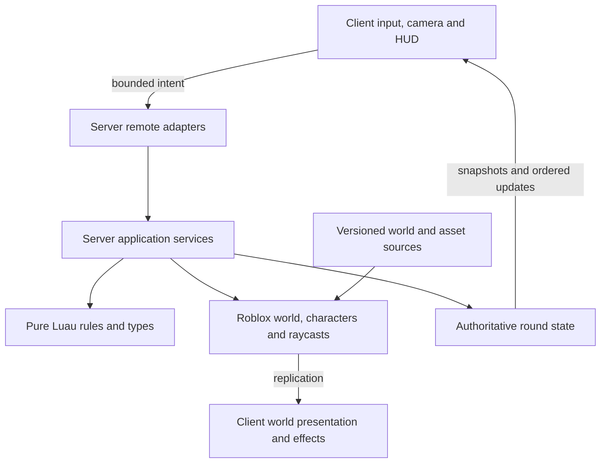

# Architecture

## Current state and target

The current source contains the development foundation and a circular greybox map: authored spawn/cover/anchors, pure circle/orbit rules, a server map owner with containment and rebuild, a server bootstrap status Folder, a client status panel, and separate standalone/Studio runners. The map's host gate and local one-client Studio map/walking checks pass; [P02](plans/02-warzone-map.md) records source, engine evidence and limits. There are no gameplay remotes, roles, rounds or combat yet. Gameplay systems below describe the **target architecture** introduced incrementally by the [roadmap](roadmap.md); create each component when its behavior is needed.

Use a single Roblox place for lobby and battlefield, Luau for game code, and Git-first editing with Rojo for supported source/world synchronization. Roblox hosts the running experience; GitHub stores reconstructable source. No external application backend, persistent player inventory, or cross-server matchmaking is needed for the MVP.

## Studio MCP and repository synchronization

Roblox Studio's built-in MCP server is the primary interactive interface for inspecting the open place, making appropriate Studio-native changes, running supported playtests and obtaining real-engine evidence. Each call targets a specific Studio instance; identify the intended place before modifying it, especially when a development and test place are both open. Discover the available tools and Studio's version-specific `skill` guidance after connection; do not assume every playtest operation is exposed in every version.

MCP and Rojo have different responsibilities. Rojo maps repository-owned Luau and world definitions into Studio. MCP operates the live session but does not itself establish Git synchronization. Make script changes in the repository for managed paths, then sync and inspect in Studio; export deliberate Studio-authored models/world assets into the repository and manifest before considering an increment done. Do not let two agents mutate one live place simultaneously, and do not sync a test mapping into the release place. See [development setup](docs/development.md#connect-roblox-studio-mcp).

## Implemented foundation

`ServerScriptService.Server` first constructs and starts `MapService`, then starts `Bootstrap`, which validates public defaults and owns one `ReplicatedStorage.BootstrapStatus` Folder plus a Heartbeat connection. Its cleanup disconnects the listener and destroys the Folder. Server-only `DevelopmentSettings` exists only in the test mapping and selects the **Test** environment label; its future two-player minimum is not used by the current shell. The release mapping selects **Development**.

The client entrypoint waits for PlayerGui and server status, then starts `StatusPanel`. That controller owns one `FoundationStatus` ScreenGui and one attribute listener; stopping it disconnects and destroys both. `Lifecycle` composes nonyielding components with idempotent start/stop and rollback on partial start failure. Component cleanup callbacks must not throw or reenter the controller.

`Validation` accepts finite numbers and bounded flat scalar payloads. `Config` decodes validated public defaults, and `RateLimit` consumes a deterministic token bucket using caller-supplied monotonic seconds. These helpers do not implement role, replay, ownership or world checks. Future server adapters must add those checks at each action boundary. Shared modules contain no secret authority state.

Pure modules with dependencies choose an explicit Instance require when `script` exists and a relative filesystem require under Lune. Standalone specs receive the actual rule module as a parameter; TestEZ wrappers pass actual mapped ModuleScripts to the same cases. This keeps one implementation usable in both runtimes without a virtual filesystem. See the [shared package](src/shared/README.md) for contracts.

## Implemented map boundary

`Workspace.World.Battlefield` comes entirely from the versioned [world definition](assets/world/Battlefield.model.json). `MapRules` validates the shared map/orbit contract: finite coordinates, radius greater than eight studs, altitude greater than sixteen studs, kill threshold below ground, matching map/orbit centers and radii, and a focus at the ground-level center. Defaults are center `(0, 0, 0)`, radius 180 studs, altitude 140 studs and kill threshold Y = −30. `orbit(settings, phaseRadians)` only samples a future aircraft position; P02 has no moving aircraft or targeting camera.

Server-only `MapService` uses real Workspace overlap/raycast queries to validate geometry and anchors, retains an unparented pristine clone, and assigns stable `CoverId`/`CoverKind` attributes to Permanent/Breakable cover. Its injected character provider and Heartbeat signal keep orchestration explicit. While started, a living character outside the disk or below the kill threshold is returned to authored `Ground05` and its velocities are cleared. The authored lobby deck has a bounded station exception; role-specific access and deployment arrive with P03. This is containment, not a general movement-exploit detector.

`stop()` disconnects Heartbeat while retaining the map and snapshot for restart. `rebuild()` destroys the owned Battlefield subtree, clones the snapshot and validates the replacement. `destroy()` is idempotent, stops containment and destroys the private snapshot; static authored geometry remains. No current round controller invokes rebuild, and external consumers must reacquire Instances after replacement. The [server package](src/server/README.md) documents the public adapter/lifecycle contract.

## Target layers and dependencies



Rules do not depend on Roblox services, client presentation, network transport, or global clocks. Server services compose rules and adapters; clients present authoritative facts and may predict cosmetic feedback. Bootstrap scripts wire dependencies explicitly. Prefer constructor arguments or simple module parameters to a dependency-injection framework.

### Repository layout

```text
AGENTS.md                 Persistent project instructions
README.md                 Player-facing overview and actual availability
game-design.md            Rules, experience and scope
requirements.md           Requirement IDs and test obligations
architecture.md           Boundaries and technical decisions
roadmap.md                 Ordered status and milestone index
plans/*.md                One executable capability plan per file
docs/                     Setup, testing, decisions, conventions, evidence
.agents/skills/            Repository-local feature-loop skill
.codex/agents/             Developer, tester and writer instructions
.github/workflows/        Full non-Studio verification CI
src/shared/               Replicated types, public config and pure common rules
src/server/               Authoritative services, server-only rules and adapters
src/client/               Input, cameras, UI, audio and effects
assets/world/             Reconstructable static world definitions/exports
assets/models/            Templates for aircraft, cover and the single rocket launcher
assets/manifest.json      Provenance and cloud asset references
tests/unit/               Pure rules and boundary cases
tests/integration/        Service workflows with controlled adapters
tests/studio/             Real-engine server/client/replication suites
tests/fixtures/           Seeds, small test maps and doubles
scripts/                  Verification and build entrypoints
default.project.json      Release DataModel mapping; excludes tests
test.project.json         Test DataModel mapping; never published
rokit.toml                Pinned development tools
build/                    Generated artifacts; ignored by Git
```

### Roblox ownership

| Filesystem area | DataModel location | Ownership |
| --- | --- | --- |
| `src/shared` | `ReplicatedStorage.Shared` | Public types, presentation config, shared pure rules; no secrets |
| `src/server` | `ServerScriptService.Server` | Authoritative services and server-only rules |
| `src/client` | `StarterPlayer.StarterPlayerScripts.Client` | Per-player local controllers |
| `assets/models` | `ServerStorage.Assets` | Templates cloned by server; only needed instances replicate |
| `assets/world` | `Workspace.World` | Static map objects authored/exported under source control |
| `tests/unit`, `tests/integration`, `tests/studio/specs-server`, `tests/fixtures` | `ServerStorage.Tests` in test project only | Shared cases, server specs and fixtures |
| `tests/studio/server` | `ServerScriptService.ServerTests` in test project only | Automatic server TestEZ runner |
| `tests/studio/client` | `StarterPlayerScripts.ClientTests` in test project only | Automatic client TestEZ runner |
| `tests/studio/specs-client`, `Packages` | `ReplicatedStorage.ClientSpecs`, `ReplicatedStorage.TestPackages` in test project only | Client specs and locked TestEZ dependency |
| `tests/fixtures/DevelopmentSettings.luau` | `ServerStorage.DevelopmentSettings` in test project only | Server-only test label/future roster fixture |

The release project excludes tests, test dependencies, fixtures and development overrides by construction, with generated-artifact inspection enforcing the boundary. Bootstrap must not run server-only modules on clients.

## Components to introduce as needed

| Component | Responsibility | First plan |
| --- | --- | --- |
| `Bootstrap`, shared validation and lifecycle | Implemented shell wiring, cleanup, structural decoding/rate helpers | P01 |
| Named remote adapters | Add action-specific role/replay/world validation when gameplay actions exist | P03 onward |
| `MapService` | Implemented geometry/anchor validation, containment and pristine map rebuild | P02 |
| `MatchService` and `RoleService` | Roster, phase/deadline, round identity, fair assignment, player lifecycle | P03 |
| `AircraftService` | Canonical perimeter orbit pose, aircraft health and destruction | P04; health in P06 |
| `ThermalCameraController` | Inward-facing camera, weapon-linked zoom, occluded highlights, cleanup | P04 |
| `CombatService` with weapon rules | Validate intent, ammo/cooldown, flight/impact, damage resolution | P05–P06 |
| `DestructionService` | Health/state and authoritative collision swaps | P07 |
| `LauncherService` | One launcher identity, atomic ownership, drop/recovery and reload continuity | P08 |
| `MatchService` outcome integration | Aircraft destruction, ground elimination, timeout and forfeit resolution | P09 (basic outcomes P03/P06) |
| `GroundController`, `HUDController`, `SpectatorController` | Role-specific controls and complete player feedback | Introduced with features; completed P10 |

Use one combat orchestration boundary with weapon-specific modules rather than three independent damage systems. `MatchService` alone commits outcomes. Other services propose changes through explicit calls/events; they never independently set the winner. Keep reset and cleanup centralized while each component owns its resources.

## Authoritative state and timing

Use typed data records for round ID, phase, phase revision, roster by UserId, role/life state, deadline, aircraft health/state, per-weapon readiness, selected weapon, launcher ownership/location/reload state, and result. Instance Attributes can expose view state but are not the internal transaction mechanism.

Inject a monotonic clock and seeded random source into rules/services. Client HUDs derive countdowns from a replicated server deadline and synchronize with the platform's server clock. Never accept client timestamps to award hits, pickups or results. Deterministic tests advance a fake clock without real sleeps.

Each active-round command carries the current round ID and a per-player monotonic sequence. Reject commands from old rounds and repeated sequences. A result is committed once; subsequent commands observe a terminal phase. Follow the conflict order in [game-design.md](game-design.md). Teardown invalidates queued work with a generation/round token so an old projectile cannot damage the next round.

## Network contracts

Use a small named RemoteEvent surface, not an unrestricted generic RPC dispatcher. Prefer asynchronous requests and snapshots; avoid yielding RemoteFunction round trips for combat. Define Luau request types **and** runtime validation: types alone do not validate untrusted packets.

| Direction / intent | Minimal payload | Server derivation and validation |
| --- | --- | --- |
| Client → fire | round ID, sequence, weapon ID, bounded aim direction/point | Role/life, equipment, ammo, cooldown, finite values, origin, range, aim envelope, obstruction |
| Client → reload/select | round ID, sequence, owned/role-authorized weapon ID | Role, ammo/reload phase, independent cooldowns; acknowledge weapon/zoom together |
| Client → pickup/drop launcher | round ID, sequence, launcher ID | Existence, reach, life, current ownership, valid ground position, active phase |
| Client → sync request | bounded request token | Per-player rate budget; return only that role's permitted snapshot |
| Server → snapshot/update | round ID, revision, permitted state | Immutable view model; client discards stale rounds/revisions |
| Server → effects | round ID, shot/event ID, bounded effect data | Cosmetic only; client deduplicates and caps lifetime/count |

Aircraft destruction is computed from server-resolved damage, never a client win claim or rocket-hit count. Validate server-observed movement for implausible travel before granting launcher pickup or accepting a ground firing origin; reject or correct suspicious movement without automatically banning from a single noisy observation. Roblox character network ownership does not make client movement authoritative for rewards.

Apply cheap shape/size checks and per-player/per-action budgets before expensive raycasts. Bound strings, tables, vectors, shot counts and queued work. Tests cover NaN, infinity, malformed nested payloads, unknown IDs, replay, stale round IDs, floods, spectators and eliminated players. Rejected requests must leave state unchanged.

## Aircraft, camera and physics

Compute a circular orbit from the authored map center, playable radius, aircraft altitude and server elapsed time. The horizontal orbit radius equals the map radius so flight follows its perimeter; the model faces the orbit tangent. The server moves an anchored aircraft model and uses its canonical pose for hit detection and muzzle position. The operator is assigned a protected noncombat station; the ground character and the operator's avatar are not interchangeable damage targets.

Begin with ordinary server replication. If visual stepping needs smoothing, interpolate a local visual shell without introducing another collidable hitbox or a second gameplay pose. Test the visual/canonical error bound and never let clients choose authoritative aircraft position. Projectile integration uses swept raycasts between steps to avoid tunneling.

Use a Scriptable operator camera whose central look direction always tracks a ground-level focus at the map center, independently of the tangent-facing aircraft model. The mouse controls a reticle within that inward view; validate aircraft aim endpoints against the playable disk and weapon sight lines. Local color correction and occluded highlights provide thermal presentation. The 30mm GAU-23/A Chain Gun selects a narrower FOV than the 105mm M102 Howitzer; there is no independent free zoom. Configure finite, distinct FOVs and update selected weapon, FOV and reticle projection coherently. Restore camera/input state on role changes. Building geometry blocks targeting and damage; presentation and server obstruction rules must agree in fixtures.

For the bounded MVP map, `Workspace.StreamingEnabled` is explicitly false (D11). This avoids a remote camera looking at absent scenery. If profiling forces streaming, treat that as a deliberate architecture revision: persistent aircraft, controlled replication focus, target-area acquisition/loading states, re-stream-safe effects and 10-player visibility tests. Do not just enable the property.

## Weapon, launcher and result invariants

Use explicit weapon configurations for `GAU23`, `M102`, `M7` and `RocketLauncher`, with the exact player-facing names from the design. Aircraft weapons are role equipment; every ground player spawns with the M-7, while only the launcher carrier can fire rockets. Keep readiness by weapon ID; selection cannot reset cooldown, reload progress or ammunition. Store launcher reload state on the round-owned launcher identity, not the current holder.

Derive integer aircraft maximum health as three times direct rocket damage. Apply each direct rocket impact once, with no duplicate splash to the same aircraft; first/second hits alone leave a pristine plane alive and the third destroys it. M-7 damage is small and positive, reducing the same health pool. No regeneration, falloff or armor modifier can break the three-hit contract. AircraftService proposes destruction to MatchService; MatchService alone commits the immediate team result and cancels pending combat.

LauncherService transitions one identity between Available, Held and Recovering; it never creates one copy per player. A short atomic non-yielding claim prevents raced pickups. Death/disconnect/drop preserves reload timing and makes it recoverable; invalid positions return it to the authored anchor. Replenishing one-round reload is the current supply default. Reset disposes the old identity and creates exactly one new launcher.

P03/P06 establish basic win proposals; P09 validates their combined timing/disconnect behavior. Follow game-design.md for deadline precedence, same-step mutual kills, forfeits and late projectiles. There is no collectible-progress or escape-zone service.

## Assets, destruction and reconstruction

Prefer text `.rbxmx` model exports and `.model.json` definitions for reviewable assets; retain source meshes/textures or their reproducible provenance when practical. Large binary exports require a documented storage/LFS decision. `assets/manifest.json` records stable internal IDs, source/author/license, local file, Roblox asset ID if any, and upload owner when known.

Each authored Part/SpawnLocation in `.model.json` uses a twelve-component canonical `CFrame` (translation followed by row-major rotation). `Position`/`Orientation` aliases are forbidden because their presence in generated XML does not ensure Studio loads the intended pose. Artifact inspection compares every authored part's finite pose, positive dimensions, shape and collision/query/touch flags in both builds, with five deliberate corruption probes. Studio loaded-transform assertions and world queries remain required: reproducible serialization alone does not prove engine reconstruction.

Static map files and server-cloned templates have separate ownership. Do not synchronize a live simulation back as authored source. Studio edits to managed objects must be exported to the mapped source and verified with a clean build. Avoid mixed ownership of the same Instance subtree.

Breakable props use predefined health thresholds and collision states. Keep stable cover IDs across model swaps. Resolve one impact against a pre-impact world view, then apply damage and cover transitions once. Late joiners reconstruct current state from the server, not a replay of missed cosmetic effects. Reset reconstructs the original map deterministically.

## Tooling and verification

Run `python3 scripts/setup.py` for the pinned tools, locked TestEZ and hash-checked Roblox engine definitions, then `python3 scripts/verify.py` for the complete non-Studio gate. It runs repository checks, StyLua, Selene, strict Roblox-aware analysis, deterministic Lune unit/service suites, deliberate failure/empty/type probes, both Rojo builds, canonical authored-geometry/corruption checks and XML release-isolation inspection. Missing tools, failed or empty suites fail the gate.

The test mapping runs separate server and client TestEZ bootstraps in real Studio Play contexts and publishes structured JSON reports. Those runs establish mapped imports and engine behavior separately from the host gate. Ordinary Linux CI runs the host gate and cannot replace required Studio evidence.

See [testing](docs/testing.md) for acceptance levels and [development](docs/development.md) for source/release workflow. A tool change needs updated pins, commands and successful clean-build evidence.

## Platform references

- [Rojo project format](https://rojo.space/docs/v7/project-format/) defines DataModel mappings and ignores.
- [Roblox client/server security](https://create.roblox.com/docs/scripting/security/client-server-boundary) informs validation at every remote boundary.
- [Roblox streaming](https://create.roblox.com/docs/workspace/streaming) describes the camera/world availability tradeoff.
- [Studio testing modes](https://create.roblox.com/docs/studio/testing-modes) separates client, server and multiplayer validation.
- [TestEZ bootstrap](https://roblox.github.io/testez/getting-started/running-tests/) is the engine-suite entrypoint.
- [Lune](https://lune-org.github.io/docs/getting-started/1-installation/) provides standalone Luau execution, not a complete live Roblox server.
