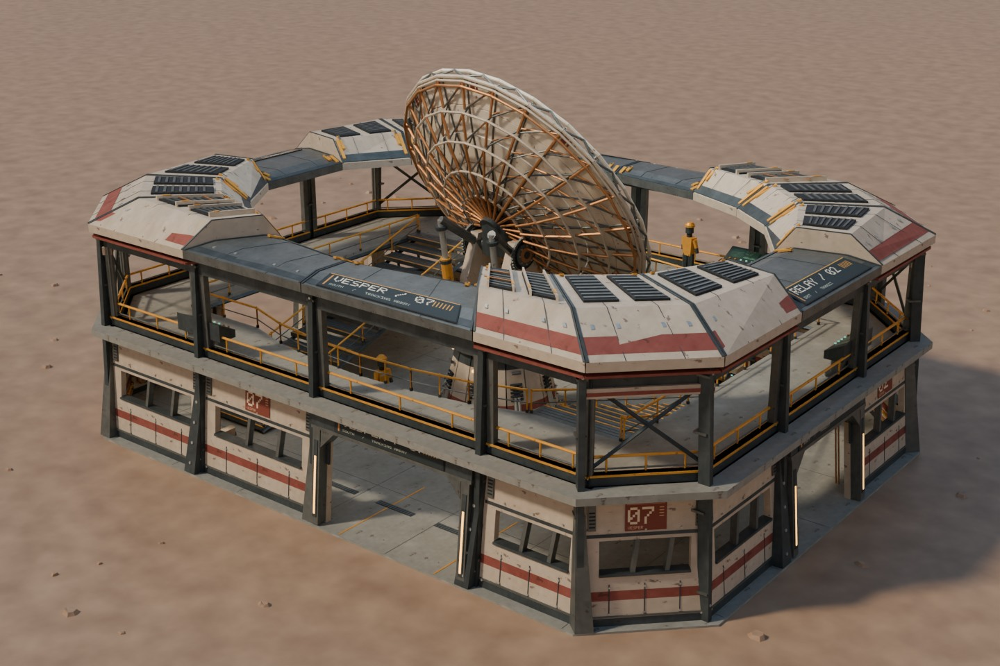

# Vesper Array · Radar Outpost 07

Open [vesper-array.blend](vesper-array.blend) in Blender 5.3.0. The proposed Warehouse replacement has four ground-level portals, two open stairs, a continuous observation gallery and a tilted 25.7-stud reflector above the courtyard. A yellow sweep circle marks the dish drive on the floor. The warm lights under the gallery mark the sheltered perimeter.



| Blender review view | What to look for |
| --- | --- |
| [Opposite approach](../../../docs/images/radar-outpost/approach.jpg) | The receiving face, roof shoulders and northern entrance |
| [South portal](../../../docs/images/radar-outpost/atrium.jpg) | The elevation rams and pedestal between the two exposed stair flights |
| [Observation gallery](../../../docs/images/radar-outpost/gallery.jpg) | Rail height, control consoles and the view down to the lower court |
| [Receiver](../../../docs/images/radar-outpost/receiver.jpg) | Individual reflector facets, feedhorn, tripod and radial seams |
| [Overhead plan](../../../docs/images/radar-outpost/overhead.jpg) | Both stair landings, the gallery loop and the open roof |

The source opens at the exterior camera. Use the middle mouse button to orbit, or use the Scene Properties camera picker to choose one of the named views and press F12. The six numbered collections separate fixed structure, pristine panels, dish machinery, equipment, alternate states and the review set. All 18 original texture images are packed. The lights, 5.5-stud scale figures and desert backdrop belong to the review scene.

## Reference and site fit

The exterior illustration supplied the chamfered corners, sloping pale armor, oxide belt and contrasting access portals. The two interior illustrations supplied the hydraulic drive, instrument stations, yellow rails and mechanical detail on both sides of the reflector. The floor-plan sketch supplied the central opening, perimeter circulation and opposed flights. The four illustrations in the supplied `src/images/radar-outpost` folder served as visual references. Surface wear, signage, scope graphics and meshes were authored for this package.

I chose the Warehouse site for its 64 × 48-stud footprint and south approach. The sketch’s 104 × 96 footprint and +14 gallery were reduced to fit that site. The working deck is at +10 and the foundation extends 0.66 below the ground-floor finish. The center of the floor sits at Blender (0, 0, 0). One Blender unit represents one stud. Blender +Z is up and the front entrance faces −Y. The proposed Roblox placement maps a Blender point (x, y, z) to (160 + x, 0.125 + z, −80 − y). The south gate is centered on world X = 168, aligned with the existing Warehouse approach. The highest reflector point would be at world Y ≈ 31.88.

## Walking and overhead cover

The ground floor has no interior dividers. The reflector pedestal and the covered strip under the gallery provide local shelter. Crossing between them takes a player through open floor. Both stairs rise inside the roof opening. From the gallery, the atrium, long unglazed exterior bays and low rails leave a player visible from several directions.

| Blender geometry check | Result in studs |
| --- | --- |
| Four ground portals | Clear centers at least 10.5 wide below the chamfered shoulders, with 7.8 under the central lintel |
| Two mirrored flights | 16 rises of 0.625 and treads of 1.875. The full tread is 8 wide. The sampled clear width between the rails is 7.67 |
| Headroom over the sampled tread positions | Minimum of 8.42 against structure and pristine panel solids |
| North console beside the curved rail | 4.78 between opposing visible faces at rail height |
| Camera ray from gallery, facing along the walkway | 12.5 clear at approximately 17° above horizontal. Backing toward a column at the same pitch meets it at 2.10 |
| Courtyard exposure | Four of six sample points at 5.5 above the floor see open sky straight up. Two fall beneath the inclined dish |

The geometry checks cover 96 stair samples, 36 portal rays and 198 supported gallery positions in both the saved scene and reimport. Camera measurements describe straight rays from a standing focus. Actual Humanoid movement, camera response, orbit visibility and performance need a later Studio playtest.

## Damage and geometry for handoff

Each of the 18 facade bays owns one ground wall, one upper wall and one roof section. The [panel catalog](panel-catalog.json) gives all 54 IDs, story numbers, Blender-space pivots, visual names and solid-proxy names. Pristine and Light share the shaped proxy, including each original door or window opening. Light adds chipped and scorched marks. Heavy removes the central 51% of the panel span and its aperture-spanning trim. Total clears the visual and all solids. The stable floors, stairs and boundary supports have separate identities.

The [assembly GLB](../../exports/radar-outpost/vesper-array.glb) contains the pristine building. The [damage GLB](../../exports/radar-outpost/damage-library.glb) is a library with deliberately coincident state alternatives, two independent mechanism proxies and four fragment candidates for each of the wall and roof families. In Blender, enable collection 05 and isolate the desired object with Local View to examine it. Select individual visual and proxy states by name for comparisons. Each version uses the same pivot. All five observation consoles share one editable mesh.

The geometry uses custom wall and roof families. A later integration must bind their proxies and fragment candidates, accommodate the open-plan layout in the current large-building validator, and check runtime destruction, collision, thermal sight lines, reset and device cost. The playable Warehouse currently uses its existing geometry.

## Package and reproduction

The intact export has 113 objects, 109 unique meshes, 86,832 assembled triangles and 85,728 unique triangles. The largest material primitive has 2,280 triangles. Its 20 materials share 18 baked color maps. Eleven wear maps are 256 × 256, four portal signs are 512 × 112, two sector stencils are 192 × 128 and the scope is 384 × 192. The set occupies 4.09 MiB decoded as RGBA8 before mipmaps. The separate damage library has 226 objects and 72,132 triangles across all alternatives. The combined states do not represent the cost of a single pristine building.

The [inspection record](../../../docs/images/radar-outpost/inspection.json) binds the exact source and GLBs to their counts and geometry checks. The [render record](../../../docs/images/radar-outpost/renders.json) binds the six review pictures to the source. A clean run using only the authoring scripts reproduced the panel catalog and both GLBs byte for byte. The repository [asset manifest](../../manifest.json) records provenance and file hashes. The GLB packages embed the textures and carry material factors, UVs, object pivots and names. Roblox documents the GLB mesh hierarchy in its [Importer guide](https://create.roblox.com/docs/studio/importer#gltf-import-hierarchy).

To reproduce from the repository root using Blender 5.3.0 on macOS, run the following. The build command regenerates the source and both GLBs. Save manual edits to a separate file before rebuilding. The inspection command alone checks an existing package. The repository verifier fingerprints authored asset files, so the penultimate command refreshes the test-only source inventory after an intentional rebuild.

```sh
BLENDER=/Applications/Blender.app/Contents/MacOS/Blender
python3 scripts/radar_outpost/layout.py
"$BLENDER" -b --python-exit-code 1 -P scripts/radar_outpost/build.py
"$BLENDER" -b --python-exit-code 1 -P scripts/radar_outpost/inspect_asset.py
"$BLENDER" -b assets/blender/radar-outpost/vesper-array.blend --python-exit-code 1 -P scripts/radar_outpost/render.py
python3 scripts/radar_outpost/record_manifest.py
python3 scripts/p17_harness.py --write
python3 scripts/verify.py
```
