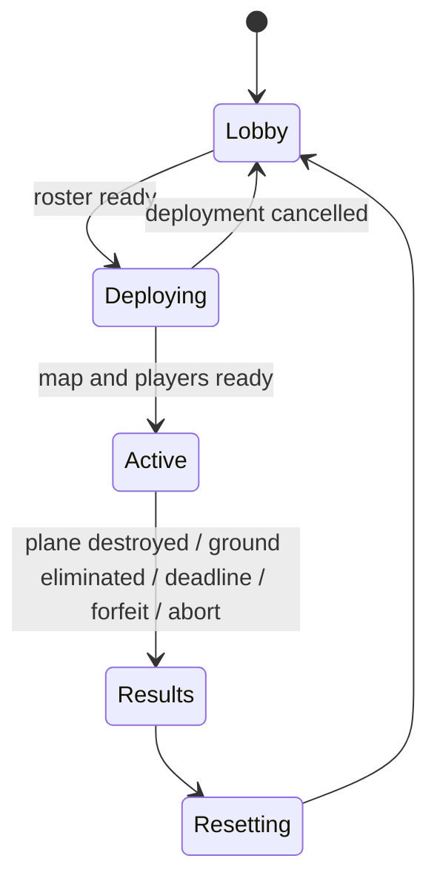

# Game design

## Intent and provenance

Build a round-based asymmetric **players-versus-C-130** game in Roblox. One player operates an orbiting aircraft; the other 5–9 players belong to one ground team and win by destroying it. The C-130 wins by eliminating everyone on the ground or running down the clock.

The user's gameplay revision on 2026-11-07 supersedes the collection-and-escape loop in the [original design conversation](https://chatgpt.com/share/6aef8a62-05b0-83ea-83c3-ff6e2804a425). Retain its 6–10 players, thermal presentation, partial destruction, and no-respawn choices. The revision selects a circular map, perimeter orbit, inward-facing aircraft view, two aircraft weapons with different zoom levels, an M-7 rifle, and one map-placed rocket launcher. The user additionally confirmed that rifles chip away at plane health and three direct rockets destroy an undamaged plane. Other concrete defaults are labeled in [decisions](docs/decisions.md).

The user's 2026-11-08 level revision expands the MVP to a battlefield with twice the current diameter, authored terrain, two large buildings and one smaller building (all at least two stories), and visible panel destruction with physical debris. The 2026-11-10 control revision selects operator WASD panning and a mobile directional pad; mouse movement aims the reticle without moving the camera. Simple graphics must demonstrate the complete mechanics; refined assets are later work. P13 supplies the validated expanded terrain/building map. P14 supplies the verified panning implementation and its engine/playability acceptance on `main`. P07 adds persistent progressive panel damage, real openings and bounded physical fragments on all battlefield buildings, including the starting shelter. Its accepted implementation is integrated on `main` through PRs #30 and #29; the [plan](plans/07-destruction.md) and [integration record](docs/evidence/p07-integration.md) distinguish source-specific acceptance from merge verification. P02/P04 evidence describes the smaller, fixed-focus prototype and is not evidence for the revised map. See [decisions](docs/decisions.md) for selected rules versus proposed defaults.

## MVP contract

One circular industrial warzone, one operator, one united ground team, one rocket launcher pickup and repeated rounds. The C-130 carries the **30mm GAU-23/A Chain Gun** and **105mm M102 Howitzer**. Every ground player starts with an **M-7 rifle**. Include aircraft health/destruction, keyboard and mobile directional panning with weapon-linked zoom, occluded thermal presentation, multi-story panel-based buildings, progressive destruction and bounded physical debris, spectating, HUD, audio and readable effects. Ten minutes is the initial round-duration default. Future levels change terrain, buildings and bounds while the orbiting C-130 and the shared panning, zoom, combat and destruction rules remain core systems.

There are no collectible mission items, item quotas, escape zones or dwell countdowns. The launcher is the sole map pickup, not a shared collection objective. Exclude persistent inventory/progression, purchases, ranking, cross-server queues, ground vehicles, manual flight, full structural collapse and NPC enemies. Additional playable levels are future work; the MVP ships the current level. Use one same-server lobby and battlefield place.

## Roles and population

- Start normal matches with 6–10 eligible players; lock the roster at deployment. Exactly one operates the C-130, with everyone else on the same ground team. Maximum server occupancy is ten.
- Prefer the longest-waiting eligible operator who did not just operate when alternatives exist, with a seeded tie-break.
- A test-only two-player override permits one tester per role. It must be absent from the release build and inaccessible to clients.
- Waiting players can walk around the protected lobby; only the assigned operator is locked at its placeholder station.
- Local Studio tests may offer single-player map exploration without granting an active role or starting a competitive round. Human testers can select a solo preview role or request a role for a real local test round, choose the next test duration, start immediately and reset through a test-only panel. Conflicting requested roles must be explained rather than silently overridden. These conveniences are excluded from release builds; production population and fair rotation rules remain unchanged.
- Late joins spectate until the next lobby. Retain round membership by UserId so disconnect/rejoin cannot restore an active life or equipment.
- Eliminated ground players spectate living teammates and cannot fire, pick up or transfer equipment. Friendly fire is off. Player body collision cannot be used to block a teammate from the launcher or cover.

## Circular battlefield, orbit and view

The expanded map implements the revised **720-stud diameter** (playable radius **360 studs**, four times the area). Keep a defined map center and aircraft altitude. Author traversable terrain with meaningful elevation, indoor cover and exposed lanes, **two large buildings and one smaller building, each at least two stories high**, with usable stairs and accessible upper floors. The candidate uses 64×48 / 64×48 / 32×48-stud footprints, eight fixed grass/rock hills and altitude 140 studs. These are construction/tuning defaults recorded in decisions, not selected dimensions. Terrain is static in the MVP; building panels supply destruction. The candidate places the protected lobby outside the combat disk at X=520 and validates anchors, containment and geometry. Future weapon ranges must support the revised geometry. The aircraft follows a fixed circular orbit above the perimeter: its horizontal radius equals the authored playable radius. It is visible and hittable from appropriate ground positions. Its model points along the flight tangent; the operator's separate targeting camera remains at the aircraft and faces inward toward a focus within the battlefield.

The P14 candidate uses **WASD** camera panning for the operator and an on-screen **directional pad** on touch devices. W/S tilt the view toward the farther/nearer portions of the level; A pans the camera left and D pans it right relative to the rendered view. The touch arrows follow their shown directions. The mouse aims the reticle without panning; a separate touch can aim while holding the pad. R or the touchable Recenter button returns to the default safe inward view. Text and window focus suspend panning. Pan speed and pad placement are tuning defaults. A held view angle stays fixed **relative to the circling aircraft**: the plane continues its unchanged orbit, so the portion of level visible under that angle changes smoothly as it flies. Pan limits let the level edge enter approximately the outer 25% of the viewport along each horizontal or vertical centerline. The circular edge may enter farther at screen corners. The wider weapon view sets the shared pan limit, so the tighter view can show less beyond the edge while retaining its aim through selection. Keep sky and a straight-down look out of view. Terrain and buildings may intercept downward rays before the flat level boundary. The camera stays at the aircraft and does not fly independently. Weapon selection retains the relative pan state and changes only the lens profile. Reticle projection follows the actual camera, terrain and upper floors. Server aim validation still restricts shots to the playable horizontal footprint, authored vertical envelope and valid muzzle-to-impact sight lines; a panned camera never grants hits through solid cover. Buildings occlude targets. Ground weapons may aim outward/upward to hit the perimeter aircraft.

The C-130 circles **every** future level automatically. A level definition supplies its playable boundary, orbit center/radius/altitude, aim envelope, terrain and buildings, spawn/launcher anchors and stable destructible-panel identities. Shared camera/pan/zoom, weapon damage, panel progression and fragment rules consume that definition instead of living in map-specific scripts. An orbit may enclose a future noncircular playable footprint; the MVP keeps its authored circular equal-radius orbit. Selecting, validating and switching among multiple levels is future scope, with reset and late-join reconstruction required before a second level can ship.

Weapon selection determines the camera field of view: the 30mm uses a narrower, more magnified view than the 105mm. Exact FOV angles are tuning values. There is no independent free-zoom control in the MVP. Rejected or stale weapon selections must not leave the HUD, reticle projection and active weapon in different states.

## Weapons and aircraft health

| Weapon | Role and availability | Rules |
| --- | --- | --- |
| 30mm GAU-23/A Chain Gun | C-130; available from deployment | Faster precise fire, tight view, bounded damage and cadence |
| 105mm M102 Howitzer | C-130; available from deployment | Slower heavy shell, wider view, larger bounded blast, readable impact delay |
| M-7 rifle | Every living ground player starts with one | Small server-authoritative aircraft damage; ordinary magazine/reload rules |
| Rocket launcher | Exactly one map-placed weapon; one carrier at a time | Direct-fire rockets; three direct hits destroy a full-health aircraft |

Each aircraft weapon retains its own cadence/cooldown/reload state across switches. Switching cannot refill ammunition, cancel a reload advantageously or reset a timer. It changes presentation and the active weapon, not the legality of firing. Weapon names identify game equipment; damage, ballistics and fire rates are gameplay configuration.

Define an integer `rocketDamage` and derive `aircraftMaxHealth = 3 * rocketDamage`. A direct rocket impact applies that full damage once, without falloff or a second splash award to the same aircraft. With no other damage, the first two hits leave positive health and the third reaches zero. M-7 hits apply a small positive `rifleDamage`; mixed rifle/rocket damage can destroy the plane sooner. Do not add regeneration, armor modifiers or critical hits that invalidate the three-rocket guarantee. Misses and near-miss splash do not count as direct rocket hits.

At zero aircraft health, commit **Destroyed** and a ground-team win immediately through MatchService. Cancel outstanding damage work and play cosmetic destruction after the result; there is no disabled-but-still-active mission phase and no damaging physics crash. The entire ground team receives the win, including already eliminated teammates.

## Single rocket-launcher lifecycle

Spawn exactly one launcher at a fixed, validated, reachable map anchor at deployment. It is not part of the initial player loadout. The ground team can see its available/carried state. A living ground player within reach can acquire it atomically; a second simultaneous claim must fail without creating another launcher. Keep a stable launcher identity for the whole round.

Initial handling defaults: the carrier retains their M-7 and can switch weapons or voluntarily drop the launcher. While the round remains Active, death, character reset or disconnect drops it at the last valid ground position so a teammate can recover it. Terminal-round cleanup takes precedence over recovery. An unreachable/out-of-bounds drop is relocated to the original anchor. Carrying, dropping, rejoining and re-picking cannot clone it or reset its reload progress.

The launcher holds one ready rocket and automatically replenishes after a configured reload delay; reserve supply is not depleted. This is a provisional balance choice to let missed shots be retried without adding ammo pickups. There are no separate ammunition/weapon items. Validate that reload timing allows at least three shots within a round. Reset destroys any old held/dropped representation and creates exactly one fresh launcher.

## Combat, cover and destruction

All fire is intent: the server derives muzzle origin, validates role/equipment/aim/rate and resolves shots against its own world. Use bounded projectile lifetime and swept collision. All remaining solid cover geometry blocks direct fire, blast damage and thermal highlighting; actual holes in damaged panels expose only the sight lines through those holes. MVP blast damage uses a documented line-of-sight sample to a target's damage anchor rather than pressure simulation.

An impact resolves damage using pre-impact geometry; a new opening benefits subsequent shots. Building surfaces are divided into large, independently identified panels. An average room spans approximately two panels in width and one panel in height; 16×8-stud panels and a 32-stud room width are initial greybox defaults, subject to avatar/route checks. Each building must contain destructible exterior wall panels on all stories and panelized roofs, so aircraft fire can open overhead cover too. The proposed MVP default keeps stairs, floors and the supporting frame stable. Full structural collapse is separate scope.

| Panel state | Heavy-cannon direct hits from intact | Visible and physical behavior |
| --- | --- | --- |
| Pristine | 0 | Original full panel before any earned damage |
| Light damage | Positive earned damage, below 3 heavy hits | Persistent visible cracks/scars with intact collision; clearly different from both pristine and heavy damage in normal and thermal views |
| Heavy damage | 3–5 | Third hit replaces the panel with a roughly 50%-destroyed variant; its dark/fractured appearance persists even when current-stage progress is zero |
| Total damage | 6 | Three more hits remove the remaining panel; no invisible collision wall remains |

The **105mm M102 Howitzer** uses this **3 hits to Damaged, 3 more to Destroyed** contract. The user confirmed that the revision's 120mm reference meant the existing 105mm weapon; retain its name and roster (D31).

**Nine earned seconds of valid same-panel 30mm impacts advance a pristine panel to Heavy damage. Earned damage persists on each panel when fire stops.** Interruptions, misses, obstruction, reloads and changing target/weapon break timing continuity but do not heal the surface or clear partial damage. The first impact after a break earns zero elapsed time; paused/off-target time never counts. A further nine valid seconds advances Heavy to Total damage. Only server-resolved impacts contribute. Mixed-fire credit remains proportional: one direct heavy hit equals three valid 30mm seconds. These cadence, second-stage and mixing values remain documented defaults; persistent damage is the user's selected behavior (D51). Duplicate and unauthorized requests cannot advance destruction. Structural damage uses direct impacts only; splash can damage exposed players under the blast rules without counting as direct panel hits.

All battlefield building walls and roofs use these rules, including the original starting shelter around the ground deployment anchors. Its legacy exterior is panelized without changing the shelter footprint, entrances or spawn protection before damage. The three multi-story buildings retain their static floors, stairs and frames; the ancillary starting shelter does not add a new two-story-building requirement. The separate waiting lobby outside the battlefield stays protected. D53 records the faithful starting-shelter construction defaults.

Server-owned state swaps and residual colliders define gameplay openings. The damaged variant removes approximately half the original face area (initial measurement tolerance 45–55%) and must show a real opening from ground and aircraft views. Visible progress is required within each stage as well as at the two swaps. This must work with primitive graphics, without waiting for refined models.

**Physical destruction is required in the MVP:** transitions release a bounded set of unanchored fragments that visibly fall and collide with static scenery under gravity. Proposed safety/performance default: server-owned fragments cannot damage/push players, obstruct routes, block weapon/thermal queries, trigger additional destruction or decide structural support. Enforce explicit fragment-count, impulse and lifetime limits and clear them on reset. This is actual physics, not only particles or a disappearing wall; exact rigid-body trajectories are not gameplay authority and need not match bit-for-bit across clients. Permanent building structure and the path network remain stable.

Give the launcher anchor at least two passable approaches, protected ground spawn positions, and useful firing angles to the full orbit. Players must not need to break a wall or spend ammunition to reach the launcher. Mark the circular boundary clearly and enforce it without turning the exterior into a hiding area. Reset restores exact map/cover state. Record asset provenance in the manifest.

Thermal presentation is grayscale/high contrast with occluded highlights for exposed players. Rendering does not substitute for server obstruction checks or promise secrecy against modified clients.

## Round states and result conflicts

Player states are Waiting → ActiveGround / ActiveGunship → Eliminated / Spectating → Waiting. Disable default automatic respawns; manual character reset eliminates a ground player. Operator character reset cannot reset aircraft health or escape an assigned role.

| Situation | Required outcome |
| --- | --- |
| Aircraft destroyed strictly before deadline | Ground team wins once |
| All active ground players eliminated before aircraft destruction | C-130 wins once |
| Deadline reached with no earlier committed ground win | C-130 wins once; an impact at exactly the deadline is too late |
| Aircraft and last ground player reach zero in the same pre-deadline simulation step | Ground win takes precedence (documented tie default) |
| Operator disconnects during Active, with ground players remaining | Ground win by forfeit; do not invent rocket hits or destruction evidence |
| Ground player leaves during Active | Remove active life; recover their launcher if held; rejoin cannot respawn |
| Last ground player leaves | C-130 wins if operator remains; an empty server cleans up without a competitive winner |
| Deployment loses a valid roster | Cancel deployment and return to lobby |
| Invalid map or unrecoverable setup error | Abort with a reason and no competitive winner, then reset |

At each server step, enforce deadline first; resolve accepted projectile/damage events as a batch against pre-impact geometry; then evaluate aircraft destruction before total ground elimination. If no result is committed, handle departures (empty server, no ground players, operator forfeit) and launcher interactions. Once Results is committed, no pending shot/pickup/disconnect can change it. A rocket already in flight can still count after its shooter dies if another ground player keeps the round active; if a prior step already ended the round, it cannot retroactively win. Never trust a client timestamp to change this order.

## Presentation and readiness

Ground HUD shows health, M-7/launcher availability and ammo/reload, shared aircraft health, launcher available/carried state, surviving teammates and time. Operator HUD shows selected named weapon, its zoom/cooldown, aircraft health, surviving opponents and time. Both show clear team win/loss/forfeit reasons. Labels/icons supplement color and visual cues supplement important sounds; provide effect/camera-shake controls.

MVP readiness also requires walking every authored floor of all three buildings on the expanded terrain, panning across the full battlefield at both weapon zooms, demonstrating the six-heavy-hit and nine-second 30mm panel rules, real damaged-state openings, bounded physical debris and repeated pristine reconstruction. MVP readiness requires complete 6- and 10-player rounds for aircraft destruction, ground elimination and timeout; correct launcher recovery and weapon switching; rejection of invalid input; repeated clean resets; and readable counterplay. Automated checks prove rules, while operated multiplayer sessions assess feel, balance and performance.
