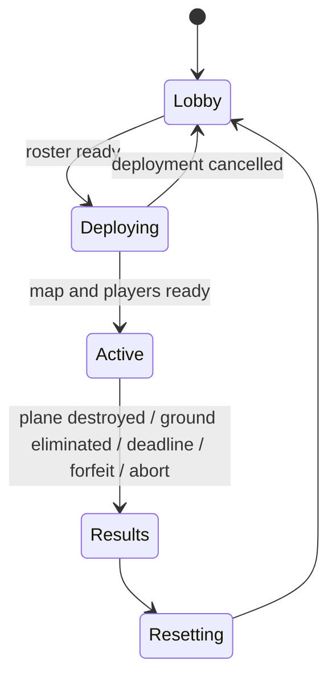

# Game design

## Intent and provenance

Build a round-based asymmetric **players-versus-C-130** game in Roblox. One player operates an orbiting aircraft; the other 5–9 players belong to one ground team and win by destroying it. The C-130 wins by eliminating everyone on the ground or running down the clock.

The user's gameplay revision on 2026-11-07 supersedes the collection-and-escape loop in the [original design conversation](https://chatgpt.com/share/6aef8a62-05b0-83ea-83c3-ff6e2804a425). Retain its 6–10 players, thermal presentation, partial destruction, and no-respawn choices. The revision selects a circular map, perimeter orbit, inward-facing aircraft view, two aircraft weapons with different zoom levels, an M-7 rifle, and one map-placed rocket launcher. The user additionally confirmed that rifles chip away at plane health and three direct rockets destroy an undamaged plane. Other concrete defaults are labeled in [decisions](docs/decisions.md).

## MVP contract

One circular industrial warzone, one operator, one united ground team, one rocket launcher pickup and repeated rounds. The C-130 carries the **30mm GAU-23/A Chain Gun** and **105mm M102 Howitzer**. Every ground player starts with an **M-7 rifle**. Include aircraft health/destruction, weapon-linked zoom, occluded thermal presentation, breakable cover, spectating, HUD, audio and readable effects. Ten minutes is the initial round-duration default.

There are no collectible mission items, item quotas, escape zones or dwell countdowns. The launcher is the sole map pickup, not a shared collection objective. Exclude persistent inventory/progression, purchases, ranking, cross-server queues, ground vehicles, manual flight, full structural collapse, additional maps and NPC enemies. Use one same-server lobby and battlefield place.

## Roles and population

- Start normal matches with 6–10 eligible players; lock the roster at deployment. Exactly one operates the C-130, with everyone else on the same ground team. Maximum server occupancy is ten.
- Prefer the longest-waiting eligible operator who did not just operate when alternatives exist, with a seeded tie-break.
- A test-only two-player override permits one tester per role. It must be absent from the release build and inaccessible to clients.
- Waiting players can walk around the protected lobby; only the assigned operator is locked at its placeholder station.
- Local Studio tests may offer single-player map exploration without granting an active role or starting a competitive round. Human testers can select a solo preview role or request a role for a real local test round, choose the next test duration, start immediately and reset through a test-only panel. Conflicting requested roles must be explained rather than silently overridden. These conveniences are excluded from release builds; production population and fair rotation rules remain unchanged.
- Late joins spectate until the next lobby. Retain round membership by UserId so disconnect/rejoin cannot restore an active life or equipment.
- Eliminated ground players spectate living teammates and cannot fire, pick up or transfer equipment. Friendly fire is off. Player body collision cannot be used to block a teammate from the launcher or cover.

## Circular battlefield, orbit and view

Define a map center, playable radius and aircraft altitude. The ground battlefield is a circular disk containing industrial ruins, indoor cover and exposed lanes. The aircraft follows a fixed circular orbit above the perimeter: its horizontal radius equals the authored playable radius. It is visible and hittable from appropriate ground positions. Its model points along the flight tangent; the operator's separate targeting view points inward toward a configured ground-level focus at the map center.

At every orbit position, the camera's central look direction follows that map focus. The operator moves an aiming reticle within the view rather than freely turning the camera away from the battlefield. Server aim validation restricts aircraft shots to the playable disk and valid weapon sight lines. Buildings still occlude targets. Ground weapons may aim outward/upward to hit the perimeter aircraft.

Weapon selection determines the camera field of view: the 30mm uses a narrower, more magnified view than the 105mm. Exact FOV angles are tuning values. There is no independent free-zoom control in the MVP. Rejected or stale weapon selections must not leave the HUD, reticle projection and active weapon in different states.

## Weapons and aircraft health

| Weapon | Role and availability | Rules |
| --- | --- | --- |
| 30mm GAU-23/A Chain Gun | C-130; available from deployment | Faster precise fire, tight view, bounded damage and cadence |
| 105mm M102 Howitzer | C-130; available from deployment | Slower heavy shell, wider view, larger bounded blast, readable impact delay |
| M-7 rifle | Every living ground player starts with one | Small server-authoritative aircraft damage; ordinary magazine/reload rules |
| Rocket launcher | Exactly one map-placed weapon; one carrier at a time | Direct-fire rockets; three direct hits destroy a full-health aircraft |

Each aircraft weapon retains its own cadence/cooldown/reload state across switches. Switching cannot refill ammunition, cancel a reload advantageously or reset a timer. It changes presentation and the active weapon, not the legality of firing. Weapon names identify game equipment; damage, ballistics and fire rates are gameplay configuration.

Define an integer `rocketDamage` and derive `aircraftMaxHealth = 3 * rocketDamage`. A direct rocket impact applies that full damage once, without falloff or a second splash award to the same aircraft. With no other damage, the first two hits leave positive health and the third reaches zero. M-7 hits apply a small positive `rifleDamage`; mixed rifle/rocket damage can destroy the plane sooner. Do not add regeneration, armor modifiers or critical hits that invalidate the three-rocket guarantee. Misses and near-miss splash do not count as direct rocket hits.

At zero aircraft health, commit **Destroyed** and a ground-team win immediately through MatchService. Cancel outstanding damage work and play cosmetic destruction after the result; there is no disabled-but-still-active mission phase and no damaging physics crash. The entire ground team receives the win, including already eliminated teammates.

## Single rocket-launcher lifecycle

Spawn exactly one launcher at a fixed, validated, reachable map anchor at deployment. It is not part of the initial player loadout. The ground team can see its available/carried state. A living ground player within reach can acquire it atomically; a second simultaneous claim must fail without creating another launcher. Keep a stable launcher identity for the whole round.

Initial handling defaults: the carrier retains their M-7 and can switch weapons or voluntarily drop the launcher. While the round remains Active, death, character reset or disconnect drops it at the last valid ground position so a teammate can recover it. Terminal-round cleanup takes precedence over recovery. An unreachable/out-of-bounds drop is relocated to the original anchor. Carrying, dropping, rejoining and re-picking cannot clone it or reset its reload progress.

The launcher holds one ready rocket and automatically replenishes after a configured reload delay; reserve supply is not depleted. This is a provisional balance choice to let missed shots be retried without adding ammo pickups. There are no separate ammunition/weapon items. Validate that reload timing allows at least three shots within a round. Reset destroys any old held/dropped representation and creates exactly one fresh launcher.

## Combat, cover and destruction

All fire is intent: the server derives muzzle origin, validates role/equipment/aim/rate and resolves shots against its own world. Use bounded projectile lifetime and swept collision. Solid intact cover blocks direct fire, blast damage and thermal highlighting. MVP blast damage uses a documented line-of-sight sample to a target's damage anchor rather than pressure simulation.

An impact resolves damage using pre-impact geometry; if it destroys a wall, the new opening benefits subsequent shots. Selected cover uses Intact → Damaged → Destroyed states; server collision swaps are authoritative and debris is cosmetic. Major buildings and the path network remain stable.

Give the launcher anchor at least two passable approaches, protected ground spawn positions, and useful firing angles to the full orbit. Players must not need to break a wall or spend ammunition to reach the launcher. Mark the circular boundary clearly and enforce it without turning the exterior into a hiding area. Reset restores exact map/cover state. Record asset provenance in the manifest.

Thermal presentation is grayscale/high contrast with occluded highlights for exposed players. Rendering does not substitute for server obstruction checks or promise secrecy against modified clients.

## Round states and result conflicts

Player states are Waiting → ActiveGround / ActiveGunship → Eliminated / Spectating → Waiting. Disable default automatic respawns; manual character reset eliminates a ground player. Operator character reset cannot reset aircraft health or escape an assigned role.

| Situation | Required outcome |
| --- | --- |
| Aircraft destroyed strictly before deadline | Ground team wins once |
| All active ground players eliminated before aircraft destruction | C-130 wins once |
| Deadline reached with no earlier committed ground win | C-130 wins once; an impact at exactly the deadline is too late |
| Aircraft and last ground player reach zero in the same pre-deadline simulation step | Ground win takes precedence (documented tie default) |
| Operator disconnects during Active, with ground players remaining | Ground win by forfeit; do not invent rocket hits or destruction evidence |
| Ground player leaves during Active | Remove active life; recover their launcher if held; rejoin cannot respawn |
| Last ground player leaves | C-130 wins if operator remains; an empty server cleans up without a competitive winner |
| Deployment loses a valid roster | Cancel deployment and return to lobby |
| Invalid map or unrecoverable setup error | Abort with a reason and no competitive winner, then reset |

At each server step, enforce deadline first; resolve accepted projectile/damage events as a batch against pre-impact geometry; then evaluate aircraft destruction before total ground elimination. If no result is committed, handle departures (empty server, no ground players, operator forfeit) and launcher interactions. Once Results is committed, no pending shot/pickup/disconnect can change it. A rocket already in flight can still count after its shooter dies if another ground player keeps the round active; if a prior step already ended the round, it cannot retroactively win. Never trust a client timestamp to change this order.

## Presentation and readiness

Ground HUD shows health, M-7/launcher availability and ammo/reload, shared aircraft health, launcher available/carried state, surviving teammates and time. Operator HUD shows selected named weapon, its zoom/cooldown, aircraft health, surviving opponents and time. Both show clear team win/loss/forfeit reasons. Labels/icons supplement color and visual cues supplement important sounds; provide effect/camera-shake controls.

MVP readiness requires complete 6- and 10-player rounds for aircraft destruction, ground elimination and timeout; correct launcher recovery and weapon switching; rejection of invalid input; repeated clean resets; and readable counterplay. Automated checks prove rules, while operated multiplayer sessions assess feel, balance and performance.
