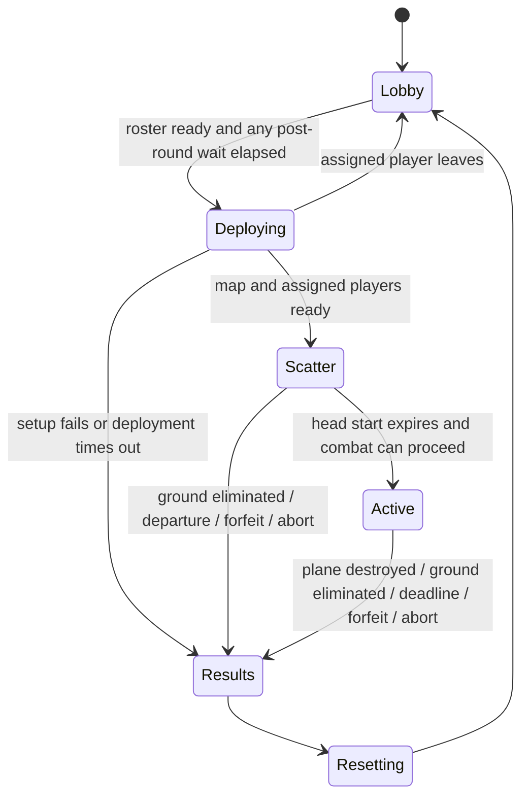

# Game design

## Intent and provenance

Build a round-based asymmetric **players-versus-C-130** game in Roblox. One player operates an orbiting aircraft. The other 1–9 players belong to one ground team and win by destroying it. The C-130 wins by eliminating everyone on the ground or running down the clock.

The user's gameplay revision on 2026-11-07 supersedes the collection-and-escape loop in the original design. It retains thermal presentation, partial destruction and no respawns. The revision selects a circular map, perimeter orbit, inward-facing aircraft view, two aircraft weapons with different zoom levels, an M-7 rifle, and one map-placed rocket launcher. The original health contract used three direct rockets; P18 later replaces it with Ground-roster scaling and fixed damage. On 2026-11-22 the user lowered the match minimum to two (D74). [Original design conversation](https://chatgpt.com/share/6aef8a62-05b0-83ea-83c3-ff6e2804a425), [decisions and defaults](docs/decisions.md)

The user's 2026-11-08 level revision expands the MVP to a battlefield with twice the current diameter, authored terrain, two large buildings and one smaller building (all at least two stories), and visible panel destruction with physical debris. The 2026-11-10 control revision selects operator WASD panning and a mobile directional pad; mouse movement aims the reticle without moving the camera. Simple graphics must demonstrate the complete mechanics; refined assets are later work. P13 supplies the validated expanded terrain/building map. P14 supplies the verified panning implementation and its engine/playability acceptance on `main`. P07 adds persistent progressive panel damage, real openings and bounded physical fragments on all battlefield buildings, including the starting shelter. Its accepted implementation is integrated on `main` through PRs #30 and #29; the [plan](plans/07-destruction.md) and [integration record](docs/evidence/p07-integration.md) distinguish source-specific acceptance from merge verification. P02/P04 evidence describes the smaller, fixed-focus prototype and is not evidence for the revised map. See [decisions](docs/decisions.md) for selected rules versus proposed defaults.

P08 originally shipped with one recoverable launcher using existing shared aircraft health and authoritative ground-origin checks. Its [acceptance record](plans/08-rocket-launcher.md) remains separate from this design contract: all eleven native harness cases pass on the recorded source. D59 removes unsupported actual same-identity reconnect from acceptance while preserving runtime authority. The [main integration record](docs/evidence/p08-p16-main-integration.md) identifies the exact matching tree and fresh host gate. D55–D57 record the original controls, flight and recovery defaults. D105 supplies the current reload values.

## MVP contract

One circular industrial warzone, one operator, one united ground team, four recoverable landmark launchers and repeated rounds. The C-130 carries the **30mm GAU-23/A Chain Gun** and **105mm M102 Howitzer**. Every ground player starts with an **M-7 rifle**. Include aircraft health/destruction, keyboard and mobile directional panning with weapon-linked zoom, occluded thermal presentation, multi-story panel-based buildings, progressive destruction and bounded physical debris, spectating, HUD, audio and readable effects. Ten minutes is the initial round-duration default. Future levels change terrain, buildings and bounds while the orbiting C-130 and the shared panning, zoom, combat and destruction rules remain core systems.

There are no collectible mission items, item quotas, escape zones or dwell countdowns. The current build has recoverable launchers. The public MVP also adds single-use healing kits. Exclude persistent inventory/progression, purchases, ranking, cross-server queues, ground vehicles, manual flight, full structural collapse and NPC enemies. The MVP ships the current level. The 2026-11-22 direction replaces the proposed level-selection feature with an open-plan radar outpost for one large building site. The first deliverable is the [Blender asset](assets/blender/radar-outpost/README.md). Use one same-server lobby and battlefield place.

## Public launch additions

The owner and trusted testers need an in-game panel to tune the published game. The numerical combat values below are the starting preset. Servers take a snapshot of the selected preset at deployment. Ground health, aircraft health per teammate, weapon damage and readiness, panel damage, medkit healing and combat duration all use that round’s settings. At result commit, the server uses the latest saved intermission length for the upcoming lobby countdown. The panel also sets the minimum lobby population from 2 to 10. A waiting lobby can apply a new minimum before deployment. [Live balance panel](plans/26-live-balance-panel.md)

Ground players aim by moving the mouse. A centered reticle guides the view and the character turns to face it. Touch players must be able to move, aim, fight and interact throughout a match. Controller support can follow launch. [Ground and touch controls](plans/27-ground-aim-and-mobile-controls.md)

Use a separate editable Blender master for the C-130, rocket launcher and medkit. Put a kit in or near each of the five battlefield buildings. It heals up to maximum health and is spent for the round by default. The panel controls healing and reuse. The operator should see the starting bunker as dark cover matching the other buildings. [Public MVP plans](roadmap.md#public-mvp-launch)

## Roles and population

- Start normal matches with 2–10 eligible players and lock the roster at deployment. Exactly one operates the C-130, with everyone else on the same ground team. A solo player waits in the lobby. Maximum server occupancy is ten.
- Prefer the longest-waiting eligible operator who did not just operate when alternatives exist, with a seeded tie-break.
- The local Studio test mapping provides explicit role and round controls. Release builds exclude those controls and the development fixtures.
- Waiting players can walk around the protected lobby; only the assigned operator is locked at its placeholder station.
- The furnished lobby has an oversized sculpted bust in the entrance hall. Facing the bust, players can walk left to the movie theater or right to the art gallery. The six frames hold original photographs for portraits 1 and 5 and approved oil renditions for 2, 3, 4, and 6. The theater television displays a still aerial scene. [Roblox lobby plan and acceptance](plans/22-integrate-lobby.md)
- Local Studio tests may offer single-player map exploration without granting an active role or starting a competitive round. Human testers can select a solo preview role or request a role for a real local test round, choose the next test duration, start immediately and reset through a test-only panel. Conflicting requested roles must be explained rather than silently overridden. These conveniences are excluded from release builds; production population and fair rotation rules remain unchanged.
- Late arrivals and eliminated Ground players enter the protected lobby and can walk around. Round membership and consumed lives stay keyed by UserId through lobby arrival and reconnect.
- Lobby players can opt in to spectating after aircraft arrival. Interacting at the TV follows a living Ground player, with target cycling when several remain and an exit to the same lobby avatar. Friendly fire is off, and teammates have noncolliding characters. [Lobby flow](plans/23-lobby-return-and-intermission.md)

## Circular battlefield, orbit and view

The expanded map implements the revised **720-stud diameter** (playable radius **360 studs**, four times the area). Keep a defined map center and aircraft altitude. Author traversable districts with stock rock formations, indoor cover and exposed lanes, **two original large buildings and one smaller building, each at least two stories high**, with usable stairs and accessible upper floors. Sand and cactus-covered rock outcrops surround the bunker and hangar. Conifers and forest floor surround Vesper. The depot has worn roads, parking and utility poles. Trails from all four bunker exits connect to each building. Land the two-deck Prism Seedship on the south side roughly opposite Vesper, with its main entry facing the Sandbreak trail. Surround the level pad with red soil, boulders and low ridges. Use a shallow impact crater west of the ship and fade the red ground into adjoining sand and depot gravel. The aircraft altitude is 140 studs. These are construction/tuning defaults recorded in decisions, not selected dimensions. Terrain is static in the MVP; building panels supply destruction. The candidate places the protected lobby outside the combat disk at X=520 and validates anchors, containment and geometry. Future weapon ranges must support the revised geometry. The aircraft follows a fixed circular orbit above the perimeter: its horizontal radius equals the authored playable radius. It is visible and hittable from appropriate ground positions. Its model points along the flight tangent; the operator's separate targeting camera remains at the aircraft and pans to a focus within the overall level square under P18.

P18 replaces the former circular/frustum camera pan boundary with the map's world-aligned **720 × 720-stud square**. Operator **WASD** and touch **directional arrows** move smoothly across that square, blocked only at its edges. A/left moves left and D/right moves right in the rendered view; an edge must allow sliding along its unblocked axis and immediate reversal. Camera restrictions must not trap input as the aircraft orbits. Mouse/touch aiming remains independent. R / Recenter, weapon-linked zoom, text/window focus suspension and role cleanup remain available. Keep the canonical aircraft orbit unchanged and camera calculations stable through near-overhead views. Earlier orbit-relative quarter-viewport acceptance remains historical P14 evidence, not proof of the revised bounds. Focus is held at a world-aligned map point while the aircraft orbits; selection preserves that point. The stable projected-right frame can roll during near-overhead/outward corner views. These presentation choices require P18’s focused operated review.

Presentation may cover the square beyond the circular combat disk. Server aim validation still restricts shots to the playable footprint, authored vertical envelope and valid muzzle-to-impact sight lines. A panned view never grants hits through solid cover.

The C-130 circles **every** future level automatically. A level definition supplies its playable boundary, presentation bounds, orbit center/radius/altitude, aim envelope, terrain and buildings, spawn/launcher anchors and stable destructible-panel identities. Shared camera/pan/zoom, weapon damage, panel progression and fragment rules consume that definition instead of living in map-specific scripts. An orbit may enclose a future noncircular playable footprint; the MVP keeps its authored circular equal-radius orbit. If a second playable level is commissioned later, its reset and late-join reconstruction require validation.

Weapon selection determines the camera field of view: the 30mm uses a narrower, more magnified view than the 105mm. Exact FOV angles are tuning values. The operator has no independent free-zoom control in the MVP. Rejected or stale weapon selections must not leave the HUD, reticle projection and active weapon in different states.

Ground third-person camera distance adapts in authored interiors under D68.
The first configured building is the smaller Outpost. Where room clearance
requires it, the ground camera moves in on entry and restores the player's
previous zoom when leaving. Camera adaptation is local presentation and keeps
walls, ceilings and roofs opaque. Future construction should allow enough
space for both avatar movement and the ordinary third-person camera.

## Weapons and aircraft health

Both sides can fire once the aircraft arrives. The table gives the settings implemented by P25. [P24 aircraft arrival](plans/24-ground-scatter-and-aircraft-arrival.md) · [P25 weapon balance](plans/25-weapon-cooldowns-and-rifle-ammo.md)

| Weapon | Role and availability | Rules |
| --- | --- | --- |
| 30mm GAU-23/A Chain Gun | C-130 at aircraft arrival | Faster precise fire, tight view, bounded damage and cadence |
| 105mm M102 Howitzer | C-130 at aircraft arrival | Wider view, bounded blast and readable impact delay. One shell reloads automatically in 12 seconds from the accepted shot |
| M-7 rifle | Every living Ground player starts with one | 5 aircraft damage per hit, 30-round magazine, unlimited reserve, two-second manual reload and 0.15-second minimum interval between shots |
| Rocket launcher | Four map-placed launchers, one per carrier | 150 damage per direct aircraft hit. Each launcher reloads its one rocket automatically in 15 seconds from its accepted shot |

Each aircraft weapon retains its own cadence/cooldown/reload state across switches. Switching cannot refill ammunition, cancel a reload advantageously or reset a timer. It changes presentation and the active weapon, not the legality of firing. Weapon names identify game equipment; damage, ballistics and fire rates are gameplay configuration.

Aircraft maximum health is **1,000 × the Ground-player count in the deployment roster**, excluding the operator. That maximum stays fixed through deaths, departures and late arrivals. A direct rocket deals up to **150** health units, and a rifle hit deals up to **5**, capped at the aircraft's remaining health and awarded once per shot. Only direct contacts award rocket damage. Reset derives fresh maximum health from the next deployment roster. [Roster scaling](plans/18-game-rebalancing.md) · [Weapon balance](plans/25-weapon-cooldowns-and-rifle-ammo.md)

At zero aircraft health, mark the aircraft **Destroyed** and commit the ground-team win through MatchService in that step. Cancel outstanding damage work and freeze the orbit. The entire ground team receives the win, including eliminated teammates. The results view shows an aircraft destruction cue and optional local audiovisual effects. [Combat presentation and spectating](plans/10-player-experience.md)

## Rocket-launcher lifecycle

Spawn one launcher at each of four validated sites at deployment. The hangar pickup sits inside a bay door. The Vesper Radar and military depot pickups sit outside their entrances. The fourth pickup is inside the Prism Seedship, accessible through its entrance without demolishing a panel. It is not part of the initial player loadout. The ground team can see its available/carried state. A living ground player within reach can acquire it atomically; a second simultaneous claim must fail without creating another launcher. Keep a stable launcher identity for the whole round.

The carrier retains their M-7 and can switch weapons or voluntarily drop the launcher. During Scatter and Active, death, character reset or disconnect drops it at the last valid ground position so a teammate can recover it. Terminal-round cleanup takes precedence over recovery. An unreachable or out-of-bounds drop is relocated to the original anchor. Carrying, dropping, rejoining and re-picking cannot clone it or reset its reload progress.

Each launcher starts loaded and holds one rocket. Its server-owned 15-second deadline stays with its round identity through a handover. The M-7 refills an equipped living player's partial or empty magazine from unlimited reserve. The desktop and touch HUDs show the loaded rounds, ∞, and any active reload timer. Elimination or round teardown discards a pending reload. Reset removes the old equipment and creates one loaded launcher at each site and a full magazine for each newly deployed Ground player.

## Combat, cover and destruction

All fire is intent: the server derives muzzle origin, validates role/equipment/aim/rate and resolves shots against its own world. Use bounded projectile lifetime and swept collision. All remaining solid cover geometry blocks direct fire, blast damage and thermal highlighting; actual holes in damaged panels expose only the sight lines through those holes. MVP blast damage uses a documented line-of-sight sample to a target's damage anchor rather than pressure simulation.

In the C-130 view, exposed Ground players stand out as **white silhouettes against a darker black-and-white environment**. The operator’s full world desaturation includes imported textures, terrain and landmark materials; the Ground view retains its normal colors. The user accepts either red targets on gray or white targets on a darker monochrome background; this candidate uses the latter (D92). Keep building form, major attached detail, damage and actual openings readable, including the Outpost’s equipment and Vesper’s radar dish. Solid cover hides the highlight, while real openings expose only their clear sight lines. Keep decorative clutter out of thermal depth where it would falsely conceal an exposed player. Exact brightness/contrast values are tuning in decisions and require fresh rendered review. Restore operator-only appearance changes on role loss.

An impact resolves damage using pre-impact geometry; a new opening benefits subsequent shots. Building surfaces are divided into large, independently identified panels. An average room spans approximately two panels in width and one panel in height; 16×8-stud panels and a 32-stud room width are initial greybox defaults, subject to avatar/route checks. Each building must contain destructible exterior wall panels on all stories and panelized roofs, so aircraft fire can open overhead cover too. The proposed MVP default keeps stairs, floors and the supporting frame stable. Full structural collapse is separate scope.

P18 replaces the old three-plus-three howitzer and nine-second-per-stage thresholds. **One direct 105mm M102 Howitzer impact destroys a panel completely. Two earned seconds of valid same-panel 30mm impacts destroy a pristine panel.** The shorter 30mm progression retains distinct persistent Light/Heavy/Total visuals and physical openings. Intermediate visual thresholds are implementation defaults.

Interruptions, misses, obstruction, reloads and changing target or weapon break timing continuity while preserving earned per-panel damage. The first impact after a break earns zero elapsed time. Only server-resolved direct 30mm impacts earn time on a panel. Duplicate, stale and unauthorized requests cannot advance destruction.

Every confirmed M102 impact on the playable battlefield produces an explosion, including a hit on empty ground. A **25-stud radius** around the contact applies to exposed Ground players and registered building panels. A road or terrain strike beside a building can open several exposed panels in one shot. A panel is in range when the closest point on a surviving solid piece is in range and visible from the impact. Evaluate all cover against the geometry present before the combat batch. The panel directly struck by the howitzer also reaches Total. The Salt Flats walk-in aircraft wreck retains its separate direct-hit rules. [Weapon impacts and acceptance](plans/19-weapon-impacts.md)

P19 uses an expanding fireball, sparks and a lingering smoke plume for a Full M102 contact, a smaller burst for a 30mm contact, and a smoke trail and burst for a rocket. An expired flight in empty space produces no impact burst. Reduced trims the flash and smoke, and Off clears local effects. Thermal Full uses fewer particles than nearby Ground Full and keeps grayscale smoke visible at orbit distance. Gunship reports and contact audio originate in the world and use distance-based delays. Rockets and the rifle retain their aircraft damage rules. [Presentation defaults](docs/decisions.md) · [Asset provenance](assets/manifest.json)

All battlefield building walls and roofs use these rules, including the original starting shelter around the ground deployment anchors. Its legacy exterior is panelized without changing the shelter footprint, entrances or spawn protection before damage. Every landmark retains static floors, stairs and supporting frames; the starting shelter remains an ancillary structure without a new two-story requirement. The separate waiting lobby outside the battlefield stays protected. D53 records the faithful starting-shelter construction defaults.

Server-owned state swaps and residual colliders define gameplay openings. The damaged variant removes approximately half the original face area (initial measurement tolerance 45–55%) and must show a real opening from ground and aircraft views. Visible progress is required within each stage as well as at the two swaps. This must work with primitive graphics, without waiting for refined models.

**Physical destruction is required in the MVP:** transitions release a bounded set of unanchored fragments that visibly fall and collide with static scenery under gravity. Proposed safety/performance default: server-owned fragments cannot damage/push players, obstruct routes, block weapon/thermal queries, trigger additional destruction or decide structural support. Enforce explicit fragment-count, impulse and lifetime limits and clear them on reset. This is actual physics, not only particles or a disappearing wall; exact rigid-body trajectories are not gameplay authority and need not match bit-for-bit across clients. Permanent building structure and the path network remain stable.

Give each launcher site at least two passable approaches, protected ground spawn positions, and useful firing angles to the full orbit. The approaches may merge at a wide doorway. Players must not need to break a wall or spend ammunition to reach the launcher. Mark the circular boundary clearly and enforce it without turning the exterior into a hiding area. Reset restores exact map/cover state. Record asset provenance in the manifest.

The current P18 presentation uses white occluded highlights and full world desaturation over darker scenery. Rendered target contrast, grayscale texture appearance and solid-cover behavior determine acceptance. Rendering does not substitute for server obstruction checks or promise secrecy against modified clients.

## Round states and result conflicts

A consumed Ground life stays consumed when the server loads a protected lobby avatar. Manual reset consumes a Ground life. Operator character reset during Scatter or Active preserves the role and aircraft health.

At a committed result, return everyone to the protected lobby and begin a 120-second intermission. Show the winner and countdown there, with map cleanup inside the wait. At expiry deploy if at least two players are eligible and the map is ready. A new server still uses its first-match startup timing. [Lobby and intermission](plans/23-lobby-return-and-intermission.md)

Scatter gives Ground 20 seconds to move and transfer launchers once deployment is ready. Ground sees the arrival countdown over the battlefield and the operator sees it on black. If play continues, the aircraft starts its orbit when the countdown expires. The server opens combat and starts the full ten-minute clock. A result during Scatter cancels the reveal and begins the lobby intermission. [Aircraft arrival](plans/24-ground-scatter-and-aircraft-arrival.md)

| Situation | Required outcome |
| --- | --- |
| Aircraft destroyed strictly before deadline | Ground team wins once |
| All active ground players eliminated before aircraft destruction | C-130 wins once |
| Combat deadline reached with no earlier committed ground win | C-130 wins once. An impact at exactly the deadline is too late |
| Aircraft and last ground player reach zero in the same pre-deadline simulation step | Ground win takes precedence (documented tie default) |
| Operator disconnects during Scatter or Active, with Ground players remaining | Ground win by forfeit with aircraft health preserved |
| Ground player leaves during Scatter or Active | Remove their life and recover any held launcher if play continues. Rejoin preserves the consumed life |
| Last ground player leaves | C-130 wins by departure if the operator remains |
| Both sides depart in one step, or nobody remains on the server | End without a competitive winner if the damage and deadline checks did not already settle the result |
| Deployment loses a valid roster | Cancel deployment and return to lobby |
| Invalid map or unrecoverable setup error | Abort with a reason and no competitive winner, then reset |

Each server step samples server time. During Scatter it resolves life and departure outcomes before checking whether to start combat. Fire requests during Scatter are discarded. At or after the combat deadline the C-130 wins by timeout and the damage batch is skipped. Before that deadline, accepted gunship impacts, M-7 rays and rocket sweeps use the cover present at the start of the batch. The server applies structural changes, evaluates aircraft destruction before total ground elimination, then considers departures. Pickup, drop and recovery proceed if play continues. A rocket already in flight can finish after its shooter dies while combat continues.

The server commits one result for the round. Aircraft destruction records the lethal shot's shooter, weapon and shot ID. C-130 wins credit the assigned operator. Departure and abort reasons remain distinct from aircraft destruction. Results freezes aircraft health and any orbit already in progress, cancels outstanding damage work and clears active equipment. Reset restores pristine cover, weapon readiness, launcher state and the lobby camera before the next deployment.

## Presentation and readiness

The [P16 Blender review kit](assets/blender/military-outpost/README.md) supplies
editable source for a weathered military exterior, ground-floor storage/workshop,
upstairs command room and reusable indoor/outdoor props, based on all three
images in `src/images/military-outpost/`. It includes six material/shape panel
families with Pristine/Light/Heavy/Total appearances, matching fragments,
explicit proxy candidates and saved review views. The user explicitly approved
revision `e8fb840` on 2026-11-13. [Blender approval](docs/evidence/p16/human-approval.json)

The playable **smaller Outpost** uses the imported revision on the same level.
Concrete, corrugated metal and roofing retain material-specific damage under the
shared P18 one-howitzer/two-second-30mm, persistent credit, real-opening and safe-fragment rules.
Floors, stairs and supports stay stable. Its authored room bounds support closer
Ground camera framing and restore prior zoom at exit. [Outpost integration and review](plans/17-integrate-military-outpost.md)

On desktop, the Ground HUD shows personal health, the equipped M-7 or
launcher's ammunition and readiness, aircraft health, launcher status,
surviving teammates and time. The operator HUD shows the selected named
weapon, zoom and readiness, aircraft health, surviving opponents and time.
Both see the winner and reason. The P23 results HUD shows the countdown alongside the result in the lobby. Spectator mode closes when the result is committed.

Text identifies warnings, impacts and results alongside optional audio and
motion. Desktop settings adjust effect intensity and aircraft destruction
shake. In P23 the shake briefly affects the lobby camera during Results. The local options carry through
the current play session. [Presentation defaults](docs/decisions.md)

MVP readiness also requires walking every authored floor of all three buildings on the expanded terrain, panning across the full battlefield at both weapon zooms, demonstrating the one-heavy-hit and two-earned-second 30mm panel rules, real damaged-state openings, bounded physical debris and repeated pristine reconstruction. MVP readiness requires complete 6- and 10-player rounds for aircraft destruction, ground elimination and timeout; correct launcher recovery and weapon switching; rejection of invalid input; repeated clean resets; and readable counterplay. Automated checks prove rules, while operated multiplayer sessions assess feel, balance and performance.
