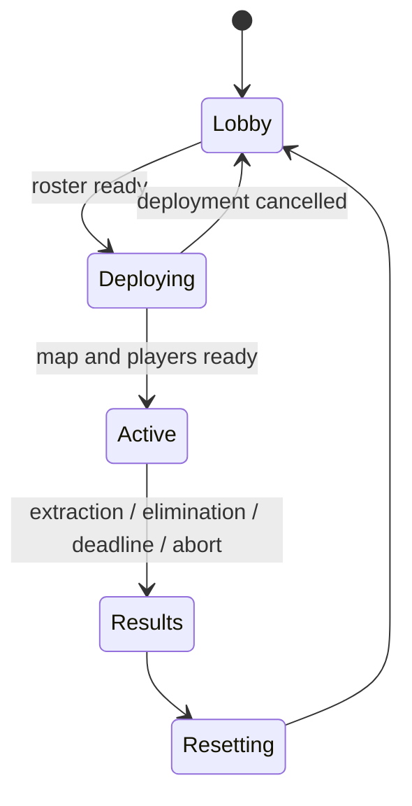

# Game design

## Intent and provenance

Build a round-based asymmetric PvP extraction shooter in Roblox. One player controls the weapons of a visible C-130-style gunship; 5–9 players on the ground cooperate to recover objectives and escape. The aircraft follows a scripted orbit rather than player-controlled flight.

This design is synthesized from the user's [shared design conversation](https://chatgpt.com/share/6aef8a62-05b0-83ea-83c3-ff6e2804a425), supplied in full as text on 2026-11-07. The directly selected choices are **6–10 players, thermal targeting, partial destruction, and no respawns**. The conversation's final scope list specifies one gunship weapon, although an earlier paragraph described two; this document follows the final list. Engineering defaults and unresolved release details are identified in [decisions](docs/decisions.md).

## MVP contract

One industrial district, one gunship role, one ground team, three shared objectives, one extraction zone, and repeated rounds. Include a cannon, rifle, limited anti-air weapon, aircraft health, occluded thermal presentation, state-based breakable cover, spectating, HUD, audio, and readable impact effects. Ten minutes is the first round-duration tuning value.

Exclude persistent inventories, player progression, purchases, ranking, cross-server queues, vehicles, free-flight aircraft physics, full structural destruction, additional maps, NPC enemies, and a second gunship weapon. Keep an ordinary same-server lobby; a separate lobby place and TeleportService are unnecessary for this MVP.

## Roles and population

- Start a public match only with 6–10 eligible players. Lock the roster at deployment; maximum server occupancy is ten for the MVP.
- Select one operator on the server. Prefer the longest-waiting eligible player who has not just operated when alternatives exist; use a seeded tie-break. Everyone else joins the ground team.
- A Studio-only two-player override permits one tester in each role. The release build cannot enable that override. It is a development aid, not a change to match size.
- Late arrivals spectate until the next lobby. Leaving and rejoining cannot restore life, equipment, or an active role in the same round; retain round membership by UserId until reset.
- An eliminated ground player has no active character or weapon authority. Spectating follows living teammates only, falling back to a neutral camera when none remain.

## Round and player states

Player state is separate: Waiting → ActiveGround / ActiveGunship → Eliminated / Extracted / Spectating → Waiting. The server disables default automatic character respawns and owns character creation. A manual character reset counts as elimination. Round reset removes old projectiles, state, connections, equipment, temporary UI/effects, and destroyed-cover replacements before making a new roster.

## Combat and cover

The cannon has visible impact warning/travel time, a cooldown, and bounded splash. The operator sends aim intent; the server derives muzzle origin, validates aim limits, and resolves the shot against its own world. Rifle and anti-air shots use server validation as well. Anti-air is a fast direct-fire projectile with limited ammunition; homing/lock-on behavior is outside the MVP.

The aircraft has a large configurable health pool. Sustained coordinated ground fire should matter. At zero health, mark it **Disabled** once, stop accepting cannon fire, remove remaining hostile cannon projectiles, and play a cosmetic failure sequence. The operator spectates; no simulated crashing aircraft damages the map. Ground players still need objectives and extraction before the original deadline.

Solid intact cover blocks direct fire, blast damage, and thermal visibility. MVP blast damage uses a documented line-of-sight sample to the target's damage anchor, not a physics pressure simulation. An impact evaluates all damage against the geometry as it existed before that impact; a wall destroyed by that impact opens a path for subsequent shots. Friendly ground fire does not damage teammates. No player body collision should be needed to solve an objective or block a teammate's extraction.

Thermal presentation is grayscale/high contrast with highlights for exposed targets. It is a visual approximation, not physical temperature simulation. Use occluded highlights and server-validated weapon sight lines; ordinary thermal presentation must not reveal a player through a solid wall. Client rendering cannot provide absolute secrecy against a modified client, so the server must still reject impossible hits.

## Destruction and map layout

Use explicit Intact → Damaged → Destroyed states for tagged walls, windows, barricades, and light cover. The server owns health and collision swaps. Debris and dust are bounded cosmetic client effects. Major buildings and the overall path network remain stable.

The industrial district needs at least two viable approaches to objectives and extraction, protected deployment positions, indoor cover, and readable exposed streets. Validate objective locations against a curated set of reachable anchors. Do not place objectives inside optional debris, below the world, or behind an opening that requires ammunition to reach. Reset restores exact map state. Record licensed source assets and exports in the asset manifest.

## Objectives and extraction

Choose three distinct mission items from at least six validated location anchors each round using a server seed. The items represent mission equipment rather than a persistent inventory. A living ground player within interaction range can collect an available item; collection is atomic and idempotent. Progress is team-shared and survives the collector's death or disconnect.

Extraction is locked until all three are collected. Each living ground player has an independent continuous dwell countdown inside the zone; the initial tuning target is five seconds. Leaving, dying, or leaving the round resets that player's dwell. The first eligible completion before the deadline ends the round as a ground-team win. Other surviving teammates receive the team result but are not falsely recorded as having extracted.

## Results and conflict rules

| Situation | Result / required behavior |
| --- | --- |
| Valid extraction completes strictly before deadline | Ground team wins once |
| Active ground team is eliminated | Gunship wins once |
| Deadline reached without a prior valid extraction | Gunship wins once; extraction at exactly the deadline is too late |
| Aircraft disabled | Combat threat ends; round continues toward extraction or deadline |
| Operator disconnects during Active | Disable aircraft; round continues; no mid-round operator replacement |
| Ground player disconnects during Active | Remove their active life, preserve collected objectives; do not allow rejoin to respawn |
| Last active ground player leaves | Gunship wins if participants remain; empty server performs cleanup |
| Players leave during deployment and roster becomes invalid | Cancel deployment and return to lobby |
| Server cannot create a valid map/roster | Abort without a competitive winner; show reason and reset |

Process accepted events on the server in a documented order. At a simulation step: enforce the deadline, apply accepted damage/eliminations, apply objective interactions, then evaluate extraction and team survival. A player eliminated in the same step cannot also extract. Once Results is committed, later events cannot change the winner. Tests must lock down these choices; network arrival order is never trusted as a client-supplied timestamp.

## Presentation and success

Ground HUD: health, weapon/ammo, time, shared item count, extraction state/dwell, and clear elimination/result messages. Operator HUD: reticle, zoom, cooldown, aircraft health, time, and objective/extraction state. Color is supplemented by labels/icons; important sounds have visual equivalents. Add separate effect/camera-shake intensity controls.

MVP readiness means the full loop works at 6 and 10 players, invalid requests cannot change authoritative state, repeated rounds clean up correctly, new players understand the next objective, and both roles have useful choices. Automated correctness gates establish rules; observed multiplayer sessions establish readability, performance, and balance. No win-rate claim is justified by a small smoke test.
